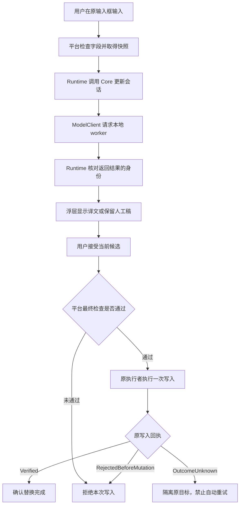
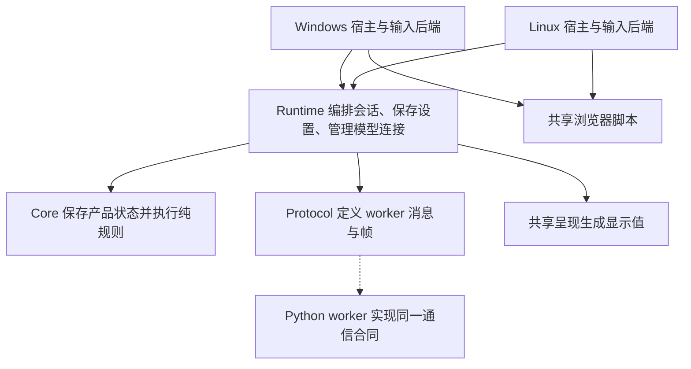

# 共享架构与平台边界

TypeLay 在用户当前的输入框旁显示本地译文。用户可以继续输入、编辑译文，再明确接受。TypeLay 只替换原输入框中的文本，不替用户发送消息或提交表单。

本文解释一次交互如何经过共享代码、平台输入后端和本地模型，以及各模块负责哪些事实。修改模块边界、进程启动或会话时从这里开始。产品行为以[产品基线](../product/README.md)为准，当前验证和待办以[开发状态](development-state.md)为准。架构维护约束见 [architecture-target.md](architecture-target.md)。

## 先看整体怎么工作

### 1. 一次翻译先取得观察，再等待用户接受

自动模式下，平台后端先检查字段元数据。字段允许读取时，后端才取得正文、选区、输入法状态和目标身份。Runtime 把有效观察交给 Core，再冻结本次模型请求。本地 worker 返回译文后，Runtime 核对结果是否仍属于当前会话，随后更新浮层。

译文可见不代表可以写入。Core 根据当前源文和会话状态判断候选资格。用户接受时，平台还要核对原目标、原按次、输入法和期限，才能执行写入计划。

按需唤醒复用同一会话路径。Windows 首次尚无快捷键观察时，会从该次按键的精确原点发起只读捕获。后到的旧观察不能追认这次按键，详见 [Windows 首次唤醒](../platforms/windows/architecture.md#首次按需唤醒的只读捕获)。一次性直接替换有独立寿命，始终绑定触发时的源字段，详见 [ADR-0002](../adr/0002-on-demand-and-direct-write.md)。

这条流程区分四种事实。快照记录一次输入观察，候选记录仍匹配会话的译文，许可提供短期且只能消费一次的接受资格，回执说明一次写入的结果。写入计划本身不授予权限。完整定义见 [GLOSSARY](../../GLOSSARY.md)。

### 2. 共享代码决定产品规则，平台代码提供真实系统事实

Windows 和 Linux 在本机使用同一份 Core、Runtime、Protocol、worker 和浏览器脚本。共享代码不读取本机窗口句柄，也不猜测输入法状态。平台后端提供可核验的观察，并在执行前再次检查原生条件。

Core 回答当前事实下能做什么。Runtime 安排请求、处理迟到结果，并把结果交给正确的会话或操作。平台负责真实窗口、焦点、输入法、按键和控件操作。模型只生成文本，不拥有源字段权限。

### 3. 同一产品通过本地进程协作

下面每个平台分支表示一台机器上的实例。连线表示本机调用或通信，图中省略安装器、练习和进程监督细节。

```mermaid
flowchart TB
    subgraph win[Windows 实例]
        WA[App：WPF、Runtime、Core、ModelClient]
        WB[UIA Broker]
        WE[外部原生应用]
        WX[浏览器与共享扩展脚本]
        WH[BrowserHost]
        WM[本地 Python worker]
        WA <-->|私有标准输入输出协议| WB
        WB <-->|UIA 或原生输入路径| WE
        WX <-->|native messaging| WH
        WH <-->|命名管道| WA
        WA <-->|worker 帧| WM
    end
    subgraph linux[Linux 实例]
        LD[GTK 桌面进程：设置、托盘、输入与视图路由]
        LA[.NET 宿主：Runtime、Core、ModelClient]
        LE[外部 GTK/Qt 应用与合作模块]
        LX[浏览器与共享扩展脚本]
        LH[native-messaging 进程]
        LM[本地 Python worker]
        LE <-->|同用户 socket| LD
        LX <-->|native messaging| LH
        LH <-->|同用户 socket| LD
        LD <-->|私有继承管道| LA
        LA <-->|worker 帧| LM
    end
```

Windows 原生浮层由 WPF 呈现。Linux GTK/Qt 浮层位于源应用中，浏览器浮层位于页面内。各自的控件、焦点和几何事实由原生实现负责。Linux 当前还依赖 niri 前台观察与可选 Fcitx 合作组件。

worker 在独立进程内执行本地推理，不监听网络端口，也不自动下载模型。用户确认后的准备流程由平台安装器下载运行时或模型。当前默认包是 Index，已有 Argos 和 Hy 安装继续按各自协议处理。

### 从图找到实现

下面的入口按用户动作和模块职责组织。平台支持范围见 [Windows 架构](../platforms/windows/architecture.md)与 [Linux 架构](../platforms/linux/architecture.md)。

| 需要理解的行为 | 实现入口 |
| --- | --- |
| 两端怎样装配同一会话控制器。 | [WindowsRuntime](../../src/windows/TypeLay.App/Windows/WindowsRuntime.cs)和 [Linux Program](../../src/linux/TypeLay.Linux/Program.cs)创建实际宿主。 |
| 输入、模型结果和接受怎样衔接。 | [SessionController](../../src/shared/TypeLay.Runtime/Sessions/SessionController.cs)使用[输入端口](../../src/shared/TypeLay.Runtime/Sessions/InputContracts.cs)和[宿主端口](../../src/shared/TypeLay.Runtime/Sessions/SessionHost.cs)。 |
| 当前译文为何能成为候选或被拒绝。 | [Session](../../src/shared/TypeLay.Core/Session.cs)、[AcceptanceGate](../../src/shared/TypeLay.Core/AcceptanceGate.cs)和 [WriteSafety](../../src/shared/TypeLay.Core/WriteSafety.cs)拥有相应产品规则。 |
| 回源、重译和术语表单由谁继续或退休。 | [具体交互](../../src/shared/TypeLay.Runtime/Sessions/SessionController.Interaction.cs)、[浏览器重译](../../src/shared/TypeLay.Runtime/Sessions/SessionController.EditorRegenerate.cs)和[术语交接](../../src/shared/TypeLay.Runtime/Sessions/SessionController.GlossaryEntry.cs)拥有各自操作。 |
| 显示刷新为何不取消用户操作。 | [SessionPresentation](../../src/shared/TypeLay.Runtime/Presentation/SessionPresentation.cs)区分显示和交互身份，平台视图消费这些值。 |
| 保存成功后通知失败怎样反馈。 | [SettingsCommit](../../src/shared/TypeLay.Runtime/Settings/SettingsCommit.cs)和 [SettingsStore](../../src/shared/TypeLay.Runtime/Settings/SettingsStore.cs)返回实际提交结果。 |
| 练习进度怎样区别于输入权限。 | [PracticeProgressCoordinator](../../src/shared/TypeLay.Runtime/Practice/PracticeProgressCoordinator.cs)记录里程碑，[自有源会话](../../src/shared/TypeLay.Runtime/Sessions/SessionController.AutomaticPractice.cs)处理真实绑定。 |
| 已派发写入和正常退出怎样结束。 | [WriteSettlement](../../src/shared/TypeLay.Runtime/Sessions/WriteSettlement.cs)记录终态，[ShutdownAsync](../../src/shared/TypeLay.Runtime/Sessions/SessionController.WriteSettlement.cs)交还结算摘要。 |
| 模型请求怎样跨进程执行。 | [ModelClient](../../src/shared/TypeLay.Runtime/Models/ModelClient.cs)、[worker 入口](../../src/shared/TypeLay.Worker/run_worker.py)和 [LocalEngine](../../src/shared/TypeLay.Worker/typelay_worker/engine.py)依次处理连接、协议和推理。 |

## 生产边界

源码按下表分工。`TypeLay.slnx` 是工作区入口，[ADR-0001](../adr/0001-workspace-and-delivery.md)规定工作区与交付边界，[ADR-0003](../adr/0003-cross-platform-runtime.md)规定共享运行时和宿主合同。

| 模块 | 模块拥有的事实 | 模块对外提供的结果 |
| --- | --- | --- |
| `TypeLay.Core` | Core 保存源快照、候选、人工稿和会话状态，并处理字段策略、选区映射、接受及写入判定。 | 调用者传入显式观察、时间和结果，取得纯规则的判定。Core 不访问操作系统、磁盘或网络。 |
| `Runtime/Sessions` | 会话控制器拥有异步请求、结果代次和副作用安排。具体交互拥有本次回源或重译的继续条件，写入记录拥有唯一终态。 | 宿主提交观察、用户意图和回执，取得呈现及待执行操作。直接任务保留独立目标和寿命。 |
| `Runtime/Presentation` | 呈现模块从产品状态生成文案、菜单和动作可用性，并维护呈现身份。 | 视图取得只读显示值；显示值不授予输入权限。 |
| `Runtime/Settings` | 设置模块拥有已提交值、版本、准备与保存过程，以及通知和外部副作用的结果。 | 所有保存入口取得明确的提交结果，不自行推断提交点。 |
| `Runtime/Practice` | 练习协调器记录用户已完成的步骤和确认结果。 | 教程取得进度；自有源的绑定、reader 退休与写入仍由会话及平台输入负责。 |
| `Runtime/Models` | 模型客户端拥有冻结加载计划、实际连接、请求和发布结果。 | 调用者取得译文、明确失败和当前连接能力。 |
| `TypeLay.Protocol` | Protocol 定义长度前缀帧和 worker 消息，不引用 Core。 | .NET 客户端与 Python worker 使用同一通信合同。Windows Broker 私有消息另属 `Windows.Contracts`。 |
| `TypeLay.Worker` | worker 校验模型载荷，保护文本结构并执行本地推理。 | worker 返回符合严格 schema 的结果或固定错误码，不输出用户正文诊断。 |
| `src/windows` 与 `src/linux` | 平台拥有宿主、原生输入、视图、连接、进程和系统副作用。 | 平台通过真实适配器提供观察和执行证明。只有同一平台内使用的代码留在该平台。 |
| `src/shared/browser` | 浏览器脚本拥有页面内控件接入和浮层交互。 | 两端共享脚本，扩展清单、注册及 native host 仍由平台负责。 |

Runtime 只引用 Core 和 Protocol。宿主注入输入服务、输入观察器、串行事件循环、视图、数据路径和进程所有者。Runtime 不依赖 WPF、Win32、UIA、Registry 或 Windows Broker DTO，也不按 provider 名称决定产品规则。

`ISessionView` 接收显示、编辑和用户意图。原生窗口与回源证明通过独立的 `ISourceInteraction` 进入。Linux 的 [Input](../../src/linux/desktop/input.py)独占 peer、绑定观察、回源、术语和语言配置记录；[Overlay](../../src/linux/desktop/overlay.py)消费冻结的连接及呈现事实，并提交具体意图。

## 平台边界不变量

### 观察、许可和执行各自保留证据

`TargetId` 只携带后端、不透明值和生命周期。Core 比较身份，各后端解释本机句柄及寿命。敏感、密码、终端和代码字段先于正文读取被排除；字段元数据缺失或错误仍可能限制识别能力。

读取可用、按键拦截和写回能力是不同事实。`InputSnapshot` 的写能力默认关闭，生产后端验证后才显式声明。Runtime 还要求 `CanInterceptAcceptance` 才发布接受许可。未知 IME、失效焦点、输入版本变化、期限届满和未知写入结果均可独立否决操作。

`IInputService` 在操作前重新确认原目标和权限。它无法安全执行时返回明确拒绝，可能已经改动正文时返回 `OutcomeUnknown`。后端不改写新目标、不模拟粘贴，也不自动重试。直接任务始终使用触发源，不通过前台回源再写入拼出替代路径。

缺少输入权限、可靠目标或几何信息时，后端保持不可用，不伪造快照或降级绕过检查。

所有会话回调在宿主的串行事件循环执行。平台事件先排队，再进入 Session。时间映射到 `ISessionLoop` 的单调毫秒域，输入、源输入和焦点版本各自保留。

### 已派发写入由原记录结算

Runtime 在发布许可或派发调用前登记原目标、计划、执行路径和代次。登记本身不授予权限。执行有两条路径：源端同步接受已经在源控件线程完成操作，`CompletedReceipt` 只用于结算；异步写回由原 `WriteAsync` 或 `WriteDirectAsync` 调用交回结果。

视图退休、暂停、设置变化和断连会撤销新资格，已经派发的操作仍由原记录接收唯一终态。重复回执不能再次写入或更新新会话。确定终态或未知结果后，共享记录释放正文；未知结果继续隔离原目标寿命。

只有实际执行者能证明许可没有被认领且已失去执行资格。过期、容量淘汰、撤权请求或没有回执都不能单独证明未执行。Windows 特定路径的 Quiet 只证明相应资源可退休，不能代替成功回执。

正常退出先等待 `ShutdownAsync`。Runtime 停止新操作并撤销许可，同时保留事件循环、输入通知和已派发继续体。预算内仍无结论的原操作按未知结果结算。宿主收到无正文摘要后才释放输入、连接和循环，`Dispose` 保留异常兜底职责。具体平台释放顺序见[维护约束](architecture-target.md#正常关闭先交还责任再释放接收者)。

## 编辑、呈现与设置

### 人工稿与回源操作分别拥有状态

Core 保留人工稿，模型刷新不能覆盖它。第一次 Tab 只请求回源；平台确认返回后，Runtime 取得新观察，Core 再判断原编辑基准是否仍匹配。下一次接受仍需新的许可。鼠标回源通过实际观察确认，不伪造 Return 请求或套用按键期限。

具体操作在调用视图或开始异步等待前登记身份。普通回源、浏览器 Replace、自有源 Keep/Replace、源端重译和术语交接各自处理继续、拒绝和退休。主捕获路径只把观察交给当前操作。旧操作退休后，只能处理自己已派发的结果，不能清理后继操作。

浏览器 Replace 区分丢弃旧稿的意图和实际回源。真实再编辑包含改回原值的 ABA，会永久撤销旧 Replace 意图。回源在途时，同一编辑器的新稿暂存于原操作；精确 ACK 到达后才按串行顺序更新 Core。没有后来编辑时，也须通过新的源捕获才能重译。原 500ms 动作期限不续期，未知结果不重发。

Windows 自有练习源进入本地稿确认时，旧 reader 必须先撤权并确认退休。原 TextBox 保留文字、选区和 Undo，Core 的 [DormantEdit](../../src/shared/TypeLay.Core/Session.DormantEdit.cs)只保留本次编辑基准。Keep 经真实 Tab 返回、精确回执和新捕获后恢复人工稿。Replace 由真实确认事件创建一次意图；新 reader 安装后还须再次捕获，才对完整当前源重译。绑定成功本身不发布许可或模型任务。

回源各分支的结果与失败条件见[回源操作合同](architecture-target.md#回源操作如何交还结果)，协议实现见[浏览器重译](../../src/shared/TypeLay.Runtime/Sessions/SessionController.EditorRegenerate.cs)和[自有源本地稿](../../src/shared/TypeLay.Runtime/Sessions/SessionController.OwnedLocalDraft.cs)。

### 显示刷新不改变操作寿命

`PresentationIdentity` 分别携带交互身份、显示序号、草稿版本和动作版本。显示序号用于丢弃旧画面。文案、颜色和菜单反馈只改变显示，真实编辑才推进草稿版本。回显不能覆盖控件中的更新稿件，也不能复活已退休动作。

GTK/Qt 和浏览器明确协商 `presentationVersion=1`。未知版本或行为字段按严格 schema 拒绝，不猜测兼容语义。各视图仍独立检查原控件、连接、焦点、IME、按次和期限。共享身份不授予读取、编辑、按键消费或写入能力。

术语表单有独立 `FormId` 和单向有效状态。表单引起的合法辅助焦点、组合输入或保存等待不等同于永久退休。真实源变化或外部失焦仍使原操作失效，关闭表单只在原辅助焦点仍有效时恢复原编辑器或原字段。

### 设置返回实际提交结果

所有现役保存入口使用 SettingsStore 的提交方法。方法先冻结用户确认值，必要时等待会话或自有源退休，再核对版本、取消和窗口寿命。文件原子替换是持久化提交点。

结果区分未提交、无变化但保存成功、已提交、已提交但通知失败，以及外部副作用未知。结果携带实际提交版本。晚到取消、窗口关闭和通知失败不能把已经提交的事实改成未提交。

登录启动由平台注册表或 XDG 适配器处理，与设置文件不是同一事务。文件失败且启动项已改变时，结果同时报告两件事实；平台不能确认副作用时，结果保持未知。界面显示真实结果，不自动补偿或重试。完整结果分支见 [SettingsCommit](../../src/shared/TypeLay.Runtime/Settings/SettingsCommit.cs)。

### 风格和术语保存保持当前人工稿

风格、术语和普通设置使用各自提交入口。旧的全量设置不能覆盖风格或术语。人工稿锁定期间，风格修改被拒绝。术语保存版本与当前会话采用的版本分别记录；当前源身份仍有效时，人工编辑、回源和待接受稿期间保存的术语只影响后续机器任务。

术语由用户主动填写，不从人工改稿自动学习。规则包含源词、译词及可选的有向语言对，没有应用作用域、隐式反向或语言中转。规则最多 64 条，每个词最多 128 UTF-8 字节，总量最多 8192 字节。无效 Unicode、控制字符、首尾空白和冲突规则被拒绝。损坏的术语字段不覆盖已有隐私排除设置。

机器稿采用新规则前，Runtime 重新检查当前模型、方向和组合资格。有效规则快照改变时，Runtime 撤销旧接受资格，再按原源文或选区重译。保存成功但当前模型不能采用时，结果明确报告规则未生效。人工追加只约束新增部分，人工前缀原样保留。已提交写回期间不保存新规则，原写入继续按回执结算。

源侧加词先撤销旧许可，保持当前候选和人工稿。保存从真实辅助控件的 IME Clear 状态发起零写入回源，再取得新捕获。新捕获须匹配原目标寿命、窗口、正文、选区、输入及配置版本和模型身份。辅助焦点或回源回执本身不授予写入权限。具体准入控件和原生证据见平台架构。

风格重置和旧术语删除是显式恢复操作。恢复操作不替剩余偏好取得模型采用资格。术语管理可以离线保存用户规则，实际翻译仍受[产品采用表](../../src/shared/TypeLay.Runtime/Models/TranslationService.cs)约束。

## 人工稿的短暂观察中断

编辑获准后，较早发起的源读取可能在编辑器获焦后返回空。只有原目标、窗口、前台、内容、连接和配置身份均未改变，且实时焦点已确认属于 Overlay 时，Runtime 才丢弃该次过时空结果。Runtime 继续撤销接受资格，不更新源快照或输入法证据，也不延长编辑交接期限。

源侧术语入口等待独立新鲜复核时，较早普通读取也可能返回等价的 Overlay 快照。只有同一未过期交接恰好跨过一次编辑焦点，且完整源基准不变，Runtime 才忽略它。原交接仍由唯一的新鲜复核决定，普通读取不能授予术语入口或许可。

人工稿已成功回源后，一次读取失败会立即撤销许可、旧计划和视图。Session 在原有 150ms 观察窗口内私下保留稿件，重复失败不续期。只有中断后的新观察与原目标寿命、正文、选区、输入和配置代次完全一致，才能恢复。明确离开、不同证据或超时结束会话，恢复也不会复活旧许可。

## 模型连接与本地推理

### 安装意图、加载成功和产品采用分别确认

[模型目录](../../src/shared/TypeLay.Worker/model-catalog.json)是 Runtime 与 worker 共用的包定义。目录可用方向、实际安装方向和当前加载方向是不同集合。设置保留用户语言选择，缺方向时明确提示，不暗中切包、改值或经第三种语言中转。

`ModelLoadPlan` 冻结精确路径、库存 schema 和 active 包。worker 先校验库存元数据，再完整核对 active 包的文件与哈希，随后加载模型。inactive 包不加载。实际 hello 与加载计划逐项吻合后，ModelClient 才发布 Ready 和本次连接身份。目录存在、下载完成或安装标记存在都不是加载证明。

高级操作同时需要技术能力和产品采用资格。当前[采用表](../../src/shared/TypeLay.Runtime/Models/TranslationService.cs)只开放固定 Index profile 的中英双向术语。风格、另述和风格术语组合仍未开放。Auto 必须覆盖该目标下全部可能的已选来源，不能借用一个方向的资格，也不在宿主猜测语言。

worker 严格区分普通、风格、术语、组合和另述请求。未知操作、未知字段或缺少对应能力时明确失败，不回退普通翻译。模型原生能力、单句推理、质量采集和产品质量验收各有不同证据范围。

### 切换和退出由原进程所有者证明

原生模型切换先验证候选，等待练习退休并隔离未派发请求，再撤回 Ready。ModelClient 取消旧交换，确认旧进程族退出后才启动候选。旧或新计划涉及 Hy 或 Index 时，不能并载候选来绕过退出障碍。

模型发布结果区分 `Confirmed`、`Unchanged` 和 `Unconfirmed`。恢复旧代须先确认候选已回收，并在原安装 lease 下确认指针仍是精确旧代，随后重新验证 hello。未知发布保持不可用。Argos 热替换可以保留已确认旧连接，但后续加载仍须解决同一进程所有者的退出障碍。

进程创建后的清理若未获证明，工厂返回携带所有者的 `ChildProcessCleanupUnconfirmedException`。`Dispose` 不是退出证明。Linux supervisor 通过待收子进程和自有进程组确认退出；Windows owner 通过原生根句柄与 Job 活动进程数确认退出。完整平台机制见各平台架构。

schema3 安装代的 `model-use.lock` 从启动前持有到退出证明。安装器只在安装 lease 下成功取得精确退休代的独占使用锁后清理。缺少标记或退出未确认时保留该代，并报告空间未回收。锁序保持安装 lease、lifecycle、serial。

### worker 保留结构并拒绝不完整输出

worker 在加载模型依赖前保存私有二进制输出流。协议帧和自检 JSON 只写该流，Python stdout 与原生标准输出转向宿主持续排空的 stderr。隔离失败时不加载模型。正常关闭也不恢复 stdout，避免原生清理日志污染协议。

普通文本上限为 8192 UTF-16 单元。原生后端另有 UTF-8、上下文和输出 token 限制，超限明确失败，不截断原文，也不发布部分结果。原文以 literal 内容进入模型，不能成为可信控制指令。精确请求字段及限制分别见 [worker 协议](../../src/shared/TypeLay.Worker/run_worker.py)、[Hy](../../src/shared/TypeLay.Worker/typelay_worker/hy.py)和 [Index](../../src/shared/TypeLay.Worker/typelay_worker/index.py)。

worker 保护 URL、邮箱、mention、编号、emoji 和换行。Argos 与 Hy 按受保护结构分段，Index 整篇推理后校验结构。术语匹配遵循精确有向范围、大小写和 Unicode 边界；worker 拒绝跨保护边界的修改要求。输出必须包含本次适用译法，但不会硬替换模型输出，也不承诺命中次数。匹配与结构规则见 [glossary.py](../../src/shared/TypeLay.Worker/typelay_worker/glossary.py)和 [engine.py](../../src/shared/TypeLay.Worker/typelay_worker/engine.py)。这些校验是必要条件，不能代替语义质量验收。

Hy 使用 ABI5，原十二方向与手动中英预览共用已验证权重。中英增量只通过独立 native 导出提供普通翻译，不借用原十二方向的高级能力。高级方向范围须为当前已选方向的合法子集。Hy 每段使用 1024 context、最多 192 新 token，全请求共用 60 秒期限。既有方向子集在选择或修复时保留，中英扩展需明确确认；旧二进制不能被假定能读取新库存。

Argos 另述使用独立操作，固定搜索后筛除无效输出与无实质差异的候选，不采样或重试。失败和无另述可保留旧译文，但不会恢复旧许可。真实质量要求见[测试协议](translation-quality.md#argos-另述真实质量采集)。

## Index 默认与兼容边界

可信空库存经用户确认后准备 Index。未知库存不能当成空库存。已有安装代、active 选择、语言偏好和方向子集不自动迁移；schema1/2 保留旧 Argos 中英默认。Repair 不补方向或删除旧包，Index 与 Hy 不能同时 active。

Index 使用独立的 `index-translate-2b-q4-k-m` 包与 ABI1 后端。平台 loader 校验实际 adapter、CPU 库、模型、词表、模板和导出。高级资格还要求 Host 在启动前核对 worker 源码、模型锁、平台 CPU 锁及 native 构建来源。固定 profile 由 [eng/index_profile.py](../../eng/index_profile.py)生成并经评审登记，普通构建不能自动扩大采用范围。

同代安装元数据必须记录受支持的 CPython 和 lingua 版本，平台独立核对锁文件。来源缺失或未知时，高级资格关闭。Host 在该自有子进程的严格 hello 成功后，才把 profile 绑定到 `VerifiedModelIdentity`。worker 自报字符串、旧连接和相同路径不能提供资格。

这组检查依赖受信安装器和未被改写的安装代。它不宣称逐字测量整个解释器，也不抵抗任意同用户篡改。Linux 语义评审不能代替 Windows 实际执行与完整性验证。

Index 每次请求只进行一次完整原文推理。普通请求使用 plain 模板，有风格、术语或结构要求时使用 canonical instTrans。请求不带 system，关闭 thinking 并使用 greedy；不切段推理、不增加背景、不自动重试。输入上限为 8192 UTF-8 字节，context 为 4096，最多生成 1024 token。超限或缺少允许的结束标记均失败。

输出先通过受保护 token 的拓扑、顺序、数量、字面值、换行位置及逐槽术语检查，再恢复源拥有的空白和换行。唯一 token 边界例外允许将 URL 或 mention 后的一个 ASCII 句点归回已有标点槽。它要求源槽已满足精确标点和空白条件，不补造标点或清洗任意输出。完整条件集中在 [engine.py 的 `_serialize_index_result`](../../src/shared/TypeLay.Worker/typelay_worker/engine.py)。重建后仍需复核拓扑与文本上限，布局规范不能证明模型语义正确。

Index 在 Linux 核验两核 affinity 和 2.5 GiB 硬 `RLIMIT_AS`。Windows 核验两核 affinity，宿主另施加单进程、2.5 GiB Job 限制。Job 内存与地址空间不是同一计量。加载及单请求均保留 60 秒期限，失败后由原进程所有者证明退出，不提高限额或回退其它模型。

## 分发与测试依赖

`eng/` 负责构建，`packaging/` 负责运行时包装和安装，`tests/` 负责验证。源码目录与部署目录不同，发行包按明确运行时清单取文件。客户端不携带 Git、skills、测试、用户设置或模型缓存。可选合作包按许可证保留对应源码和生产重建输入，见 [Fcitx 分发](../platforms/linux/fcitx.md)。

共享测试准备留在 tests 内，生产代码不为测试导出额外接口。平台端口服务真实生产适配器，不为未知平台建立空项目。目录或部署路径变化须验证相应发行包，编译不证明搬迁后的包能运行。验证方法和证据边界统一见[测试协议](testing.md)。

## 开放风险与安全边界

以下缺口仍限制产品验收。当前架构评分和局部路径通过都不能关闭它们。

- B-01 涉及 Windows 通用 UIA 的非原子写回与按键所有权。定义和关闭条件见 [Windows 写回风险](../platforms/windows/architecture.md#b-01非原子写回与按键所有权)，Linux 合作路径通过不关闭此项。
- B-02 涉及未完成的真实桌面验收。独立网站、物理输入、完整中文 IME、多显示器/DPI、Undo 和视觉一致性需要对应用户路径证据。构建、fixture、软件注入和模型自检各自只证明其观察范围。
- B-03 涉及未完成的通用输入后端。普通输入框是产品目标，代表性应用不是支持名单。未知 IME 保持未知，已知组合态只使用可靠的已提交前缀。状态恢复不把旧预览自动升级为候选。

结构保护可能影响句子上下文质量，人工追加保留前缀也不保证全文语义重新融合。控件事件、Undo 和受控状态须按真实写入路径验证，最终文字相同不足以证明交互正确。

worker 没有网络调用路径，不等于操作系统网络沙箱。无正文日志也不能控制系统崩溃转储或内存分页。实际发行组件、模型许可、供应链和签名仍需单独核验，入口见 [THIRD_PARTY_NOTICES.md](../../THIRD_PARTY_NOTICES.md)。
