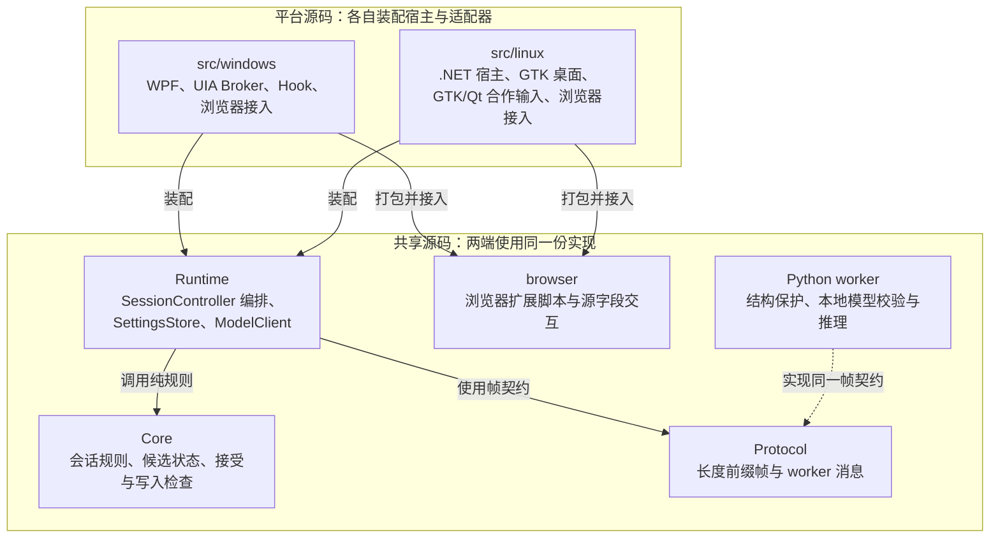
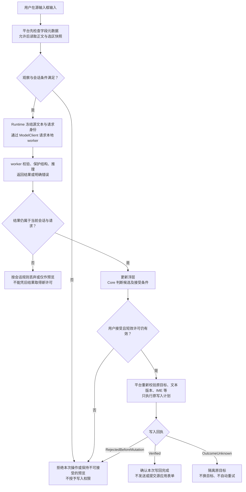

# 共享架构与平台边界

改模块边界、进程启动、会话或目录时读取。TypeLay.slnx 是工作区入口；[ADR-0001](../adr/0001-workspace-and-delivery.md)规定工作区与交付，[ADR-0003](../adr/0003-cross-platform-runtime.md)规定共享运行时与宿主契约。产品要求从[产品验收基线](../product/README.md)读取，平台现状不降低要求。

## 先看整体怎么工作

TypeLay 不是把模型输出直接粘回输入框。它先确认“这是哪个输入框、现在能读什么”，再翻译和展示；只有用户接受且原目标仍满足写入条件，才尝试写回。**模型只生成文本，不拥有焦点、按键或写入权限。**

下面三张图分别回答：代码由谁负责、运行时有哪些进程、一次翻译怎样安全结束。它们描述当前实现，不表示所有输入框或模型能力都已通过验收。

### 1. 源码职责：共享规则，分别接入系统

- **Core 回答“能不能做”，Runtime 决定“何时做”，平台负责“怎样在当前系统里做”。** 输入、视图、串行事件循环与子进程所有权由宿主注入；共享控制器不直接操作窗口或输入法。
- `shared` 指共享源码，**不是一台两端共同访问的服务器**。Windows 与 Linux 各自在本机创建 Runtime、Core 会话和模型客户端。worker 是另一个本地进程，不在 .NET 进程里执行。
- 浏览器脚本共用，但扩展清单、注册、native host 与宿主连接仍有平台差异。Linux 内部共用的 GTK/Qt 代码不因此成为跨平台共享代码。

### 2. 运行时协作：同一产品，不是同一个进程

每条分支表示一台机器上的运行实例；图中连线表示通信或本机调用，不表示依赖下载。为突出主路径，省略安装器、教程和子进程监督细节。

```mermaid
flowchart TB
    subgraph win[Windows 实例]
        WA["App 进程<br/>WPF + Runtime/Core + ModelClient"]
        WB["UIA Broker 进程<br/>Windows 输入观察与操作"]
        WE["外部原生应用<br/>目标输入控件"]
        WX["浏览器进程<br/>共享扩展脚本 + 网页输入控件"]
        WH["BrowserHost 进程"]
        WM["本地 Python worker 进程<br/>加载 Argos 或 Hy"]
        WA <-->|私有标准输入输出协议| WB
        WB <-->|UIA 或原生输入路径| WE
        WX <-->|native messaging| WH
        WH <-->|命名管道| WA
        WA <-->|标准输入输出：worker 帧| WM
    end
    subgraph linux[Linux 实例]
        LD["GTK 桌面进程<br/>设置、托盘、输入与视图路由"]
        LA[".NET 宿主进程<br/>Runtime/Core + ModelClient"]
        LE["外部 GTK/Qt 应用进程<br/>合作模块 + 源控件与浮层"]
        LX["浏览器进程<br/>共享扩展脚本 + 网页输入控件"]
        LH["native-messaging 进程"]
        LM["本地 Python worker 进程<br/>加载 Argos 或 Hy"]
        LE <-->|同用户 socket| LD
        LX <-->|native messaging| LH
        LH <-->|同用户 socket| LD
        LD <-->|私有继承管道| LA
        LA <-->|标准输入输出：worker 帧| LM
    end
```

Windows 的原生浮层由 WPF 呈现，浏览器浮层在页面内；Linux GTK/Qt 浮层在对应源应用中，浏览器浮层也在页面内。因此“浮层”不是所有平台都共用的一个窗口。Linux 当前还依赖 niri 前台观察与可选 Fcitx 合作组件；上图省略它们，不表示已实现合成器或输入法无关支持。

翻译 worker 只做本地推理，不监听网络端口；**用户确认后的模型准备可以下载运行时或模型**，那是安装流程，不是把输入文字发给在线翻译服务。当前后端是 Argos 与 Hy；更换模型仍涉及协议能力、模型包与后端适配，不能把这张图理解成任意模型即插即用。

### 3. 一次自动翻译：显示结果不等于允许写入

以下以自动模式、源输入框中的一次接受为例。按需唤醒复用会话路径；一次性直接替换不经过预览或 Tab，始终绑定触发时的原目标，详见 [ADR-0002](../adr/0002-on-demand-and-direct-write.md)。

这里有四个容易混淆的东西：**快照**是一次输入观察；**候选**是仍匹配会话的译文；**许可**是短期、可撤销、只能消费一次的接受资格；**回执**是本次写入的结果。候选不是许可，写入计划也不是平台授权。完整术语见 [GLOSSARY](../../GLOSSARY.md)。

图里的“平台执行”有两条实际路径：源端同步接受路径在源控件线程完成操作，再向控制器报告 `CompletedReceipt`，**控制器只结算，不再补写一次**；异步路径由控制器调用 `IInputService.WriteAsync` 并等待回执。两者都不能把未知结果当成功或安全重试；Windows 通用 UIA 的非原子风险仍未解决，见下文 [开放风险](#开放风险与安全边界)。编辑译文时人工稿另有保护，不能被新模型结果覆盖；编辑回源也不自动代表已经写入。

### 从图找到实现

链接指向当前源码，按职责阅读，不必先通读整个仓库。修改职责或通信边界时，同步更新对应图；具体通过、失败与未测状态仍以平台说明为准，不在图里复制每轮 CI 结果。

| 想看什么 | 从哪里开始 |
| --- | --- |
| 两端怎样创建同一控制器 | [WindowsRuntime](../../src/windows/TypeLay.App/Windows/WindowsRuntime.cs)、[Linux Program](../../src/linux/TypeLay.Linux/Program.cs) |
| 输入、翻译、编辑与接受怎样衔接 | [SessionController](../../src/shared/TypeLay.Runtime/SessionController.cs)、[输入端口](../../src/shared/TypeLay.Runtime/InputContracts.cs)、[视图与事件循环端口](../../src/shared/TypeLay.Runtime/SessionHost.cs) |
| 候选与写入为何被允许或拒绝 | [Session](../../src/shared/TypeLay.Core/Session.cs)、[AcceptanceGate](../../src/shared/TypeLay.Core/AcceptanceGate.cs)、[WriteSafety](../../src/shared/TypeLay.Core/WriteSafety.cs) |
| 模型请求怎样跨进程并执行 | [ModelClient](../../src/shared/TypeLay.Runtime/ModelClient.cs)、[worker 入口](../../src/shared/TypeLay.Worker/run_worker.py)、[LocalEngine](../../src/shared/TypeLay.Worker/typelay_worker/engine.py) |
| Linux 两个宿主进程怎样连接 | [desktop main](../../src/linux/desktop/main.py)、[DesktopLink](../../src/linux/TypeLay.Linux/DesktopLink.cs) |
| 为什么两端输入能力不同 | [Windows 架构](../platforms/windows/architecture.md)、[Linux 架构](../platforms/linux/architecture.md) |

下面保留实现与维护所需的精确合同。风格、术语与另述虽已有代码，当前质量发布门仍关闭；图中的普通翻译链不代表这些要求已交付。

## 生产边界

Windows/Linux 在 trunk 共用 src/shared/ 下的一份 Core、Runtime、Protocol、Python worker 与浏览器脚本。src/windows/ 和 src/linux/ 只拥有各自宿主及本机适配；eng/ 拥有构建，packaging/ 拥有运行时包装与安装，tests/ 拥有受控工具和断言。

`TypeLay.Core` 拥有 Session、AcceptanceGate、WriteSafety、字段安全策略、UTF-16 选区映射和展示状态的纯逻辑。只接收显式快照、时间与结果；不读取操作系统、环境变量、网络或磁盘。回归通过这些公开边界观察，不断言私有字段。

`TypeLay.Runtime` 引用 Core/Protocol，拥有 SessionController 的时序编排、设置持久化及 ModelClient 的本地模型协议。宿主注入输入服务/输入观察、串行事件循环、视图、数据路径和进程所有权。这里没有 WPF、Win32、UIA、Registry、Windows Broker DTO 或 provider 名称判定。模型、设置、平台事件通过公开端口进入同一会话所有者，不另建线程、服务容器或消息总线。

GTK、Qt 和共享浏览器沿用现有视图状态，在 `Translating`、正文非空且 `editorOwnsText=false` 时以现有弱化文字色显示旧译文，与 Windows 更新态对齐；新结果恢复正常色，编辑与回源人工稿保持原色，不增加协议字段或接受资格。

[本轮呈现检查](https://github.com/DingJWuyu/Typelay/actions/runs/39097718674)已通过 GTK3、GTK4 和 Qt 的实际控件颜色状态断言，以及浏览器浅深色、320/520 像素四个场景的状态序列；Qt 真实模型编辑与回源链也通过。浏览器测试已明确传入当前视图代次，并在实际进入编辑后才输入人工稿，保留原源文字不变断言。双端搬迁后发行包也已验证扩展图标；整套平台检查仍有其它失败，不能将这些检查作为完整输入验收。

TypeLay.Protocol 不引用 Core，拥有长度前缀帧和 worker 消息。Windows Broker 私有协议另属 Windows.Contracts，不是全平台共享协议。

TypeLay.Worker 是独立 Python 进程，拥有本地模型校验、文本结构保护与推理。源码及 worker 协议共享，原生 Python 依赖的目标平台发行与真实推理分别验证；worker 不自动下载、不监听端口，不向协议输出原始异常或用户文本诊断。模型安装与用户同意流程由各平台宿主负责。

worker 入口在加载模型依赖前保存不可继承的专用二进制输出，帧和 `--self-check` JSON 只写该流。Python stdout、原生 fd1 与 Windows 标准输出句柄均改指向宿主持续排空的 stderr；正常关闭及解释器退出期间不恢复 stdout，避免原生清理日志污染最后一帧。隔离失败不加载模型并以固定失败退出；不增加原始异常或用户文本日志，也不跳过污染前缀或放宽帧解析。固定语料诊断入口在自身提前导入 CT2 前使用同一隔离。

内部另述操作 `translate-alternative` 沿用长度帧的 `id/text/source/target`，另需非空 `previousCandidate`，不接受 `preserved`；只处理 Argos 中英单段、无受保护结构的原文。普通翻译与另述维持 beam_size=2；扩大搜索束的固定语料实测仍有数字约束失真，不作为默认改进。另述固定 CPU/int8、beam_size=2、patience=1、num_hypotheses=2、max_input_length=0、max_decoding_length=512、repetition_penalty=1.05，源分词超过384拒绝，不采样、不重试。按模型顺序筛掉空、截断、非法、含受保护结构及与旧候选仅大小写/空白/标点不同的结果，不改写候选来制造差异。响应仍为 `id/status/text/code/elapsedMs`：`translated` 为筛选后的另述；`no-alternative` 的 text/code 均为空，只表示没有可用不同候选；拒绝为 `error` 加固定 code。Hy 在 Runtime 发 RPC 前拒绝，旧 worker 的 `unknown-operation` 直接失败，均不退回普通翻译。发起时撤销接受许可；返回必须属于完全相同的会话、输入、焦点、命令与模型代次，迟到另述不能降为预览；同代失败或无另述保留旧译文，但不恢复旧许可。浮层入口已接入同一共享状态，但产品发布门保持关闭，真实语言质量尚未通过；固定合成语料采集入口见[测试协议](testing.md#argos-另述真实质量采集)。

模型包目录由 worker 随包的单份 `model-catalog.json` 定义，Runtime 嵌入同一文件。目录 schema2 以包描述 backend、版本、下载地址和直接方向；正式目录包含原 Argos 中英双向与固定 revision 的 Hy-MT2 Q4_K_M 中文与日语、韩语、法语、西班牙语、德语、葡萄牙语互译的十二方向预览包。LegacyDirections、默认安装集合和原语言选项继续保留中英方向；设置接受目录已知的直接方向、Auto 与同语，不随安装或离线状态重置。Runtime 接受显式 schema3 加载计划。Linux 准备卡消费精确库存、当前选择与实际 hello 的包/版本/方向子集，提供明确确认的下载并使用、切换、修复及非当前包移除；Windows 亦接入 schema3 包事务和共享包操作呈现，原 schema1/2 安装与启动保持兼容；Windows 开发候选仅在包内 ABI5 生产组件齐备时提供 Hy 下载与使用入口，实际加载仍须通过 worker 的完整校验；两端实际验证状态见 [Windows 当前候选](../platforms/windows/README.md#当前可验证候选)和 [Linux 验证边界](../platforms/linux/README.md#当前可用范围与验收边界)。

模型包呈现复用 `TranslationPreparationView` 的 `PackageRows` 与 `CurrentModelText`。目录覆盖不是已安装或已加载方向；缺少当前方向时只提示，不更改语言或暗中切包。Linux 的可选语言取实际安装且平台可用的包方向，同时保留默认中英和已保存值；Windows 设置与快捷面板按实际已加载方向更新语言选择，同一列表刷新保留搜索和焦点；离线或已保存值不在当前模型能力内时如实回显，不自动改值。

浮层语言呈现复用准备状态中的 `languageChoices`，GTK3、GTK4 和 Qt 按 code 映射现有菜单，浏览器与 Windows 显示真实语言名称；未知值不再回退显示为英语或自动识别。原生浮层缺失或不合法的选项数据时关闭语言修改。浮层保存复用现有 `traySettings` 的 source/target 局部更新，失败保留最后确认值，结果未知不声称保存成功；不再提交旧的全量设置。原生模块须由目标应用重启后加载同期版本。

界面动作携带完整、冻结的 format1 请求与 `expectedCurrent`，确认后仍校验视图是否过期，再由同一准备任务传给安装器；暂停、继续及重试不会读取最新控件重建请求。已有包库存不再使用旧方向修复入口；损坏库存不提供任何修改动作。Hy 准备入口根据各平台的只读 native 组件检查呈现；真正准备和模型加载仍独立完整验证，不能把组件存在当作模型就绪。下载大小取嵌入的同一 `model.lock.json`，不将下载大小误作安装峰值空间。

目录版本与 `installed.json` 版本独立。`ReadInstallationSelection` 只读库存意图；schema3 的 packages 每项含精确 id/version、非空方向子集和包根相对 files 清单，允许库存备选覆盖同一方向。`ReadActiveSelection` 单独要求非空、无重复的 activePackages ID 列表，只接受原 Argos 包的非空子集或恰一个 Hy 包，拒绝混合家族、多 Hy 与方向冲突。schema3 包根是 `models/packages/<id>/<version>/`；原 schema1/2 的默认选择、文件位置与校验要求保持兼容。读取意图不校验磁盘，也不授予 Ready。

worker 先规范校验全部库存元数据，只扫描及完整 SHA 校验 active 包的精确文件集合，全部验证后才导入并加载相应模型；inactive 包不读取模型文件、不导入后端。schema3 Argos 还核对 metadata 的来源/目标/版本及安装器五项必需文件。普通 hello 不做推理，只在全部 active 加载成功后返回方向；schema3 另返回已加载包 identity；schema1/2 仅在同样严格的文件集合、SHA、五项必需文件及 metadata 来源/目标/版本校验后追加 packages，否则保持原普通 hello。身份校验只读，不迁移库存；原完整性失败仍拒绝启动。停止或启动失败释放已加载资源，不以安装标记存在代替验证。Auto、同语和人工追加判断继续先于缺方向反馈，无静默中转。

Hy 的 Linux x86_64 与 Windows x64 路径使用 ABI5 的固定十二方向，实际选择的方向共享一个模型 handle；Windows 开发候选已接通生产 DLL 闭包、加载器与包操作；实际发行链的通过、失败及未运行边界见 [Windows 当前候选](../platforms/windows/README.md#当前可验证候选)。打开模型前必须解析唯一版本化导出 `hy_open_v5`，旧 ABI2/3/4 adapter 不得进入加载或 hello。新安装登记完整十二方向；已有合法方向子集在选择和修复时保持原意图，hello 只报告实际加载子集。可信 native 与 CPU 闭包随 worker 发布，GGUF 和模型许可证属于安装包。生产门只消费随包固定锁和 production-adapter 清单，不依赖源码、header、原下载 ZIP 或测试报告；CPU 选择使用官方 score，并检查实际已映射库的精确路径与字节身份，拒绝异源预加载库。共享 native 源码在 `src/shared/TypeLay.Worker/native/hy/`，构建测试与生产共用，audit 仅 fixture 宏启用。构建入口和 runtime-only 交付见 [Linux 开发](../platforms/linux/development.md#hy-worker-可选构建)及 [Windows 开发](../platforms/windows/development.md#hy-生产载荷候选构建)。

Hy 保留通用 8192 UTF-16 文本上限，并在结构分段前对整请求加 8 KiB UTF-8 上限；每次 native segment 固定 context 1024、最多192新 token，所有片段共用一个60秒 deadline。超限明确拒绝，无截断、无部分输出；只有真实 EOG 才返回结果。可信模板/控制 token 与原文 literal tokenization 分离，ABI仅对模型输入应用 CRLF→LF，孤立 CR 拒绝；外层保留原文与原换行结构。Hy --self-check 最多运行一个实际样句并独立报告全部已加载方向，不把语言质量矩阵放入启动；原 Argos 自检逐方向行为保持。

风格指令后端（产品发布门关闭、质量未验）：不可变 TranslationJob 的可空 Style 仅接受可信枚举 Natural/Formal；null 保持普通翻译原帧和原提示。显式风格使用独立 `translate-styled-v1`，旧 worker 明确拒绝，不回退普通翻译；非 Hy 在 Runtime 与 worker 双层拒绝。worker 把风格与同一请求 deadline 冻结给各段，ABI5 的 `hy_translate_styled_v5` 仅从固定枚举选择可信指令，Natural 与 Formal 均有独立可信指令，源文仍独立 literal 编码，不接受任意提示词。

共享风格状态与持久化已接通，新增风格入口仍受产品发布门控制：旧设置 Styles=null 保持普通行为，首次明确选择建立 Natural 全局默认及应用覆盖；删除覆盖重新继承全局，无法确认应用身份时只用全局，不借用上一应用。保存须经控制器验证产品发布策略、真实 Hy 活连接的 styledTranslationVersion=1、设置版本及当前源 token/观察代次；没有当前会话也可保存全局，但不能绕过能力与发布验证。原 settings 原子落盘成功后先同步应用配置、撤销旧资格并从原源重译，再发独立 StyleChanged；不广播普通 Configure/settings，也不让旧全量表单反向覆盖。人工编辑、回源中、待接受人工稿及续写种子均拒绝保存风格；明确重新生成后才解除。活动教程/写回/直接任务期间暂拒绝变更，已有退休 ACK 等待结束后重验原保存上下文。每个会话和 Direct 任务冻结风格、原源、方向及配置代次；Direct 应用身份仅沿原成功命令 lease/capture 传递。换到非 Hy 时已保存偏好休眠，普通 Argos 保持原请求，新风格保存拒绝且不换模型；技术能力不代表已通过质量或已开放 Windows/Linux UI。入口开放前，须以实际 Q4_K_M、greedy、1024 context 和192输出 token 配置完成自然/正式成对验证，检查风格效果、原义、否定、状态、时态与 CPU 响应，按已验证方向开放；提示词存在和软件合同通过不构成质量证据。术语表独立接口见下段。

共享产品发布策略是编译期的操作与精确包 ID/版本/方向表，风格、术语、另述当前全部关闭；技术 hello 不授予质量放行。管理入口发布与实际模型采用分别判断，状态查询和命令共用资格，普通/Direct/Append 的专用分发再次核验。只有真实 hello 精确核对 packages/version/directions 后才生成本连接身份；发送在 ModelClient 同一 owner 锁内绑定该身份，旧身份不能借模型切换派发。Auto 必须覆盖该已验证 active 身份内通往目标的全部可能方向，不新增检测请求。schema1/2 保留原普通 Ready/翻译；完整安装可经 worker 只读校验得到精确身份，缺少身份的旧安装仍不授予新操作，不从目录意图猜包版本。显式包修复仍沿既有 schema3 事务，启动不触发修复、迁移或下载。双端设置与浮层风格/另述会话入口已接线，主动加词使用独立辅助输入合同；受控注入策略测试不构成真实模型质量验收。

恢复操作独立于新增能力发布：用户明确确认“重置翻译风格”才原子清除全局及所有应用覆盖到 Styles=null；Natural 不表示重置。离线或非 Hy 可移除休眠偏好，有活动会话仍保留人工稿、IME、教程、写回、退休及原 token/源观察门，无变化不写盘或重算。重置保留术语并继续其采用门，不静默清规则。术语恢复只允许删除已提交规则的严格原样子集或清空，删除豁免保存发布门，不豁免残余规则的模型采用门。

Windows 与 Linux 设置使用同一控制器状态和专用风格/术语命令；普通全量设置不能夹带这些字段。新增管理控件按共享发布门隐藏，已保存偏好仍可显式恢复：无源会话时按已提交的应用键删除单个风格覆盖，或确认清除全局与全部覆盖；旧术语可删除。打开设置沿既有流程结束源会话，不能借用旧 token 或上一应用创建覆盖。术语草稿在保存失败、取消关闭和外部更新时保留；若基线规则未变，仅其他设置推进版本，可使用最新版本保存；规则确已改变则展示最新完整列表，明确确认替换并绑定该次版本，再次变化仍拒绝。退休等待期间关闭或放弃会取消精确请求，已经提交的结果不回滚。两端接线的编译与协议回归不等于实际 GTK/WPF 桌面或模型质量验收。

浮层更多菜单复用共享只读资格与短反馈：风格仅操作当前可靠应用的覆盖，继承独立于自然/正式，客户端不传应用名。菜单展开时冻结原 view token 与设置版本，点击仍由控制器重验；另述失败保留原候选，不恢复旧接受资格。发布门关闭时新增入口隐藏。反馈只属于原动作代次，不能覆盖既有输入法、写回或错误状态；浏览器与 Linux 桥仅排除新增菜单呈现子对象对编辑身份的影响，其余原字段仍沿原生命周期规则。WPF/GTK/Qt/浏览器实际桌面交互及模型质量仍须分别验收，主动加词不得借用译文编辑身份。

浮层主动加词保留普通 `EditingTranslation` 会话，并在双端标准浏览器 `input`/`textarea`、Windows 非自有标准原生 `Edit` 及 Linux GTK3 标准 `GtkEntry`、GTK4 标准 `GtkEntry`（同一标准 `GtkEntryBuffer` 与其直属 `GtkText` delegate）、Qt6 标准 `QLineEdit`/`QPlainTextEdit` 接入 `ValidTranslation` 与 `EditedTranslationPending` 来源；新增入口仍由共享发布策略关闭，自有教程、GTK4 `TextView` 及其它非上述标准控件、通用 UIA/WPF 虚拟控件、其它 Qt 控件及富文本的源侧入口不开放。GTK4 源侧加词已在隔离 niri、真实 GTK4/Fcitx 组件与受控公开浮层协议下通过 14 项交互检查：上述两个源状态各覆盖保存、取消、源文变化、buffer 替换、输入法 reset、外部失焦及无点击重放拒绝。该证据不包含真实模型术语质量；用户机器上的 niri 实测与产品整体验收仍未完成。用户明确填写源词、译词与全局或有向范围，不从人工改稿自动学习。表单拥有独立 form ID、原 view token、设置版本与取消请求，单规则追加复用原完整保存资格，不全表覆盖；精确重复规则确认无额外落盘，冲突或失败保留表单，结果未知不自动重试。原译文控件、稿件、选区及撤销历史保留，辅助焦点不是译文快捷键资格；仅精确表单控件及实际 IME Clear 可保存，Tab 在表单内导航，Esc 先遵守输入法再取消表单。关闭仅在仍属原会话的实际辅助焦点时恢复原编辑器或原源字段，外部失焦不抢回；离开原状态或原 token 失效由控制器主动退休表单，迟到提交不复活。源侧表单由控制器标记，平台默认拒绝；打开不借用编辑态，撤销旧接受许可并保持原状态、候选和人工稿。保存仅从当前辅助控件的实际 IME Clear 发起零写入回源，再用新捕获核验原目标生命周期、窗口、输入版本、文本、选区、语言、风格、术语与模型身份。

Windows 原生路线只支持已绑定的 `win32-edit-transaction-v2` 字段：保留原进程、窗口、控件及 native lifetime cookie，只认可该表单的两次精确前台转移，不修改全局输入代次。回源前由 Broker 复核原绑定、正文、选区与真实 IME；独立的有界取消凭证在外部失焦、配置变化或关闭后永久失效。回源不把焦点强制改到原窗口内的另一个字段，不授予任何写入资格。Windows 只有当前表单及实际回源 receipt 匹配才允许双 false ACK 的只读捕获，普通双 false 仍拒绝。

Linux 保留既有普通预览语义，只对该回源路径增加精确 receipt 检查。Linux 仅把当前表单 Opening/Returning 阶段内、浏览器同步自有焦点调用所证明的精确 source/auxiliary 转移保留为同一窗口；可信双焦点事件、实际目的控件、原 peer/route/lifetime/window/foreground 及一次消费缺一则沿用普通失效，外部字段或窗口往返不豁免。GTK3 独立绑定原表单的 context/input/content 与实际窗口、标准源控件和精确辅助控件；仅自有同步焦点调用内的完整 `set-focus` 序列可证明一次转移，最多八条原焦点事件按原顺序带连续计数发送，第三控件、重放、缺失及非焦点事件均不豁免。回源沿原 450ms provider 等待取得源侧明确 Clear，旧编辑票和辅助 Clear 不能代替新源捕获；自然转移若使 context 代次改变仍拒绝，须经真实 GTK 检查原因，不扩宽此门。

Qt 源侧入口仅限标准 `QLineEdit`/`QPlainTextEdit`，绑定 provider/context/field/input/storage/selection 与稿件身份，多行还绑定并重核原文档代次；Returning 阶段不赋予编辑或源写权，必须取得新源侧 Clear 及精确回源 receipt。宿主协议回归不替代 Qt 原生编译或 GUI 验收，具体通过、失败及未运行边界见 [Linux 当前验证状态](../platforms/linux/README.md#当前可用范围与验收边界)。GTK3 编译和真实 GUI/IME 的证据分别按 [Linux 当前验证边界](../platforms/linux/README.md#当前可用范围与验收边界)记录，编译通过不授予交互验收。

被表单生命周期取代的旧捕获成功与异常均丢弃，不影响当前有效读取的失败收束。机器稿保存后按原选区重译，待接受人工稿只为下次机器任务保存规则；失败保留结果且仍无接受票；Linux 回源后的明确失败需关闭并重新打开表单重试，普通用户辅助回访不豁免窗口失效，未知结果不自动重试。外部失焦退休且不抢回焦点。原子保存成功先固化结果再应用设置与退休表单，原 Add 请求仍收到精确结果，不另发完成通知或复活表单。共享控制器、真实文件和平台桥回归覆盖基本保存、取消/失效、幂等、回源重验及通知失败；各平台实际桌面交互和模型质量仍待验收。

显式本地术语后端与共享状态（新增管理入口未开放、未作真实模型质量验收）：`ChangeGlossaryAsync` 只接收用户主动确认的完整规则集，不从人工修改自动学习。`GlossarySnapshot` 冻结版本和深不可变规则；规则只含源词、译词及可空的精确有向语言对，无应用作用域、隐式反向或语言中转。最多64条，每个源词/译词最多128 UTF-8字节，总量8192字节，拒控制字符、首尾空白和无效Unicode。相同scope/source的相同译法去重、不同译法拒绝。损坏的新Glossary字段只被丢弃，保留原隐私排除；旧全量设置不能覆盖规则。沿现Settings原子替换文件，使用独立GlossarySaved通知，不广播普通settings/Configure；失败不改内存或会话，通知失败明确返回已保存。

术语管理发布后，无会话或人工态持久化不依赖当前模型；保存版本与会话已应用版本独立。人工编辑、回源、待接受稿和续写种子期间可保存，但仅更换下一机器任务的规则快照，不更改当前稿、选区、候选、接受许可或配置代次；保存上下文仍校验目标、源文/输入代次及取消/设置版本，人工编辑不要求陈旧源快照仍满足写入新鲜度。新Append只约束新增源文，旧人工prefix原样冻结，不用旧稿中的译词满足本次检查。机器稿保存前须以拟保存规则验证当前精确模型/方向的采用资格及风格组合；保存后撤销旧资格并从原源/选区重译，旧结果不能降为预览；待提交Direct取消，已提交写回期间拒绝保存并按原receipt收束。

ModelClient只筛明显无关方向：显式方向无global及该精确方向规则、或Auto无global及该target规则时保持普通原帧；其余使用独立`translate-glossary-v1`，要求当前Hy活连接的精确数值`glossaryTranslationVersion=1`，旧worker及非Hy明确拒绝，不回退。宿主不检测语言或匹配词。worker沿原检测顺序得到actual后，方向专属规则覆盖同source全局规则。所有匹配大小写精确、不规范化Unicode；包含Han/Kana/Hangul的源词（包括混合词）按子串，其余词的两侧不得紧邻Unicode字母、数字、组合附加符或下划线。重叠按Unicode scalar长度降序、起点升序、源词/译词scalar ordinal确定排序选互不重叠命中。只把完整落入本次实际可翻译segment的命中交给后端，跨保护边界或要求修改protected内容明确拒绝；protected中的恒等规则不需模型应用。各段真实输出须先包含本段指定译法（同边界规则），再拼回结构、合并人工prefix；不硬替换输出，不承诺命中次数，此检查仅为必要条件，不是质量通过。

新op严格白名单字段；旧translate、styled、alternative显式拒绝glossary/terms字段，包括null。Style与潜在适用glossary仅在独立组合技术能力及精确包/版本/方向的组合质量门均通过时采用；组合质量门当前仍关闭。ABI5的`hy_translate_glossary_v5`接收有界结构化词对；可信固定模板取[官方Hy-MT2术语示例](https://huggingface.co/tencent/Hy-MT2-1.8B)，源词、译词与原文分别沿同一literal编码，不进入可信指令，所有片段literal审计累计。完整prompt仍须满足context1024及192输出token预留，各段共用原60秒deadline，超限拒绝且不发布部分结果。无词命中的段保持原普通prompt字节。ABI5的软件合同、真实CPU ELF加载与无模型参数验证均不能作为GGUF推理、术语语言质量或UI开放证据。

风格与术语组合复用同一 `ModelRequest.Style/Glossary`，使用独立 `translate-styled-glossary-v1`；hello 的可空严格整数 `styledGlossaryTranslationVersion=1` 只在验证并实际绑定可选 `hy_translate_styled_glossary_v5` 后发布。既有 ABI5 布局、单项签名和五导出闭包不变；新 native 闭包仅多此导出，两种闭包均要求精确 manifest、完整文件哈希、固定 ABI 与真实加载路径。旧闭包可继续普通及单项翻译，但拒绝组合；未知或缺失闭包、哈希/ABI错误、声明扩展但实际符号缺失都拒绝 native 身份，不降级猜测。用户安装模型目录仍只有原 GGUF 和许可证，native 随发行 worker 分发，不改库存或重下模型。app/worker 按同一发行包配套，旧客户端的严格响应 schema 会拒绝带新能力字段的 hello，不承诺跨发行版本混用。组合将风格、每段命中术语和同一原文交给同一 native decode，沿原结构保护、共享截止时间和原资源上限，不串行改写或替换模型输出；另述组合仍拒绝。组合能力与模型连接身份在设置保存及源侧加词回源时重新核验。

Hy 的 ABI5 实际模型、安装生命周期与固定质量采集结果分别见 [Windows 当前候选](../platforms/windows/README.md#当前可验证候选)、[Linux 模型验证边界](../platforms/linux/README.md#可选多语言预览模型)及[共同产品缺口](../product/README.md#当前共同开发缺口)。握手、单句推理、采集完成与完整产品质量验收是不同证据，不能互相替代。

[Windows 架构](../platforms/windows/architecture.md)描述 WPF、UIA Broker、Hook、原生 Edit、Windows.Contracts 与安装；[Linux 架构](../platforms/linux/architecture.md)描述 GTK/Qt、浏览器、niri、合作输入和 XDG。平台内共用的实现留在本平台，不因多个本机模块使用就进入 src/shared/。

## 平台边界不变量

Core 的 TargetId 只比较 backend、opaque value 和 lifetime；各后端解释自己的身份与寿命。共享逻辑不解包本机句柄。

观察就绪不等于拥有 Tab，也不等于能写回。InputSnapshot 的两种写能力默认 false，生产后端校验通过后显式声明；共享控制器还要求 CanInterceptAcceptance 才发布 Tab 许可。未知 IME、敏感元数据、焦点/输入版本、时效、字段寿命及未知写入结果继续独立否决，不能用单一“支持平台”开关覆盖它们。

IInputService 的实现负责操作前重新确认目标与权限，不能把 WritePlan 当授权。无法安全写入返回明确拒绝；可能已经变更返回 OutcomeUnknown，不换目标、不模拟粘贴、不自动重试。直接写回保持绑定触发源，不通过前台 return/write 组合实现。缺失输入权限、可靠目标或几何信息时安全不可用，不伪造快照。

所有会话回调在宿主串行事件循环执行；平台回调先排队，不直接并发调用 Session。时间映射到 ISessionLoop 的单调毫秒域，输入/源输入/焦点版本分开保留。

模型加载使用不可变 ModelLoadPlan 冻结精确路径、库存 schema 与 active 包期望，实际 hello 必须逐项吻合后才授予 Ready。旧路径 API 仅接受显式合法 schema1/2。schema3 请求语法按目录已知语言校验，Auto、同语和人工追加仍交 worker 按原顺序判断。

旧或新计划含 Hy 时，宿主先校验候选，再由 PrepareModelChangeAsync 等待练习退役 ACK、隔离尚未派发的请求和完成回调、撤销许可；已派发写入按原 receipt 收束一次。随后客户端撤回 Ready，取消旧交换并等待自有进程退出证明，才启动唯一候选。发布结果分 Confirmed、Unchanged、Unconfirmed；仅候选已回收且持有原安装 lease 确认指针仍为精确旧代时，允许重新启动旧代并验证 hello。未知发布一律不可用；Hy 串行切换未确认退出时保持不可用。Argos 热替换失败可续用已确认旧连接，但下一次加载须先获同一进程所有者的退出证明。锁序保持安装 lease、lifecycle、serial。

控制器释放时停止循环并释放其输入服务/观察器；模型客户端、设置和视图由宿主拥有。进程创建后清理未获证明时，工厂必须返回携带所有者的专用异常，客户端保留退出障碍；Dispose 本身不是退出证明。Linux 模型专用 supervisor 仅在无待收子进程且自有组不存在时确认退出；Windows 模型专用 owner 挂起创建根进程，确认 Job 限制、精确归属和三条私有管道后才恢复执行；Argos 保持原 kill-on-close 限制，Hy 使用单进程与 2.5 GiB 上限。原生根句柄已退出且 Job active=0 才确认回收，同步管道也受原交换期限约束。新 schema3 代的 model-use.lock 从启动前共享持有至该退出证明；安装 lease 下只有精确已知退休代的独占使用锁成功后才清理，旧无标记或退出未确认的代保留并报告空间未回收。最终 Dispose 未获证明时保留使用句柄至 App 结束，不将关闭 Job 当成删除许可；外部强杀时序不作绝对保证。Broker/Practice 进程工厂不变。Windows Hy 计划要求包内生产组件齐备；正式 ABI5 包、原生生命周期及安装切换的实际证据见 [Windows 当前候选](../platforms/windows/README.md#当前可验证候选)。stderr 持续排空且不保存正文。

## 分发与测试依赖

源码目录与部署目录不同。客户端打包从明确的运行时清单复制，不带 .git、skills、源码、测试、归档资料、用户设置或模型缓存。可选合作包保留许可证要求的对应源码、修改与生产重建输入，详见 [Fcitx 分发](../platforms/linux/fcitx.md)。改变部署路径须验证搬迁后的实际发行包，不能只检查编译。

共享测试准备仅留在 tests 内，不向生产代码导出额外的“方便测试”接口。平台端口有 Windows/Linux 生产使用者；不为未开发平台保留空项目或假实现。证据边界统一见[测试协议](testing.md)。

## 开放风险与安全边界

- B-01：Windows 通用 UIA 非原子写回与物理按键所有权仍是发布阻塞，定义及关闭条件见 [Windows 写回风险](../platforms/windows/architecture.md#b-01非原子写回与按键所有权)。Linux 合作路径通过不关闭此项。
- B-02：真实桌面验收不完整。独立网站、物理 Tab、完整中文 IME、多显示器/DPI 与视觉一致性需要对应用户路径的证据；构建、fixture、软件注入和模型自检不能替代。具体流程见[测试协议](testing.md)。
- B-03：通用输入后端不完整。未知 IME 不授予编辑/接受资格，不能当成 Clear；已知组合态只使用可靠的已提交前缀，状态恢复不自动把旧预览升级为候选。Windows 只读预览与 Linux 未合作路径的正文读取边界各见平台架构；未暴露安全编辑能力的自绘/富文本仍缺后端，补齐的是控件能力，不是应用名单。

字段元数据可能错误或缺失。敏感、密码、终端、代码等排除须先于正文读取，不能宣称对伪装字段零误判。控件事件、撤销栈及受控状态必须按实际写入路径验证，不能仅比对最终文字。

文本和模型输入/输出限制以 Core 与 worker 的实现为准，超过限制拒绝而非静默截断。结构保护分段保留 URL、邮箱、mention、编号、emoji 和换行，可能影响上下文质量；人工追加保留人工前缀，不保证全文语义重新融合。

worker 没有网络调用路径不等于 OS 网络沙箱；无正文日志不代表能控制系统崩溃转储或内存分页。发布仍须审查实际组件/模型许可、供应链及签名，见根目录 THIRD_PARTY_NOTICES.md。

## 人工稿的短暂观察中断

已经编辑并成功回源的人工稿遇到一次无法读取原输入框时，Runtime 会立即撤销许可、失效旧计划和视图、隐藏浮层；Session 仍是唯一正文持有者。私有保留最多使用现有150ms观察窗口，重复失败不续期。只有取得中断之后的新鲜观察，且原目标寿命、正文、选区、输入与配置代次均未改变，才能恢复；明确离开、前台过期、不同证据或超时直接结束该会话。恢复不复活旧许可，未知输入期间仍不能准备写回。
