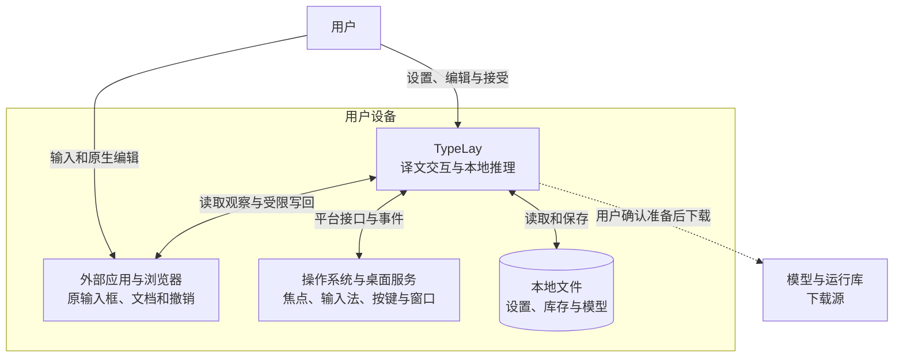
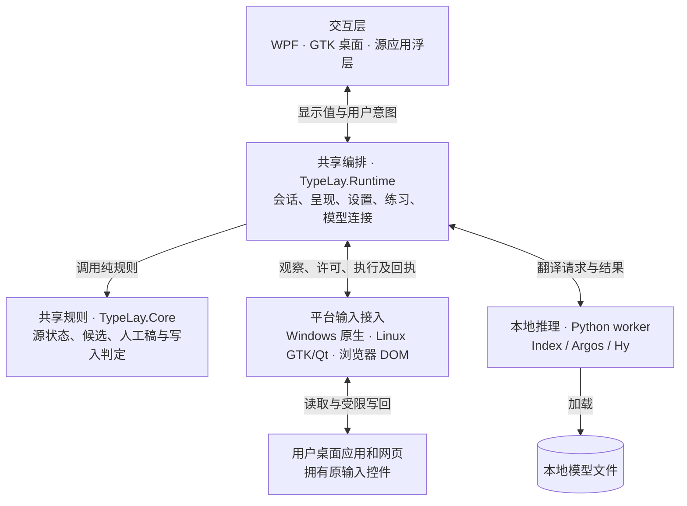
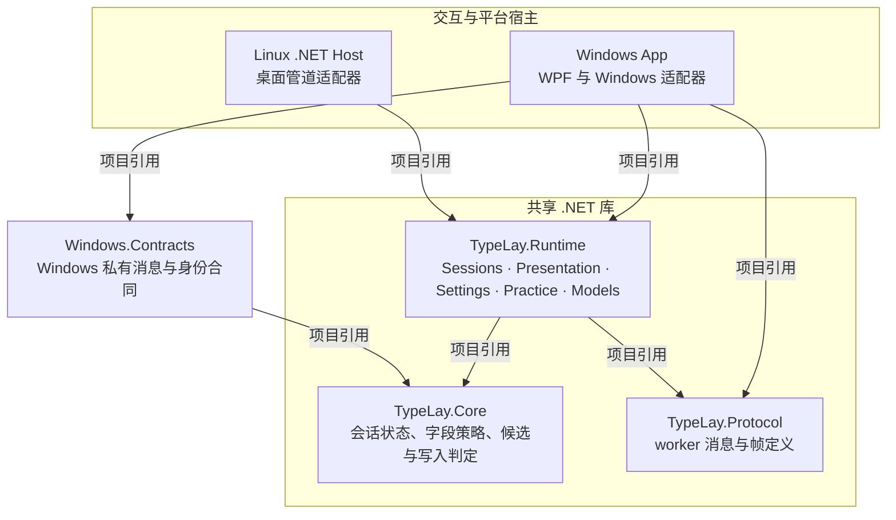
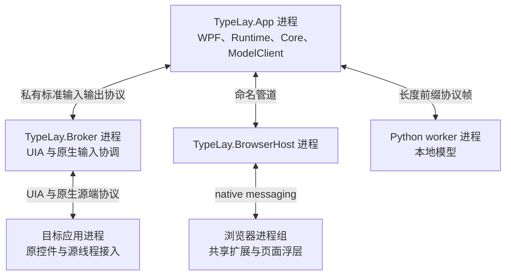
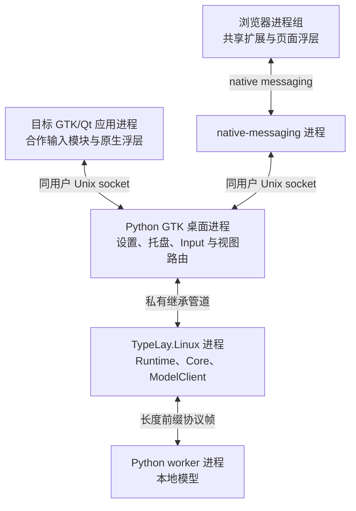
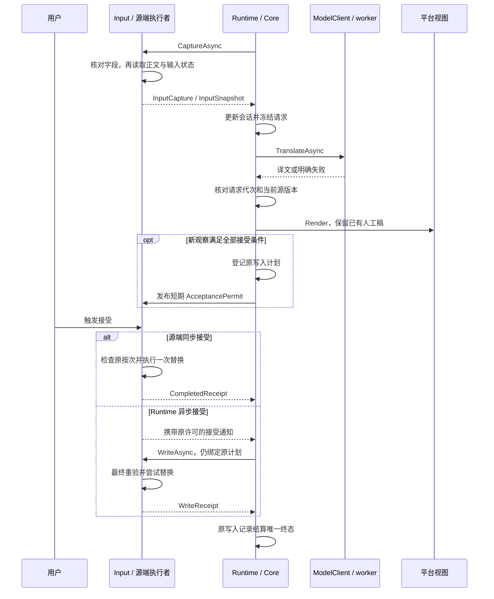
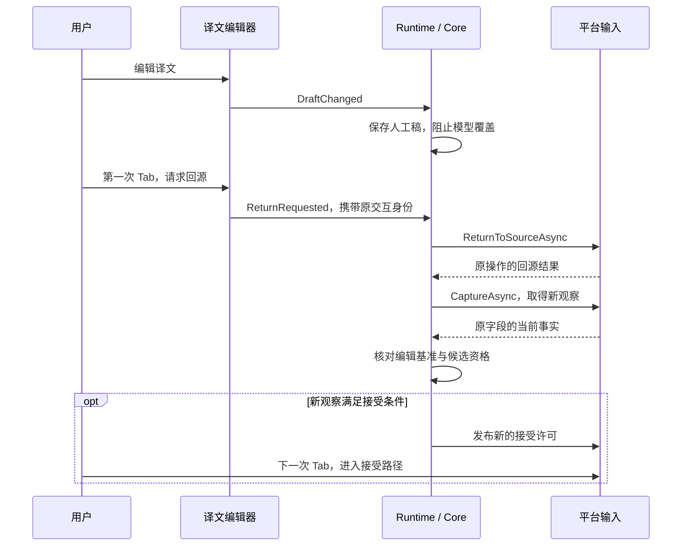

# TypeLay 系统架构

TypeLay 是本地输入框翻译工具。系统读取用户当前输入框，在旁边展示译文，并在用户明确接受后写回原处。自动模式持续跟随输入；按需模式由快捷键唤醒；直接替换绑定触发时的原字段，跳过预览。系统不代替用户发送消息或提交表单。

本文面向需要理解或修改系统的工程师，描述当前实现。Windows 使用 WPF，Linux 使用 GTK 桌面程序，并在源应用中呈现 GTK/Qt 浮层；网页浮层由共享浏览器脚本呈现。既定 GPUI 选择仍保留在[演进约束](architecture-target.md#教程模型与-ui-技术栈的范围)中，当前代码尚未实施前端迁移。

## 阅读路线与图示约定

本文借鉴 [C4 的分层视图](https://c4model.com/diagrams)，按上下文、模块、部署与运行时展开。每张图只表达一种关系；框和箭头的含义写在图旁。图示保存在 Markdown 的 Mermaid 代码块中，可随代码一起审查。

| 要回答的问题 | 阅读位置 |
| --- | --- |
| TypeLay 与用户应用、操作系统和模型是什么关系？ | [系统上下文](#系统上下文)与[逻辑结构](#逻辑结构与生产边界)。 |
| 哪些代码共享，哪些组件独立运行？ | [模块依赖](#逻辑结构与生产边界)与[部署视图](#进程部署与通信)。 |
| 一次预览、编辑和接受怎样完成？ | [运行时视图](#关键运行时流程)。 |
| 状态由谁保存，失败影响什么？ | [状态与存储](#状态所有权与持久化)及[故障边界](#故障处理与一致性)。 |
| 要改的行为具体在哪里实现？ | [源码导航](#源码导航与深入阅读)、[会话合同](session-runtime.md)及[模型运行架构](model-runtime.md)。 |

产品行为由[产品基线](../product/README.md)约束，界面由[已确认原型](../design/README.md)约束。本文说明实现，已有验证记录与未测范围见[GitHub Issues](https://github.com/DingJWuyu/Typelay/issues)。

## 系统上下文

普通翻译在用户设备内完成。外部应用保留输入框、文档和原生撤销历史的所有权；TypeLay 通过平台接入读取和受限写回。模型准备可以访问下载源，正文翻译不经过远端推理服务。

这是系统边界图，TypeLay 在这里作为一个整体。实线表示本机交互或数据访问，虚线表示模型准备时的网络依赖。应用接入能力受平台实现限制，当前结构不表示通用输入支持已经完成。

### 界面归属

浮层不总属于 TypeLay 主窗口进程。不同呈现位置决定了几何、焦点和真实按键必须在哪里确认。

| 界面 | 实际呈现位置 | 与共享运行时的分工 |
| --- | --- | --- |
| Windows 设置、托盘与原生浮层 | `TypeLay.App` 进程中的 WPF 控件。 | WPF 负责控件与系统事件，Runtime 提供会话、显示值和操作结果。 |
| Linux 设置、托盘与桌面管理 | Python GTK 桌面进程。 | 桌面程序经私有管道消费 .NET Host 的共享结果。 |
| Linux GTK/Qt 源端浮层 | 目标应用进程内的合作模块。 | 模块使用原控件及其父窗口定位、编辑和确认按键。 |
| 浏览器浮层 | 网页内的共享脚本。 | 页面脚本负责 DOM 与交互，两端各有 native messaging 桥。 |

多套视图共享产品规则和呈现值，控件实现仍分别维护。这是当前架构的维护成本之一。

## 逻辑结构与生产边界

系统按交互、产品编排、纯规则、平台输入和模型推理分工。共享规则不解释窗口句柄；模型不持有输入框的写入权限。

### 逻辑分层

这张图展示运行中的职责关系。逻辑层可以跨越多个进程，同一进程也可以承载多个层；实际部署在下一节展开。

### 主要程序集依赖

共享产品逻辑通过下列 .NET 项目装配。Python 桌面程序、原生模块和浏览器脚本通过平台桥接入宿主。

本图表示宿主与共享库的主要项目引用，箭头从使用者指向依赖。Runtime 内的五个目录属于同一个库。Python worker 实现相同的帧协议，不引用 .NET Protocol 程序集。

下表给出完整的生产职责。`TypeLay.slnx` 是 .NET 工作区入口，目录及交付原则由 [ADR-0001](../adr/0001-workspace-and-delivery.md)规定，共享运行时边界由 [ADR-0003](../adr/0003-cross-platform-runtime.md)规定。

| 模块 | 主要职责 | 对外提供的边界 |
| --- | --- | --- |
| `TypeLay.Core` | 保存源快照、候选和人工稿，执行字段、选区、接受与写入规则。 | 调用者传入显式事实和时间，取得纯判定；Core 不访问系统、磁盘或网络。 |
| `Runtime/Sessions` | 安排捕获和模型请求，管理具体交互、直接任务及写入结算。 | `SessionController` 接收观察、意图和原请求结果，驱动输入与视图端口。 |
| `Runtime/Presentation` | 从产品状态生成文案、菜单、动作可用性和呈现身份。 | 平台取得显示值；显示值不授予输入权限。 |
| `Runtime/Settings` | 冻结保存值，处理持久化版本、通知和外部副作用的结果。 | 保存入口返回完整提交结果。 |
| `Runtime/Practice` | 记录已确认的练习里程碑。 | 教程读取进度；真实源绑定与写入仍归会话和平台输入。 |
| `Runtime/Models` | 管理加载计划、模型连接、请求和产品采用资格。 | `ITranslationService` 返回译文、明确失败及连接能力。 |
| `TypeLay.Protocol` | 定义 .NET 客户端使用的 worker 帧与消息。 | Python worker 实现同一通信合同，不引用该 .NET 程序集。 |
| `TypeLay.Worker` | 校验模型载荷，保护文本结构，执行本地推理并校验输出。 | 独立进程通过严格消息返回结果或错误码。 |
| `src/windows`、`src/linux` | 装配宿主，实现原生输入、视图、连接、进程监督和系统副作用。 | 适配器提供真实观察和执行证明。 |
| `src/shared/browser` | 接入网页输入控件，在页面内呈现和编辑译文。 | 两端共享脚本，扩展清单和 native host 注册归各平台。 |

Runtime 的主要宿主端口是 `IInputService`、`IInputMonitor`、`ISessionView`、`ISourceInteraction` 和 `ISessionLoop`。宿主分别提供异步输入、即时输入通知、视图、原生交互证据及串行事件循环。Runtime 不自行创建 UI 线程，也不依赖 WPF、UIA、Registry 或 Windows Broker DTO。

## 进程部署与通信

每个平台独立运行自己的 TypeLay 实例，Windows 与 Linux 之间没有协调服务器。下面两图的节点表示进程，连线表示运行时通信；源应用节点也标出其中承载的接入代码。

### Windows 部署

App 装配会话、启动 Broker，并通过进程所有者管理 worker。浏览器按需启动 BrowserHost。UIA（Windows UI Automation）读取与源线程按键处理是不同机制，详细线程、Hook 和原消息约束见 [Windows 架构](../platforms/windows/architecture.md)。

### Linux 部署

桌面进程启动 .NET Host。Host 通过平台进程所有者管理 worker，Linux supervisor 补充进程族退出证明。niri 提供前台观察，合作 Fcitx 组件提供输入法及源端接入依据。图中省略这些系统服务、练习宿主和 VS Code 手动路径，完整关系见 [Linux 架构](../platforms/linux/architecture.md)。

两个宿主各装配一个 `SessionController`。Windows 将回调串行化到 Dispatcher，Linux 使用 Host 的 `EventLoop`。平台输入线程仍独立处理原生事件，事件与回执进入共享状态前必须经过宿主循环。

## 关键运行时流程

### 观察、推理、预览与接受

下面展示当前会话的正常路径。`Input` 代表平台输入适配器及其真实执行者，`Runtime` 包含它调用的 Core 规则。读取前先检查字段元数据；模型结果和接受操作还要分别复核身份与资格。

源端同步接受已经完成原控件操作，`CompletedReceipt` 只负责报告结果。Runtime 不为该回执补发写入。异步接受则由原 `WriteAsync` 调用返回回执。两条路径均可能在执行前拒绝，也可能得到未知结果，处理方式见[故障边界](#故障处理与一致性)。

快照、候选、许可和回执是四种不同事实。候选可见不等于有写权限，许可也不能代替源端最终检查。平台缺少能力时保持预览或明确拒绝，完整合同见[会话与输入合同](session-runtime.md#观察许可和执行各自保留证据)。

### 人工编辑与回源

普通编辑回源分成“返回原框”和“接受译文”两次动作。首次 Tab 不写入，回源后的新观察决定人工稿能否重新成为候选。

本图描述普通回源的产品顺序。浏览器 Replace、自有练习源 Keep/Replace 和源侧术语表单有各自操作身份与退休条件，详见[编辑与回源合同](session-runtime.md#人工稿与回源操作分别拥有状态)。显示刷新不能延长操作寿命。

### 按需唤醒与直接替换

按需唤醒创建原字段的预览会话，后续复用上述编辑与接受流程。Windows 首次尚无快捷键观察时，按该次按键原点发起只读捕获，见[首次唤醒](../platforms/windows/architecture.md#首次按需唤醒的只读捕获)。

直接替换由 `DirectTranslation` 保存触发源、选区和配置。它取得译文后调用 `WriteDirectAsync`，不显示预览，也不把任务改绑到后来获得焦点的输入框。直接任务与当前预览会话具有独立寿命，产品约束见 [ADR-0002](../adr/0002-on-demand-and-direct-write.md)。

## 状态所有权与持久化

进程、会话、交互和写入不会同时结束。系统分别记录它们的状态，避免关闭浮层时遗失已派发操作，或让旧结果更新新会话。

| 状态或数据 | 权威所有者 | 寿命及存储 |
| --- | --- | --- |
| 目标身份、焦点、输入法和按次 | 平台输入适配器及原执行者。 | 绑定原连接、原目标寿命和观察版本，保存在内存。 |
| 源快照、候选和人工稿 | `Core/Session`。 | 属于当前源字段会话，保存在内存，不写翻译历史。 |
| 回源、重译或表单操作 | Runtime 的具体交互对象。 | 保存本次身份、原期限和继续条件，退休后不能操作后继对象。 |
| 直接翻译任务 | `DirectTranslation` 及 Runtime。 | 绑定触发源，与当前前台会话分离；仍在内存中完成。 |
| 模型请求与连接 | `ModelClient`。 | 请求属于冻结加载计划和实际连接，迟到响应不能跨代采用。 |
| 写入计划与结算 | Runtime 的原 `WriteSettlement` 记录。 | 持续到唯一终态，终态释放正文；未知结果隔离原目标寿命。 |
| 用户设置、风格和术语 | `SettingsStore`。 | 保存到平台配置目录的 `settings.json`，文件替换是持久化提交点。 |
| 模型安装代与 active 选择 | 平台安装仓库。 | 保存于本地数据目录，使用锁与进程退出证明约束清理。 |
| 教程里程碑 | `PracticeProgressCoordinator`。 | 当前练习保存已确认进度，完成标记通过设置持久化；进度不授予源权限。 |

Windows 默认使用 `%LOCALAPPDATA%/TypeLay`。Linux 分开使用 XDG 配置目录和数据目录。具体路径、安装与恢复方法由各平台使用说明维护。

## 故障处理与一致性

系统没有覆盖输入框、设置文件和模型进程的全局事务。每个边界报告自己的事实，调用者据此决定下一步。

| 发生的情况 | 系统处理 | 对用户和后续操作的含义 |
| --- | --- | --- |
| 字段被排除，或目标、输入法状态无法确认。 | 平台拒绝相应读取或写入。 | 不借用旧观察或其它字段完成本次操作。 |
| 旧捕获、模型响应或视图事件迟到。 | 原所有者核对身份、版本和代次。 | 不能覆盖新源、新人工稿或恢复已撤销动作。 |
| 写入前明确拒绝。 | 回执为 `RejectedBeforeMutation`。 | 本次执行者确认未修改正文。 |
| 原操作确认完成。 | 回执为 `Verified`，原记录只结算一次。 | 重复消息不导致第二次写入。 |
| 写入可能已发生，结果无法确认。 | 回执为 `OutcomeUnknown`，隔离原目标寿命。 | 不自动重试，也不把“没有回执”解释为“没有写入”。 |
| 设置已保存，但通知失败。 | 返回已提交版本及通知失败事实。 | 界面报告实际保存结果，不能声称保存已回滚。 |
| 模型退出或发布无法确认。 | 保留原进程所有者及安装代，保持相应连接不可用。 | 不并载新模型绕过退出障碍，不删除仍可能被使用的文件。 |

正常退出先停止新操作并撤销许可，再等待原写入结算。事件循环、输入通知与继续体保留到 `ShutdownAsync` 返回摘要，宿主随后释放资源。模型回收另外要求平台证明进程族退出。详细合同见[写入结算](session-runtime.md#已派发写入由原记录结算)与[模型切换](model-runtime.md#切换和退出由原进程所有者证明)。

## 架构取舍

| 决策 | 解决的问题 | 当前代价与约束 |
| --- | --- | --- |
| Core 保持纯规则，Runtime 统一编排。 | 两端复用会话与提交语义，规则可以在无桌面环境验证。 | 平台适配器仍须提供真实系统证据，共享测试不能替代桌面验收。 |
| 原生输入与视图留在平台或源应用。 | 使用真实控件、焦点、输入法和撤销语义。 | 多语言、多 UI 实现继续存在，接入范围依赖平台能力。 |
| Python worker 独立运行。 | 推理依赖与桌面宿主分离，连接和进程生命周期可单独处理。 | 需要协议、模型安装代、资源限制和退出证明。 |
| 观察、许可、实际写入与结算分开。 | 避免把可见译文或一次取消当成写入事实。 | 跨进程时序复杂，不能用单个成功布尔值覆盖所有结果。 |
| 设置文件与系统副作用分别报告。 | 保存后通知失败、启动项变化等结果不会被混淆。 | 某些失败需要报告部分完成或未知状态。 |

这些取舍的维护要求见[架构约束](architecture-target.md)。新项目、进程或接口须有实际职责，目录整理本身不是增加抽象的理由。

## 开放风险与安全边界

B-01、B-02、B-03 仍限制完整产品验收。架构评分、编译和局部回归都不能关闭这些缺口。

| 风险 | 当前边界 | 需要的证据 |
| --- | --- | --- |
| B-01：Windows 非原子写回与按键所有权。 | 通用 UIA 读取和写回不是原子事务，原键消费还受原生路径约束。 | [Windows 写回风险](../platforms/windows/architecture.md#b-01非原子写回与按键所有权)规定关闭条件；Linux 合作路径通过不关闭此项。 |
| B-02：真实桌面验收尚不完整。 | 独立网站、物理按键、完整中文输入法、多显示器/DPI、Undo 和视觉均有独立边界。 | 目标平台及同一交付物上的实际用户路径证据。 |
| B-03：通用输入后端尚未完成。 | 普通输入框是产品目标，代表性应用只是样本。未知输入法状态保持拒绝，已知组合态只使用可靠提交前缀。 | 真实应用中的读取、编辑、接受和原生撤销证据。 |

worker 的结构校验不能证明译文语义正确。结构保护可能影响上下文，人工追加保留前缀也不保证全文语义重新融合。当前高级能力准入见[模型运行架构](model-runtime.md#安装意图加载成功和产品采用分别确认)。

worker 没有网络调用路径，但并未运行在操作系统网络沙箱中。无正文日志不能控制系统崩溃转储或内存分页。发行组件、模型许可、供应链和签名分别核验，入口见 [THIRD_PARTY_NOTICES.md](../../THIRD_PARTY_NOTICES.md)。

## 源码导航与深入阅读

| 修改主题 | 主要实现入口 | 继续阅读 |
| --- | --- | --- |
| 两端宿主装配与事件循环。 | [WindowsRuntime](../../src/windows/TypeLay.App/Windows/WindowsRuntime.cs)、[Linux Program](../../src/linux/TypeLay.Linux/Program.cs)。 | [Windows 架构](../platforms/windows/architecture.md)、[Linux 架构](../platforms/linux/architecture.md)。 |
| 会话、候选和输入交互。 | [Core/Session](../../src/shared/TypeLay.Core/Session.cs)、[SessionController](../../src/shared/TypeLay.Runtime/Sessions/SessionController.cs)。 | [会话、交互与提交合同](session-runtime.md)。 |
| 显示刷新与人工编辑身份。 | [SessionPresentation](../../src/shared/TypeLay.Runtime/Presentation/SessionPresentation.cs)。 | [呈现合同](session-runtime.md#显示刷新不改变操作寿命)。 |
| 设置持久化与部分失败。 | [SettingsCommit](../../src/shared/TypeLay.Runtime/Settings/SettingsCommit.cs)、[SettingsStore](../../src/shared/TypeLay.Runtime/Settings/SettingsStore.cs)。 | [设置提交](session-runtime.md#设置返回实际提交结果)。 |
| 练习进度与真实源绑定。 | [PracticeProgressCoordinator](../../src/shared/TypeLay.Runtime/Practice/PracticeProgressCoordinator.cs)、[AutomaticPractice](../../src/shared/TypeLay.Runtime/Sessions/SessionController.AutomaticPractice.cs)。 | [练习职责约束](architecture-target.md#教程模型与-ui-技术栈的范围)。 |
| 模型安装、连接与推理。 | [ModelClient](../../src/shared/TypeLay.Runtime/Models/ModelClient.cs)、[run_worker.py](../../src/shared/TypeLay.Worker/run_worker.py)、[LocalEngine](../../src/shared/TypeLay.Worker/typelay_worker/engine.py)。 | [本地模型运行架构](model-runtime.md)。 |
| 构建、安装与测试。 | [eng](../../eng/)、[packaging](../../packaging/)、[tests](../../tests/)。 | [开发工作流](development.md)、[测试策略](testing.md)。 |

`src/` 只放生产实现，构建、运行时包装和验证分别归 `eng/`、`packaging/`、`tests/`。发行包按显式清单取文件，普通用户不依赖 Git、SDK 或源码树。可选合作包保留其许可证要求的源码和重建输入。修改目录或部署路径时，以搬迁后的实际发行包验证结果为准。
