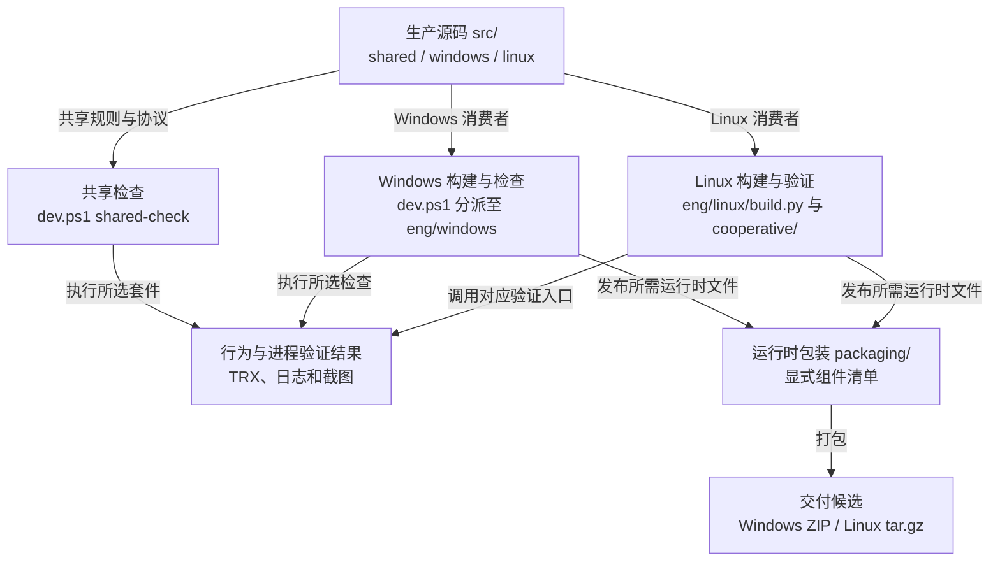

# 开发工作流与构建入口

先确认变更影响哪个产品边界，再选择构建和验证入口。本页提供共享工作流程；[Windows 开发](../platforms/windows/development.md)和 [Linux 开发](../platforms/linux/development.md)分别维护平台环境与命令。

## 工程入口与交付物

`src/` 提供生产实现，`eng/` 组织检查和构建，`packaging/` 提供运行时包装。测试消费生产边界，发行包使用显式运行时清单。



图中连线表示命令职责与产物关系，不表示每次变更都运行全部任务。包生成只产生候选，后续验证仍需说明实际覆盖范围。

| 当前任务 | 从哪里开始 |
| --- | --- |
| 理解模块、进程或数据流。 | [系统架构](architecture.md)。修改会话或模型时，继续读[会话合同](session-runtime.md)或[模型运行架构](model-runtime.md)。 |
| 修改并验证共享逻辑。 | 本页[共享检查](#运行共享检查)与[测试策略](testing.md)。 |
| 构建、诊断或检查平台交付物。 | [Windows 开发](../platforms/windows/development.md)或 [Linux 开发](../platforms/linux/development.md)。 |
| 根据已有质量假设采集模型输出。 | [翻译质量采集与评审](translation-quality.md)。普通开发检查不启动这类采集。 |
| 接手已有 ticket。 | 对应的 GitHub issue；操作见[任务跟踪约定](../agents/issue-tracker.md)。 |

## 确认范围与完成条件

工作以 `hitl` 为集成分支。分支、推送和发布权限遵循根 [AGENTS.md](../../AGENTS.md)，堆叠 PR 的操作见[任务跟踪约定](../agents/issue-tracker.md)。接手 ticket 时，读取对应 GitHub issue 的要求、依赖和讨论。

改代码前，读 [GLOSSARY.md](../../GLOSSARY.md) 和[工程架构](architecture.md)，确定模块归属。布局、项目依赖或打包变更还需遵循 [ADR-0001](../adr/0001-workspace-and-delivery.md)。产品行为以[产品验收基线](../product/README.md)为准，工程整理不授权改变规格。

用[实际价值判断](testing.md#实际价值判断)说明要解决的用户问题，再按[测试协议](testing.md)选择可观察边界。在 spec 或 ticket 中明确必过检查和允许保留的历史失败例外。完成条件应说清需要看到的行为、保留的安全拒绝，以及环境不足时哪些结果仍未验证。

## 运行共享检查

共享检查需要 PowerShell 7.2 及以上、[global.json](../../global.json) 固定的 .NET SDK，以及 Python。先在工程 Python 环境中安装共享检查依赖，再从仓库根目录执行入口：

```sh
python -m pip install -r eng/requirements.txt -r tests/shared/requirements.txt
pwsh -File ./dev.ps1 shared-check
```

该入口执行 Core、Runtime、Protocol、Windows.Contracts 的 .NET 回归，以及共享 Python 套件。`test_ci_artifacts.py` 在其中读取真实 `check.yml`，为各上传步骤和矩阵分组创建本地合成证据，核对必需文件、载荷排除、生产归属和安装包开关。该回归不启动桌面或模型，也不传输工件。

`test_linux_ci_coverage.py` 核对默认发现范围内的 Linux 测试模块。新增模块须在 `check.yml` 中通过标准 `unittest discover` 按文件执行，确保没有 `unittest.main()` 的模块也会运行。检查只认现有的成功路径条件和顺序执行命令，禁用步骤及无法解释的条件不能计为覆盖。仅供独立私有会话运行的模块，在该回归的 `PRIVATE_SESSION_ONLY` 中注明原因；当前没有例外。检查只读取文件路径和工作流，不导入 Linux 测试。`Linux / contracts` 执行 discovery 入口的无显示回归，完整私有桌面验收仍使用独立入口。

一个套件失败后，其余套件继续执行；入口在全部套件结束后返回失败。它使用 locked restore，不需要 Windows SDK、桌面或翻译模型。Windows.Contracts 虽可跨平台执行，仍属于 Windows 的契约。

修改 Python 代码时，先按平台开发说明创建工程 Python 虚拟环境并安装固定工具。激活该环境后，检查格式与 lint：

```sh
python -m ruff check .
python -m ruff format --check --diff .
```

根目录 Ruff 命令也检查 `.agents/skills/verify-typelay/scripts/` 下的 Python 脚本。新增脚本无需登记。共享检查会核对这些脚本是否进入 Ruff 的文件发现范围。

定位问题时，可以直接运行受影响的 .NET 项目或 Python 套件。例如：

```sh
dotnet test tests/shared/TypeLay.Runtime.Tests -c Release -p:RestoreLockedMode=true
PYTHONPATH=src/shared/TypeLay.Worker python -m unittest discover -s tests/shared/worker -v
```

上面的环境变量写法适用于 POSIX shell。在 PowerShell 中，先设置 `$env:PYTHONPATH = 'src/shared/TypeLay.Worker'`。修复验证通过后，再运行受影响的邻近行为和工作区检查。

## 按变更补充平台验证

按实际消费者选择验证，不按文件所在机器推断覆盖范围。

| 变更影响 | 接下来执行的验证 |
| --- | --- |
| 共享会话、控制器或协议 | 先执行共享回归。若平台消费者行为变化，再执行对应平台场景。 |
| 平台宿主、输入、浮层或设置 | 按平台开发说明执行构建与相关真实进程、桌面场景。 |
| 项目引用或显式链接源码 | 构建所有受影响消费者，包括手列 `Compile Include/Link` 的 fixture。 |
| 启动路径、资源或部署清单 | 验证搬迁后的实际发行包，不能只运行源码目录中的入口。 |
| 文档、注释或无消费者文件清理 | 核对差异、现役引用和目录归属。仅此类变更无需模型、桌面或发布包重建。 |

根 [dev.ps1](../../dev.ps1) 将 `shared-check` 交给 [eng/shared/check.ps1](../../eng/shared/check.ps1)，其余任务交给 Windows 入口。Linux 使用 [eng/linux/build.py](../../eng/linux/build.py) 和 [eng/linux/cooperative/](../../eng/linux/cooperative/)。CI 复用这些入口；修改构建语义时应修改对应入口。

## 更新依赖与保存产物

NuGet 依赖版本统一写入 [Directory.Packages.props](../../Directory.Packages.props)。用 `dotnet restore` 更新受影响的 `packages.lock.json`，再用 locked mode 验证；锁文件由工具生成。

Python 开发工具进入 [eng/requirements.txt](../../eng/requirements.txt)。仅共享回归使用的解析依赖进入 [tests/shared/requirements.txt](../../tests/shared/requirements.txt)，避免改变固定字体的构建键。模型运行依赖进入 [worker requirements.txt](../../src/shared/TypeLay.Worker/requirements.txt)，并与两端安装器的实际安装声明一致。依赖变更还需验证对应安装或分发路径。

构建输出、发行包、TRX、日志和截图进入被忽略的 `artifacts/`；.NET 中间结果留在各项目的 `bin/`、`obj/`。使用合成测试文本，避免将用户数据带入产物。

## 判断 CI 实际检查了什么

每次向工作分支或 `hitl` 推送，[check.yml](../../.github/workflows/check.yml) 都会对推送的提交执行完整检查。`main`、`trunk` 不触发该工作流。

以 `hitl` 为目标的 PR 打开、重新打开、更新 head，或从其他 base 改投 `hitl` 时，[pr-candidate.yml](../../.github/workflows/pr-candidate.yml) 合并事件中的 base 和 head，在检出的源码树执行 `./dev.ps1 shared-check`。只改标题或正文时，该 job 跳过。两端有冲突时，GitHub 可能不创建 `pull_request` 运行。该组合仍待验证；已启动的组合检查遇到冲突会失败。

`hitl` 收到 push 后，[hitl-candidates.yml](../../.github/workflows/hitl-candidates.yml) 枚举仍以它为目标的开放 PR。枚举 job 在每个 head 发布 `hitl shared / <完整 base SHA>` 等待状态，链接指向该次运行。每个 PR 用新 base 和自己的 head 运行相同的共享检查。独立的报告 job 将最终状态写回同一组合。枚举失败或结果发布失败时，Actions 显示错误；缺少当前组合的有效结果时按待验证处理。

**审查当前组合。** 在 PR 的 Checks 中打开与当前 base SHA 对应的详情。以下命令直接读取远端 `hitl` 和 PR head，列出该 head 的 PR 运行和当前 base 对应的 push 状态链接。把 `72` 换成实际 PR 编号。

```bash
set -euo pipefail
pr=72
base=$(gh api 'repos/{owner}/{repo}/git/ref/heads/hitl' --jq .object.sha)
head=$(gh api "repos/{owner}/{repo}/pulls/$pr" --jq 'select(.state == "open" and .base.ref == "hitl") | .head.sha')
test -n "$head"
printf 'PR #%s  head=%s  hitl=%s\n' "$pr" "$head" "$base"
gh api --paginate "repos/{owner}/{repo}/actions/runs?event=pull_request&head_sha=$head&per_page=100" \
  --jq '.workflow_runs[] | select(.path == ".github/workflows/pr-candidate.yml") | [.display_title, .html_url] | @tsv'
gh api --paginate "repos/{owner}/{repo}/commits/$head/statuses?per_page=100" \
  | jq -r --arg context "hitl shared / $base" '.[] | select(.context == $context) | [.state, .target_url] | @tsv'
```

1. 打开链接，在对应 PR 的共享 job 日志核对完整 head、base、实际检出的提交、tree 和共享检查的退出结果。运行摘要也记录这些源码身份及工作流的引用和提交。在已取得两个父提交的本地仓库，用 `git merge-tree --write-tree "$base" "$head"` 复核 tree。
2. 在该次 Actions 运行打开 **Workflow file**，核对事件、工作流文件和版本。PR 事件使用候选合并提交中的工作流；push 事件应来自上述 `hitl` 提交的 `hitl-candidates.yml`，并调用同一版本的 `pr-candidate.yml`。对于 push 状态，还须确认该 PR 的报告 job 已发布这一对 SHA 的结果。同名检查、PR 总览或状态发布者本身都不足以确认这些事实。
3. 对照当前 base 审查 PR 的改动。若 PR 修改工作流、`dev.ps1 shared-check` 的入口、依赖、测试发现或断言，先核对具体差异，再确认日志实际运行了预期检查。在审清前，该组合仍待验证。只有当前两端匹配、来源可核实且共享检查实际成功时，才可将组合记为通过。提交合并前重新读取两个 SHA；任何一端已变更都需查看新组合。完整 push 的结果另行验收。

以其他工作分支为 base 的堆叠 PR 仍按 push 检查审查。重新读取远端 head 和紧邻 base，确认 head 已包含该 base。同步栈并推送新 head 后，核对本次 push 的检查与源码 artifact。

核对提交时，分别记录以下身份：

| 身份 | 核对内容 |
| --- | --- |
| PR head 和 base | GitHub 当前的源分支提交和目标分支提交。旧 head 的成功不属于最新 head。 |
| 实际被测提交 `tested_commit` | 运行实际检出的提交。审查 PR 时，push 记录须与 head 相同。组合检查记录的是以 base 和 head 为双亲的实际检出提交。 |
| tree | 用 `git rev-parse '<提交>^{tree}'` 核对源码树。tree 相同只能说明源码内容相同，不能证明某次检查实际执行。 |
| 最终 `hitl` 提交 | 合入后的集成提交。最终综合验收须来自同一实际集成提交，不能拼接各层的旧结果。 |

完整 push 检查使用以下固定名称。矩阵展开后共 19 个 job，各组保留现役测试命令、断言和产品期限。工作流没有按事件添加前缀，自动 push 与手动取证使用相同 job 名称。保护配置仍须核对最终候选的实际 check name 和来源 app。

| 检查名 | 执行范围 |
| --- | --- |
| `fonts`、`fcitx-build` | 按输入哈希准备跨分支固定产物。 |
| `shared` | Python lint、格式、Linux 输入反馈、宿主离线隔离、共享 .NET 和 worker 回归。 |
| `Windows contracts / 1`、`Windows contracts / 2`、`Windows contracts / 3`、`Windows contracts / 4` | 完整 Windows solution 测试。前三片分配耗时较长的 App 类，第四片自动接收其余类和项目。两项归档正文超时测试仅在第二片执行；物理 Tab 交接包消费同片的原合同结果。每片单独保存 TRX 和失败摘要。 |
| `windows-tools` | 构建、格式、worker 与受控 native adapter。 |
| `Windows desktop / ordinary` | continuous 与 Notepad。启动 Notepad 前核验本组 continuous 的退出，末尾核验两个消费者的退出。 |
| `Windows desktop / hy` | 在自己的 runner 执行 continuous，核验该消费者退出后，再执行 Hy。 |
| `Index / windows` | 一次构建实际发行包，依次执行正式 Index 生命周期和默认 Index 浏览器。两份结果保留同一 ZIP、原生载荷和共同文件摘要。 |
| `Index / linux` | 正式 Index 安装、真实宿主推理及包生命周期。 |
| `Linux / contracts` | 合同、无模型界面与发行包验证。 |
| `Linux / browser` | 合作浏览器与编辑器。 |
| `Linux / settings` | 设置、教程与 Hy 生命周期。 |
| `Linux / native` | 原始 Fcitx 客户端探针、core 合作事务、Qt probe、完整桌面包搬迁和普通 GIMP。 |
| `Linux / native-gtk` | 本组 core 合作事务、GTK3 术语会话和 GTK 桌面。 |
| `Linux / native-gtk4` | 本组 core 合作事务、GTK4 术语会话和 GTK4 桌面。 |
| `Linux / native-qt` | 本组 core 合作事务、Qt probe 和 Qt 桌面。 |

每轮最多有 19 个 job，字体准备后最多并行 18 个，低于免费 runner 的 20 个并发上限。不同 runner 不共享桌面、模型安装代或消费者进程。每个 Windows 桌面组各自完成正式 Argos 安装与 continuous。Hy 只消费自己 runner 中该次调用的安装和内核退出证明；普通组校验自己 runner 中 continuous 与 Notepad 的原始退出证明。Index 生命周期和浏览器各自执行正式准备，并保留本次安装代和退出证明。同一包不表示同一安装代，也不授予其它 runner 通过资格。完整 solution 构建留在合同与工具组，桌面组只构建它实际消费的 fixture。job 内独立检查在失败后继续，依赖失败的场景保持 skipped。Actions 原始 step 和 job 状态就是结果；失败、取消和 skipped 都不能表述为通过。当前没有负责人批准的历史失败例外。以后获批的例外仍须放在独立非必需 job，保留真实失败。

结果 artifact 的名称或内含源码记录带有 SHA、run ID 和 attempt。`artifacts/ci/source.json` 记录实际 `git rev-parse HEAD`。push 测试的是 head，不是 GitHub 临时合并提交。墙钟时间统一按 `max(必过 job.completed_at) - run.created_at` 计算，包含排队、准备和诊断上传。

Linux / native 与 Linux / native-qt 的 `qt-language-options` 步骤独立记录语言搜索。完整 Qt probe 成功时复用其中已经完成的语言场景证据；probe 失败时，在新目录复验并复用本次生产二进制，重建 fixture 后运行语言入口，保留原异步资格结果。两者均为必过步骤。搜索日志、状态和截图另存带有分组名称的 `typelay-linux-qt-language-options-*` artifact，Qt 桌面日志和 JSON 另存 `typelay-linux-qt-desktop-events-*`。具体命令与证据边界见 [Qt 功能地图](../../.agents/skills/verify-typelay/features/qt.md)。

GTK3 桌面的源码与包身份、日志、JSON 和截图另存 `typelay-linux-gtk3-desktop-events-*`，成功或失败均保留。该小型工件直接收集原 `gtk-desktop` 步骤的结果，不重新执行场景。语言续显的焦点与期限判据见 [GTK3 语言菜单](../../.agents/skills/verify-typelay/features/settings.md#driving-it-with-private-niri)。

GTK4 的术语 probe 和完整桌面诊断另存 `typelay-linux-gtk4-events-*`，成功或失败均收集既有结果。该工件仅包含源码与构建身份、术语 probe 和 `gtk4-desktop` 的顶层 JSON、日志与截图，另保留术语会话的顶层状态与清理日志。续租和接受失败的判据见 [GTK4 功能地图](../../.agents/skills/verify-typelay/features/settings.md#driving-it-with-private-niri)。

### 固定产物的复用与更新

[fixed.py](../../eng/ci/fixed.py) 将固定构建保存为 GitHub prerelease。tag 为 `ci-fonts-<SHA256>`、`ci-fcitx-<SHA256>`、`ci-hy-<SHA256>`、`ci-index-<SHA256>` 或 `ci-linux-tools-<SHA256>`，所有分支都能读取。字体的输入包含生成器、字体锁和固定工具版本。`ci-fcitx` 只保存第三方 Fcitx、LibIME、中文附加组件及对应的固定源码和数据。它的键包含 [third_party.py](../../eng/linux/cooperative/third_party.py) 中的源码和数据校验值、第三方补丁、构建配方及 [Arch 快照日期](../../eng/ci/arch-snapshot)。TypeLay 自身的 GTK4、Qt6 和公共头文件不进入第三方键。

Linux 的原始 pacman 包也通过 release 复用，键只包含快照日期和工具安装配方。现有生产者在新键首次运行时准备全部 SDK 与桌面软件包，消费者每轮仍执行原有完整包列表、签名与依赖校验，不复用已安装的系统目录。Python 和 GitHub CLI 从固定仓库引导后，才读取该原始包缓存。

Linux 生产者和消费 runner 都将 pacman 仓库固定到该日期，并用 `-Syyuu` 同步全部已安装软件包，包含滚动容器中较新的包的降级。GTK4 和 Qt 的目标 ABI 包仍保留原 SHA-256 校验。普通上游更新不改变工具链；升级时主动修改快照日期，并在 Actions 验证依赖、目标 ABI 和完整场景。修改第三方源码 pin、数据、补丁或构建配方也会生成新键。普通 TypeLay 原生源码改动仍须满足 10 分钟。

判定新键首建时，以本轮 Check 运行摘要中各固定键的状态为准。摘要中的 `fonts` 生产者列出字体，`fcitx-build` 列出 `linux-tools`、`hy`、`index` 和 `fcitx`。在这两个 job 的日志中按完整 tag 查找 `release` 事件。命中时可核对 `ready` 记录及跳过的构建和发布步骤。冷建时可核对 `missing` 记录、准备或构建步骤，以及发布步骤中的 `publish/complete` 或 `Reused verified fixed build` 记录。生产者先遇到未命中，完成准备后才发现其他生产者已发布同一键，这一轮仍计为冷建。状态未知时，按摘要列出的已知阶段查看相应步骤。

PR 按 `W = max(必过 job 的完成时间) - run.created_at` 报告每次运行的完整耗时，并单列该轮检查结论。五个键全部命中时，W 须在 600 秒以内。新键首建可以超过 600 秒，PR 须同时记录触发键变化的输入。失败或未知状态不能单独作为首建依据。

输入没有变化时，CI 下载已有产物；输入变化或产物不存在时，CI 自动构建并发布新 tag。不同分支的生产者可同时执行，不共享 job 并发组。同一分支的新 head 仍会取消旧运行。`fcitx-build` 同时负责第三方原生依赖、Hy 和 Index 固定下载，命中时只查询，不重新下载或构建。

生产者在打包前再次查询输入哈希 tag。已有公开产物时，生产者下载并核对 asset SHA-256 后复用。尚无产物时，每个生产者创建自己独占的临时 draft，上传并核对 asset SHA-256，再将完整 release 原子发布到输入哈希 tag。首次发布竞争时，胜出产物保持不变；竞争方下载并校验胜出产物后复用。成功发布不会留下临时 tag。上传失败或发布被明确拒绝时，生产者删除自己的 draft。发布响应丢失时，生产者保留 release 并明确失败，避免删除已公开的产物。进程被强制终止时可能留下私有 draft，后续生产者使用独立 draft，不依赖它完成。

消费 runner 同时准备桌面环境与当前应用，在使用固定字节前才等待发布。`restore --wait-for-job` 默认最多等待 1800 秒，可用 `--wait-seconds` 指定正数秒数。该上限容纳已有 17 分钟冷构建，固定产物命中时的完整检查仍须满足 T16 的 600 秒门槛。生产者失败、取消或缺失时，消费者明确失败；生产者结束后会再查询一次，避免漏掉刚公开的产物。权限错误、产物不完整和校验失败均不作为缓存未命中。只有两个生产者 job 需要 `contents: write`，其余 job 只读。该机制不依赖默认分支缓存，不修改仓库设置。

消费者按 release 元数据中的 asset ID 下载到临时文件。遇到短暂的连接中断、HTTP/2 协议错误或 HTTP 5xx 时，消费者在 1 秒和 2 秒后分别重试一次，每次从头下载。三次尝试共用 600 秒预算，以便传输 Hy 和 Index 等大型归档。完整命中运行仍须在 600 秒内结束。TLS 握手失败时，只有 curl 明确报告接收连接被对端重置才会重试。代理或源站拒绝访问、产物缺失或 SHA-256 不符时，消费者立即失败。只有摘要匹配的归档才进入解压步骤。

排查冷发布时，用同一 tag 和 asset ID 对照生产者的 `publish` 和消费者的 `release`、`download`、`digest` 日志。每次下载都记录 UTC 起止时间。失败记录包含 curl 错误和已接收的归档字节数。`http_status` 记录源站响应码，`proxy_status` 记录代理对 CONNECT 的响应码。未收到对应响应时，该值为 `null`。

归档解压后，消费者继续校验第三方输入、已安装文件和上游源码补丁。消费 runner 每次重新编译当前提交的 TypeLay GTK/Qt 模块及接入它们的 Fcitx GTK/Qt 插件，随后执行原有生产构建记录和 ABI 校验。测试 fixture 也重新编译，全部场景重新执行。固定构建不携带 TypeLay 模块或测试成功记录，旧结果不能授予当前提交通过资格。

Hy 的键只包含生成锁中模型、许可证和运行库压缩包的固定下载记录，不包含当前产品源码记录。它复用原始下载文件，不保存安装后的模型、运行库目录或验收结果。运行 Hy 场景的 Windows runner 仍执行原有准备入口，对每个文件重新检查完整大小与哈希、提取并校验运行库，再执行模型安装和产品场景。`Index / windows` 只通过现有 `eng/windows/hy/prepare_runtime.py` 准备打包所需的 Hy CPU 运行库，不搬运 Hy 模型。该入口校验固定官方归档与运行库文件。Index 的模型和许可证也以各自锁定的下载记录为键，Linux 和 Windows 均复用原始下载，并执行原准备入口的完整校验。这些固定下载产物使用同一套 release 传输和校验规则。

普通 push 上传 TRX、JSON、日志、截图及诊断配置。原生桌面组上传证据目录中的直接文件，并显式保留 GTK4 映射前连接回归的 JSON 与 Qt 动画帧子目录，不递归上传隔离安装、模型数据和运行库。最终验收需要安装包时，在目标提交手动运行工作流，并设置 `upload_packages=true`。安装包仍在每轮构建和搬迁验证，只是平时不上载。

CI 的主 Linux 包与合作包均使用 `--compression-level 1`，减少压缩耗时；包内文件、来源校验和搬迁验收保持一致。单独运行打包入口时，默认仍使用等级 9。四个原生组各自构建当前应用与 GTK 合作模块。`native` 和 `native-qt` 还构建 Qt 模块。每组等待自己的构建结束，检查各退出状态后，才执行依赖场景。原始 Fcitx 客户端探针仍在 `native` 保留独立结果。

Fcitx runner 默认执行 core、GTK4 和 GTK3 三个现役会话。CI 用 `--scope core`、`--scope gtk3` 和 `--scope gtk4` 分配检查，每个 scope 都先执行自己的 core 会话。各 scope 都编译并记录 core 和 GTK4 fixture。只有 `all` 与 `gtk3` 编译额外的 GTK3 fixture 和原生模块，并记录 GTK3 fixture 摘要。GTK 两组分别保留对应术语会话及桌面旅程，两个 Qt 消费组分别执行完整 Qt probe。每组使用自己的生产字节、fixture 和清理证明，不跨 runner 导入成功记录。所有场景的断言、产品期限和独立失败语义保持不变。

```sh
gh workflow run check.yml --repo DingJWuyu/Typelay --ref <工作分支> -f upload_packages=true
```

手动运行也执行完整检查；它不能替代 `hitl` 上连续三次自动 push 的时限验收。模型权重只在固定下载 release 和临时 runner 中复用，不进入结果 artifact。CI 不再提供质量采集开关，显式模型研究按[翻译质量采集指南](translation-quality.md)独立执行。

## 启用与验收 hitl 合并保护

保护设置由负责人在开发流程 PR 合入 `hitl` 后另行触发。文档合入不代表保护已经生效，也不免除启用前提。启用时按以下顺序核对：

1. 按[任务跟踪约定](../agents/issue-tracker.md)核对原生依赖。对应 job 已在真实 PR 最新 head 的自动 push 上运行，spec 的必过项均须成功。残留历史失败须逐项获准，并在独立的非必需 job 中保留原始结果。批准规则见[结束条件](#结束条件)。前提未满足时保留未完成状态，不配置保护。
2. 从最终候选最新 head 的自动 push 检查中确定完整集合。将 spec 必过范围逐项对应到实际 check name 和来源 app ID，核对工作流、原始步骤 outcome 及 artifact。集合须覆盖前置生产者和全部必过分片，不能只选已经成功的消费者。工作流拆分、事件或名称变化后重新核对，不沿用旧清单或同名的任意来源。
3. 负责人触发设置后，用 GitHub 原生保护约束 `hitl`。将必需检查绑定到上一步确认的名称和 app，并要求分支与最新 base 同步。管理员也须遵守检查，不设置管理员或其它角色的绕过入口。只保护 `hitl` 不会约束以 `work/**` 为目标的上层 PR；负责人仍按相邻 base 和该层最新证据逐层审查。
4. 读取实际保护配置和有效规则，核对匹配分支、启用状态、必需检查及来源、最新 base 约束和管理员限制。使用规则集时，连同继承的规则和 bypass actor 一起核对。配置文案或一般的 `mergeable` 状态不足以证明这些约束生效。
5. 在受规则约束的 PR 上观察管理员的原生合并判定。分别验证必需检查失败、缺失、跳过、取消，以及最新 head 尚无结果时都阻止合并。跳过情形须覆盖前置失败导致的未执行。若任一情形仍可合并，保护验收失败；修正工作流或配置后重新验证，不能用人工审查代替原生阻断。
6. 将实际启用的检查名、来源 app、目标分支和管理员约束同步到本页，并在任务中保存配置与合并判定回执。负责人确认保护生效且验收完成后，才关闭对应 ticket。后续修改工作流或保护时，同步更新现役说明。

## 结束条件

交付前检查 `git diff`，确认只有预期变更，没有用户数据、临时脚本或生成物。删除已无现役用途的内容时，同步清理入口、引用和配置。

按[结果表述](testing.md#结果表述)报告已执行、失败和未执行的范围。必过项中的测试、lint 或打包检查失败或未执行时，任务仍未完成。允许保留的历史失败必须由负责人逐项批准，在 spec 或 ticket 中提供复现方式、影响边界、原始结果和后续 ticket；结果仍如实记录为失败，不能因建票而记为通过。例外不得覆盖必过项、新引入的回归、错误目标写入、隐私泄漏或人工稿丢失。

负责人仍须审查本地旅程与视觉证据，GitHub 检查不能代替这项审查。按[测试策略](testing.md#结果表述)核对实际范围、源码与包及模型身份、命令与退出码、字段结果、截图和清理回执。复用相同 tree 的本地结果时说明适用范围，不能将这些结果记成新 head 的原生检查成功。

任务未完成时，保留必要原件和进度。达到完成条件后删除临时文件，不另建任务归档。

推送前核对已有授权、目标分支和远端进度，遵守根 AGENTS.md 的分支规则。
