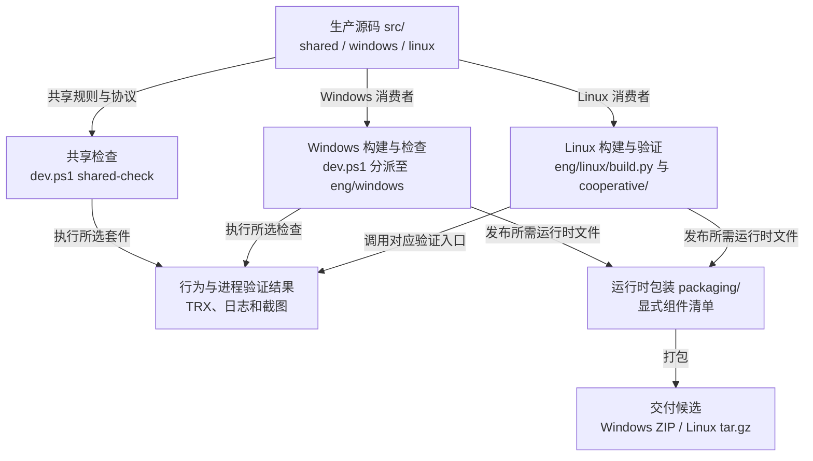

# 开发工作流与构建入口

先确认变更影响哪个产品边界，再选择构建和验证入口。本页提供共享工作流程；[Windows 开发](../platforms/windows/development.md)和 [Linux 开发](../platforms/linux/development.md)分别维护平台环境与命令。

## 工程入口与交付物

`src/` 提供生产实现，`eng/` 组织检查和构建，`packaging/` 提供运行时包装。测试消费生产边界，发行包使用显式运行时清单。



图中连线表示命令职责与产物关系，不表示每次变更都运行全部任务。包生成只产生候选，后续验证仍需说明实际覆盖范围。

| 当前任务 | 从哪里开始 |
| --- | --- |
| 理解模块、进程或数据流。 | [系统架构](architecture.md)。修改会话或模型时，继续读[会话合同](session-runtime.md)或[模型运行架构](model-runtime.md)。 |
| 修改并验证共享逻辑。 | 本页[共享检查](#运行共享检查)与[测试策略](testing.md)。 |
| 构建、诊断或检查平台交付物。 | [Windows 开发](../platforms/windows/development.md)或 [Linux 开发](../platforms/linux/development.md)。 |
| 根据已有质量假设采集模型输出。 | [翻译质量采集与评审](translation-quality.md)。普通开发检查不启动这类采集。 |
| 接手已有 ticket。 | 对应的 GitHub issue；操作见[任务跟踪约定](../agents/issue-tracker.md)。 |

## 确认范围与完成条件

工作以 `hitl` 为集成分支。分支、推送和发布权限遵循根 [AGENTS.md](../../AGENTS.md)，堆叠 PR 的操作见[任务跟踪约定](../agents/issue-tracker.md)。接手 ticket 时，读取对应 GitHub issue 的要求、依赖和讨论。

改代码前，读 [GLOSSARY.md](../../GLOSSARY.md) 和[工程架构](architecture.md)，确定模块归属。布局、项目依赖或打包变更还需遵循 [ADR-0001](../adr/0001-workspace-and-delivery.md)。产品行为以[产品验收基线](../product/README.md)为准，工程整理不授权改变规格。

用[实际价值判断](testing.md#实际价值判断)说明要解决的用户问题，再按[测试协议](testing.md)选择可观察边界。在 spec 或 ticket 中明确必过检查和允许保留的历史失败例外。完成条件应说清需要看到的行为、保留的安全拒绝，以及环境不足时哪些结果仍未验证。

## 运行共享检查

共享检查需要 PowerShell 7.2 及以上、[global.json](../../global.json) 固定的 .NET SDK，以及 Python。以下命令在仓库根目录执行：

```sh
pwsh -File ./dev.ps1 shared-check
```

该入口执行 Core、Runtime、Protocol、Windows.Contracts 的 .NET 回归，以及共享 Python 套件。一个套件失败后，其余套件继续执行；入口在全部套件结束后返回失败。它使用 locked restore，不需要 Windows SDK、桌面或翻译模型。Windows.Contracts 虽可跨平台执行，仍属于 Windows 的契约。

修改 Python 代码时，先按平台开发说明创建工程 Python 虚拟环境并安装固定工具。激活该环境后，检查格式与 lint：

```sh
python -m ruff check .
python -m ruff format --check --diff .
```

定位问题时，可以直接运行受影响的 .NET 项目或 Python 套件。例如：

```sh
dotnet test tests/shared/TypeLay.Runtime.Tests -c Release -p:RestoreLockedMode=true
PYTHONPATH=src/shared/TypeLay.Worker python -m unittest discover -s tests/shared/worker -v
```

上面的环境变量写法适用于 POSIX shell。在 PowerShell 中，先设置 `$env:PYTHONPATH = 'src/shared/TypeLay.Worker'`。修复验证通过后，再运行受影响的邻近行为和工作区检查。

## 按变更补充平台验证

按实际消费者选择验证，不按文件所在机器推断覆盖范围。

| 变更影响 | 接下来执行的验证 |
| --- | --- |
| 共享会话、控制器或协议 | 先执行共享回归。若平台消费者行为变化，再执行对应平台场景。 |
| 平台宿主、输入、浮层或设置 | 按平台开发说明执行构建与相关真实进程、桌面场景。 |
| 项目引用或显式链接源码 | 构建所有受影响消费者，包括手列 `Compile Include/Link` 的 fixture。 |
| 启动路径、资源或部署清单 | 验证搬迁后的实际发行包，不能只运行源码目录中的入口。 |
| 文档、注释或无消费者文件清理 | 核对差异、现役引用和目录归属。仅此类变更无需模型、桌面或发布包重建。 |

根 [dev.ps1](../../dev.ps1) 将 `shared-check` 交给 [eng/shared/check.ps1](../../eng/shared/check.ps1)，其余任务交给 Windows 入口。Linux 使用 [eng/linux/build.py](../../eng/linux/build.py) 和 [eng/linux/cooperative/](../../eng/linux/cooperative/)。CI 复用这些入口；修改构建语义时应修改对应入口。

## 更新依赖与保存产物

NuGet 依赖版本统一写入 [Directory.Packages.props](../../Directory.Packages.props)。用 `dotnet restore` 更新受影响的 `packages.lock.json`，再用 locked mode 验证；锁文件由工具生成。

Python 开发工具进入 [eng/requirements.txt](../../eng/requirements.txt)。模型运行依赖进入 [worker requirements.txt](../../src/shared/TypeLay.Worker/requirements.txt)，并与两端安装器的实际安装声明一致。依赖变更还需验证对应安装或分发路径。

构建输出、发行包、TRX、日志和截图进入被忽略的 `artifacts/`；.NET 中间结果留在各项目的 `bin/`、`obj/`。使用合成测试文本，避免将用户数据带入产物。

## 判断 CI 实际检查了什么

主工作流是 [check.yml](../../.github/workflows/check.yml)。每次向工作分支或 `hitl` 推送都会执行完整检查。`main`、`trunk` 不触发该工作流。仓库内 PR 直接展示 head 提交的 push 检查，避免同一提交再跑一次 PR 合并提交。堆叠 PR 的 base 变化后，需要 rebase 并推送新 head，才能取得新基底上的证据。

CI 使用以下并行分工，各组保留现役测试命令、断言和产品期限。

| Job | 执行范围 |
| --- | --- |
| `fonts`、`fcitx-build` | 按输入哈希准备跨分支固定产物。 |
| `shared` | Python lint、格式、Linux 输入反馈、宿主离线隔离、共享 .NET 和 worker 回归。 |
| `windows-contracts`，4 个分片 | 完整 Windows solution 测试。前三片分配耗时较长的 App 类，第四片自动接收其余类和项目。两项归档正文超时测试仍单独执行一次；物理 Tab 交接包消费同片的原合同结果。 |
| `windows-tools` | 构建、格式、worker 与受控 native adapter。 |
| `windows-desktop`，2 个分片 | 普通组执行 continuous、浏览器和 Notepad，保留三项退出校验。Hy 组在自己的 runner 重新执行 continuous，核验该消费者退出后，再执行 Hy。 |
| `index-windows`、`index-linux` | 正式 Index 安装、真实推理及包生命周期。 |
| `linux`，3 个分片，加 `linux-native` | 合同与无模型界面、浏览器与编辑器、合作输入与原生桌面、设置教程与 Hy 生命周期。 |

每轮最多有 16 个 job，字体准备后最多并行 15 个，低于免费 runner 的 20 个并发上限。不同 runner 不共享桌面、模型安装代或消费者进程。每个 Windows 桌面组各自完成正式 Argos 安装与 continuous。Hy 只消费自己 runner 中该次调用的安装和内核退出证明；普通组仍校验 continuous、浏览器与 Notepad 的全部原始退出证明。完整 solution 构建留在合同与工具组，桌面组只构建它实际消费的 fixture。job 内独立检查在失败后继续，依赖失败的场景保持 skipped。Actions 原始 step 和 job 状态就是结果；失败、取消和 skipped 都不能表述为通过。当前没有负责人批准的历史失败例外。以后获批的例外仍须放在独立非必需 job，保留真实失败。

各结果 artifact 都带 SHA、run ID 和 attempt。`artifacts/ci/source.json` 记录实际 `git rev-parse HEAD`。push 测试的是 head，不是 GitHub 临时合并提交。墙钟时间统一按 `max(必过 job.completed_at) - run.created_at` 计算，包含排队、准备和诊断上传。

### 固定产物的复用与更新

[fixed.py](../../eng/ci/fixed.py) 将固定构建保存为 GitHub prerelease。tag 为 `ci-fonts-<SHA256>` 或 `ci-fcitx-<SHA256>`，所有分支都能读取。字体的输入包含生成器、字体锁和固定工具版本。`ci-fcitx` 只保存第三方 Fcitx、LibIME、中文附加组件及对应的固定源码和数据。它的键包含 [third_party.py](../../eng/linux/cooperative/third_party.py) 中的源码和数据校验值、第三方补丁、构建配方及 [Arch 快照日期](../../eng/ci/arch-snapshot)。TypeLay 自身的 GTK4、Qt6 和公共头文件不进入第三方键。

Linux 生产者和消费 runner 都将 pacman 仓库固定到该日期，并用 `-Syyuu` 同步全部已安装软件包，包含滚动容器中较新的包的降级。GTK4 和 Qt 的目标 ABI 包仍保留原 SHA-256 校验。普通上游更新不改变工具链；升级时主动修改快照日期，并在 Actions 验证依赖、目标 ABI 和完整场景。修改第三方源码 pin、数据、补丁或构建配方也会生成新键。新键第一次构建可以超过 10 分钟，PR 应记录触发变更和完整耗时；普通 TypeLay 原生源码改动仍须满足 10 分钟。

输入没有变化时，CI 下载已有产物；输入变化或产物不存在时，CI 自动构建并发布新 tag。写入 job 按产物类型串行，避免分支同时重复构建。原生生产者只构建第三方依赖。消费 runner 同时准备桌面环境与当前应用，在使用固定字节前才等待发布；生产者失败会使等待明确失败。发布先创建 draft，上传完成后才公开。只有这两个 job 需要 `contents: write`，其余 job 只读。该机制不依赖默认分支缓存，不修改仓库设置。

下载时先核对 GitHub asset SHA-256，再校验第三方输入、已安装文件和上游源码补丁。消费 runner 每次重新编译当前提交的 TypeLay GTK/Qt 模块及接入它们的 Fcitx GTK/Qt 插件，随后执行原有生产构建记录和 ABI 校验。测试 fixture 也重新编译，全部场景重新执行。固定构建不携带 TypeLay 模块或测试成功记录，旧结果不能授予当前提交通过资格。

普通 push 只上传 TRX、JSON、日志和截图。最终验收需要安装包时，在目标提交手动运行工作流，并设置 `upload_packages=true`。安装包仍在每轮构建和搬迁验证，只是平时不上载。

CI 的合作包使用 `--compression-level 1`，减少压缩耗时；包内文件、来源校验和搬迁验收保持一致。单独运行打包入口时，默认仍使用等级 9。

```sh
gh workflow run check.yml --repo DingJWuyu/Typelay --ref <工作分支> -f upload_packages=true
```

手动运行也执行完整检查；它不能替代两次自动 push 的时限验收。模型权重只留在临时 runner，不进入结果 artifact。CI 不再提供质量采集开关，显式模型研究按[翻译质量采集指南](translation-quality.md)独立执行。

## 结束条件

交付前检查 `git diff`，确认只有预期变更，没有用户数据、临时脚本或生成物。删除已无现役用途的内容时，同步清理入口、引用和配置。

按[结果表述](testing.md#结果表述)报告已执行、失败和未执行的范围。必过项中的测试、lint 或打包检查失败或未执行时，任务仍未完成。允许保留的历史失败必须由负责人逐项批准，在 spec 或 ticket 中提供复现方式、影响边界、原始结果和后续 ticket；结果仍如实记录为失败，不能因建票而记为通过。例外不得覆盖必过项、新引入的回归、错误目标写入、隐私泄漏或人工稿丢失。

任务未完成时，保留必要原件和进度。达到完成条件后删除临时文件，不另建任务归档。

推送前核对已有授权、目标分支和远端进度，遵守根 AGENTS.md 的分支规则。
