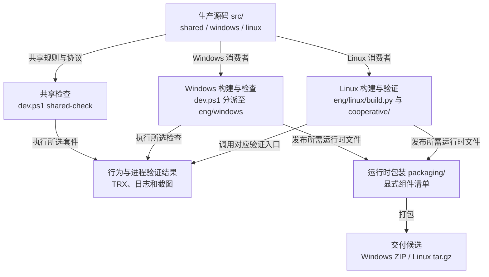

# 开发工作流与构建入口

先确认变更影响哪个产品边界，再选择构建和验证入口。本页提供共享工作流程；[Windows 开发](../platforms/windows/development.md)和 [Linux 开发](../platforms/linux/development.md)分别维护平台环境与命令。

## 工程入口与交付物

`src/` 提供生产实现，`eng/` 组织检查和构建，`packaging/` 提供运行时包装。测试消费生产边界，发行包使用显式运行时清单。



图中连线表示命令职责与产物关系，不表示每次变更都运行全部任务。包生成只产生候选，后续验证仍需说明实际覆盖范围。

| 当前任务 | 从哪里开始 |
| --- | --- |
| 理解模块、进程或数据流。 | [系统架构](architecture.md)。修改会话或模型时，继续读[会话合同](session-runtime.md)或[模型运行架构](model-runtime.md)。 |
| 修改并验证共享逻辑。 | 本页[共享检查](#运行共享检查)与[测试策略](testing.md)。 |
| 构建、诊断或检查平台交付物。 | [Windows 开发](../platforms/windows/development.md)或 [Linux 开发](../platforms/linux/development.md)。 |
| 根据已有质量假设采集模型输出。 | [翻译质量采集与评审](translation-quality.md)。普通开发检查不启动这类采集。 |
| 接手已有 ticket。 | 对应的 GitHub issue；操作见[任务跟踪约定](../agents/issue-tracker.md)。 |

## 确认范围与完成条件

工作以 `hitl` 为集成分支。分支、推送和发布权限遵循根 [AGENTS.md](../../AGENTS.md)，堆叠 PR 的操作见[任务跟踪约定](../agents/issue-tracker.md)。接手 ticket 时，读取对应 GitHub issue 的要求、依赖和讨论。

改代码前，读 [GLOSSARY.md](../../GLOSSARY.md) 和[工程架构](architecture.md)，确定模块归属。布局、项目依赖或打包变更还需遵循 [ADR-0001](../adr/0001-workspace-and-delivery.md)。产品行为以[产品验收基线](../product/README.md)为准，工程整理不授权改变规格。

用[实际价值判断](testing.md#实际价值判断)说明要解决的用户问题，再按[测试协议](testing.md)选择可观察边界。在 spec 或 ticket 中明确必过检查和允许保留的历史失败例外。完成条件应说清需要看到的行为、保留的安全拒绝，以及环境不足时哪些结果仍未验证。

## 运行共享检查

共享检查需要 PowerShell 7.2 及以上、[global.json](../../global.json) 固定的 .NET SDK，以及 Python。以下命令在仓库根目录执行：

```sh
pwsh -File ./dev.ps1 shared-check
```

该入口执行 Core、Runtime、Protocol、Windows.Contracts 的 .NET 回归，以及共享 Python 套件。一个套件失败后，其余套件继续执行；入口在全部套件结束后返回失败。它使用 locked restore，不需要 Windows SDK、桌面或翻译模型。Windows.Contracts 虽可跨平台执行，仍属于 Windows 的契约。

修改 Python 代码时，先按平台开发说明创建工程 Python 虚拟环境并安装固定工具。激活该环境后，检查格式与 lint：

```sh
python -m ruff check .
python -m ruff format --check --diff .
```

定位问题时，可以直接运行受影响的 .NET 项目或 Python 套件。例如：

```sh
dotnet test tests/shared/TypeLay.Runtime.Tests -c Release -p:RestoreLockedMode=true
PYTHONPATH=src/shared/TypeLay.Worker python -m unittest discover -s tests/shared/worker -v
```

上面的环境变量写法适用于 POSIX shell。在 PowerShell 中，先设置 `$env:PYTHONPATH = 'src/shared/TypeLay.Worker'`。修复验证通过后，再运行受影响的邻近行为和工作区检查。

## 按变更补充平台验证

按实际消费者选择验证，不按文件所在机器推断覆盖范围。

| 变更影响 | 接下来执行的验证 |
| --- | --- |
| 共享会话、控制器或协议 | 先执行共享回归。若平台消费者行为变化，再执行对应平台场景。 |
| 平台宿主、输入、浮层或设置 | 按平台开发说明执行构建与相关真实进程、桌面场景。 |
| 项目引用或显式链接源码 | 构建所有受影响消费者，包括手列 `Compile Include/Link` 的 fixture。 |
| 启动路径、资源或部署清单 | 验证搬迁后的实际发行包，不能只运行源码目录中的入口。 |
| 文档、注释或无消费者文件清理 | 核对差异、现役引用和目录归属。仅此类变更无需模型、桌面或发布包重建。 |

根 [dev.ps1](../../dev.ps1) 将 `shared-check` 交给 [eng/shared/check.ps1](../../eng/shared/check.ps1)，其余任务交给 Windows 入口。Linux 使用 [eng/linux/build.py](../../eng/linux/build.py) 和 [eng/linux/cooperative/](../../eng/linux/cooperative/)。CI 复用这些入口；修改构建语义时应修改对应入口。

## 更新依赖与保存产物

NuGet 依赖版本统一写入 [Directory.Packages.props](../../Directory.Packages.props)。用 `dotnet restore` 更新受影响的 `packages.lock.json`，再用 locked mode 验证；锁文件由工具生成。

Python 开发工具进入 [eng/requirements.txt](../../eng/requirements.txt)。模型运行依赖进入 [worker requirements.txt](../../src/shared/TypeLay.Worker/requirements.txt)，并与两端安装器的实际安装声明一致。依赖变更还需验证对应安装或分发路径。

构建输出、发行包、TRX、日志和截图进入被忽略的 `artifacts/`；.NET 中间结果留在各项目的 `bin/`、`obj/`。使用合成测试文本，避免将用户数据带入产物。

## 判断 CI 实际检查了什么

主工作流是 [check.yml](../../.github/workflows/check.yml)。它自动检查所有目标分支的 PR，包括指向 `hitl` 的 PR 和指向下层工作分支的堆叠 PR。PR 创建、更新提交、重新打开或转为待审时都会触发。标题、正文或目标分支编辑不触发工作流，避免产生同名的 skipped 检查。`hitl`、`trunk` 和 `work/**` 的 push 也会触发。触发器不授予修改分支的权限。

堆叠 PR 调整目标分支后，按[任务跟踪约定](../agents/issue-tracker.md#stacked-prs)同步栈。rebase 后推送新 head 会通过 `synchronize` 产生新证据。只改 base 而未更新 head 时，没有新的被测合并提交证据；审查仍须核对 artifact 中的 base 和 `tested_commit`。

[ci_scope.py](../../eng/shared/ci_scope.py) 根据事件和提交证据选择检查范围。PR 和 `hitl` push 始终保留共享、Windows 和 Linux 检查。PR 使用 Actions 默认检出的测试合并提交。每次运行的 Summary 和 `typelay-ci-source-*` artifact 记录事件、PR head、base、实际被测提交、run ID 和 attempt。审查时核对这三个提交身份，不把 PR head 当作测试合并提交。

工作流触发后，检查范围由现役选择器确定。完整检查覆盖共享、Windows 和 Linux；符合条件的工作分支 push 可以按本次 push 触及的全部路径缩减平台范围。选择器会计入撤销、重命名和合并父提交；提交身份不完整、未知或共享路径、跨平台变更和空变更会保留双端检查。

查看结果时，区分以下情形：

- 仅文档的有效工作分支 push 只运行共享检查；只涉及单个平台的变更保留共享与该平台检查。共享测试修改也保留双端检查。
- `index-windows` 和 `index-linux` 独立检查正式 Index 安装器与宿主生命周期。它们不替代既有输入、Hy 或 GUI 检查；`quality-only` 也不执行这些 Index job。
- `quality-only` 必须同时显式选择质量采集。它用于固定响应采集，不构成产品验收。只有执行这类任务时才读[翻译质量采集指南](translation-quality.md#linux-模型包生命周期中的显式质量采集)。

共享、Windows、Linux 和两端 Index job 各自运行，不等待其它平台检查通过。选择器成功后，源码证据上传失败仍保留为失败，但不阻断已选定的平台 job。job 内的独立检查也继续执行。例如，Python lint 失败不阻断共享行为检查；Linux 主包构建失败不阻断 HTTP 下载和 VS Code 事务检查。需要实际包、模型或前序进程退出证明的场景仍等待这些前提。Notepad 退出证明单独记录，证明失败时场景显示 `not-run`。

各 job 的 Summary 和 `artifacts/ci/<job>.json` 逐项记录 `passed`、`failed` 或 `not-run`。[ci_report.py](../../eng/shared/ci_report.py) 读取 Actions 的原始步骤 outcome；跳过、取消或缺少执行记录都记为 `not-run`。所选必过项没有全部通过时，报告步骤返回失败。报告不会把 `continue-on-error` 后的 conclusion 当作通过依据。runner 被强制终止、job 未启动或检出失败时可能无法生成报告，此时以 Actions 的失败、取消或 skipped 状态确认未完成，不能补记通过。

当前没有负责人批准的历史失败例外，全部产品检查保留在必过 job 中。获批例外须在相应变更中放入独立的非必需 job，保留原始失败结果。本工作流不配置合并保护。CI 触发与结果呈现可以独立验收；产品红项仍阻塞对应产品规格的完成。

共享 CI 还执行仓库 Python lint、格式检查和 Linux 输入反馈合同。`shared-check` 本身不包含全部 CI 步骤。选择器的行为回归已纳入共享检查，单独维护选择器时可运行 `python -m unittest discover -s tests/shared -v`。

CI artifact 按提交 SHA 命名。上传范围由工作流明确列出，避免上传整个 `artifacts/`。Index 模型只下载到临时 runner，模型文件不进入其 cache 或 artifact；CPU archive 可缓存，结果只保留结构化阶段与身份信息。日志属于实际执行的提交，不能将旧头结果写成当前头通过。

## 结束条件

交付前检查 `git diff`，确认只有预期变更，没有用户数据、临时脚本或生成物。删除已无现役用途的内容时，同步清理入口、引用和配置。

按[结果表述](testing.md#结果表述)报告已执行、失败和未执行的范围。必过项中的测试、lint 或打包检查失败或未执行时，任务仍未完成。允许保留的历史失败必须由负责人逐项批准，在 spec 或 ticket 中提供复现方式、影响边界、原始结果和后续 ticket；结果仍如实记录为失败，不能因建票而记为通过。例外不得覆盖必过项、新引入的回归、错误目标写入、隐私泄漏或人工稿丢失。

任务未完成时，保留必要原件和进度。达到完成条件后删除临时文件，不另建任务归档。

推送前核对已有授权、目标分支和远端进度，遵守根 AGENTS.md 的分支规则。
