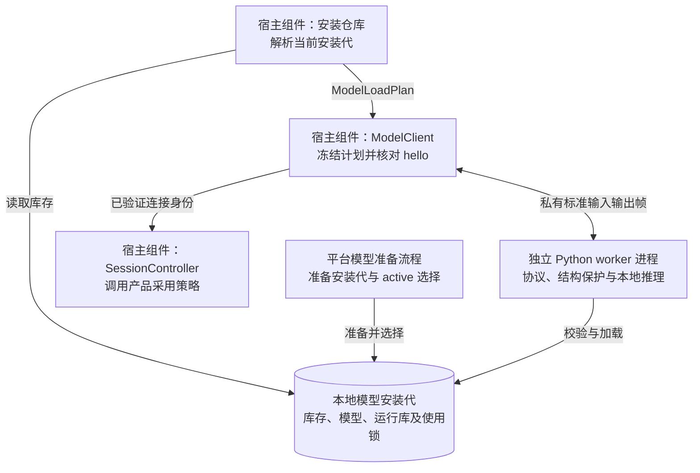

# 本地模型运行架构

本文解释模型从安装代进入可用连接的过程，以及请求、切换和退出的边界。它面向修改 worker、模型适配器或安装流程的工程师。模型准备命令见平台开发文档，质量证据的采集方法见[翻译质量采集与评审](translation-quality.md)。

## 模型能力边界

新用户明确准备模型时默认选择 Index；已有 Argos/Hy 安装与选择保留。普通翻译、安装完成、worker 握手、采集完成和语言质量通过分别判断。

[TranslationReleasePolicy.Current](../../src/shared/TypeLay.Runtime/Models/TranslationService.cs)只允许已登记固定 Index profile 的中英双向术语。风格、另述和组合质量门保持关闭，界面保存偏好不代表当前模型可以执行。Auto 的方向覆盖和精确模型身份仍按下文核对。

质量问题与待验方向由[模型质量 Issue #23](https://github.com/DingJWuyu/Typelay/issues/23)承接。文档迁移和安装成功不改变发布策略，质量采集方法见[翻译质量采集与评审](translation-quality.md)。

## 组件与数据流

平台安装器准备本地文件，`ModelClient` 负责连接及请求，Python worker 负责推理。`SessionController` 调用 `TranslationReleasePolicy` 核对产品采用资格。模型加载成功与产品允许使用高级功能分别判断。

安装仓库、ModelClient 和 SessionController 位于同一个平台 .NET 宿主。worker 进程内由 `run_worker.py` 处理协议，`LocalEngine` 保护结构并调用 Index、Argos 或 Hy 后端。模型准备由平台入口单独组织，普通翻译请求不触发下载。图中连线表示实际数据关系，进程创建与回收仍由各平台实现。

## 模型连接与本地推理

### 安装意图、加载成功和产品采用分别确认

[模型目录](../../src/shared/TypeLay.Worker/model-catalog.json)是 Runtime 与 worker 共用的包定义。目录可用方向、实际安装方向和当前加载方向是不同集合。设置保留用户语言选择，缺方向时明确提示，不暗中切包、改值或经第三种语言中转。

`ModelLoadPlan` 冻结精确路径、库存 schema 和 active 包。worker 先校验库存元数据，再完整核对 active 包的文件与哈希，随后加载模型。inactive 包不加载。实际 hello 与加载计划逐项吻合后，ModelClient 才发布 Ready 和本次连接身份。目录存在、下载完成或安装标记存在都不是加载证明。

高级操作同时需要技术能力和[产品采用资格](#模型能力边界)。Auto 必须覆盖该目标下全部可能的已选来源，不能借用一个方向的资格，也不在宿主猜测语言。

worker 严格区分普通、风格、术语、组合和另述请求。未知操作、未知字段或缺少对应能力时明确失败，不回退普通翻译。模型原生能力、单句推理、质量采集和产品质量验收各有不同证据范围。

### 切换和退出由原进程所有者证明

原生模型切换先验证候选，等待练习退休并隔离未派发请求，再撤回 Ready。ModelClient 取消旧交换，确认旧进程族退出后才启动候选。旧或新计划涉及 Hy 或 Index 时，不能并载候选来绕过退出障碍。

模型发布结果区分 `Confirmed`、`Unchanged` 和 `Unconfirmed`。恢复旧代须先确认候选已回收，并在原安装 lease 下确认指针仍是精确旧代，随后重新验证 hello。未知发布保持不可用。Argos 热替换可以保留已确认旧连接，但后续加载仍须解决同一进程所有者的退出障碍。

进程创建后的清理若未获证明，工厂返回携带所有者的 `ChildProcessCleanupUnconfirmedException`。`Dispose` 不是退出证明。Linux supervisor 通过待收子进程和自有进程组确认退出；Windows owner 通过原生根句柄与 Job 活动进程数确认退出。完整平台机制见各平台架构。

schema3 安装代的使用锁从启动前持有到退出证明。Windows 使用 `model-use.lock`，Linux 使用 `use.lock`。安装器只在安装 lease 下成功取得精确退休代的独占使用锁后清理。缺少标记或退出未确认时保留该代，并报告空间未回收。锁序保持安装 lease、lifecycle、serial。

### worker 保留结构并拒绝不完整输出

worker 在加载模型依赖前保存私有二进制输出流。协议帧和自检 JSON 只写该流，Python stdout 与原生标准输出转向宿主持续排空的 stderr。隔离失败时不加载模型。正常关闭也不恢复 stdout，避免原生清理日志污染协议。

普通文本上限为 8192 UTF-16 单元。原生后端另有 UTF-8、上下文和输出 token 限制，超限明确失败，不截断原文，也不发布部分结果。原文以 literal 内容进入模型，不能成为可信控制指令。精确请求字段及限制分别见 [worker 协议](../../src/shared/TypeLay.Worker/run_worker.py)、[Hy](../../src/shared/TypeLay.Worker/typelay_worker/hy.py)和 [Index](../../src/shared/TypeLay.Worker/typelay_worker/index.py)。

worker 保护 URL、邮箱、mention、编号、emoji 和换行。Argos 与 Hy 按受保护结构分段，Index 整篇推理后校验结构。术语匹配遵循精确有向范围、大小写和 Unicode 边界；worker 拒绝跨保护边界的修改要求。输出必须包含本次适用译法，但不会硬替换模型输出，也不承诺命中次数。匹配与结构规则见 [glossary.py](../../src/shared/TypeLay.Worker/typelay_worker/glossary.py)和 [engine.py](../../src/shared/TypeLay.Worker/typelay_worker/engine.py)。这些校验是必要条件，不能代替语义质量验收。

Hy 使用 ABI5，原十二方向与手动中英预览共用已验证权重。中英增量只通过独立 native 导出提供普通翻译，不借用原十二方向的高级能力。高级方向范围须为当前已选方向的合法子集。Hy 每段使用 1024 context、最多 192 新 token，全请求共用 60 秒期限。既有方向子集在选择或修复时保留，中英扩展需明确确认；旧二进制不能被假定能读取新库存。

Argos 另述使用独立操作，固定搜索后筛除无效输出与无实质差异的候选，不采样或重试。失败和无另述可保留旧译文，但不会恢复旧许可。真实质量要求见[测试协议](translation-quality.md#argos-另述真实质量采集)。

## Index 默认与兼容边界

可信空库存经用户确认后准备 Index。未知库存不能当成空库存。已有安装代、active 选择、语言偏好和方向子集不自动迁移；schema1/2 保留旧 Argos 中英默认。Repair 不补方向或删除旧包，Index 与 Hy 不能同时 active。

Index 使用独立的 `index-translate-2b-q4-k-m` 包与 ABI1 后端。平台 loader 校验实际 adapter、CPU 库、模型、词表、模板和导出。高级资格还要求 Host 在启动前核对 worker 源码、模型锁、平台 CPU 锁及 native 构建来源。固定 profile 由 [eng/index_profile.py](../../eng/index_profile.py)生成并经评审登记，普通构建不能自动扩大采用范围。

同代安装元数据必须记录受支持的 CPython 和 lingua 版本，平台独立核对锁文件。来源缺失或未知时，高级资格关闭。Host 在该自有子进程的严格 hello 成功后，才把 profile 绑定到 `VerifiedModelIdentity`。worker 自报字符串、旧连接和相同路径不能提供资格。

这组检查依赖受信安装器和未被改写的安装代。它不宣称逐字测量整个解释器，也不抵抗任意同用户篡改。Linux 语义评审不能代替 Windows 实际执行与完整性验证。

Index 每次请求只进行一次完整原文推理。普通请求使用 plain 模板，有风格、术语或结构要求时使用 canonical instTrans。请求不带 system，关闭 thinking 并使用 greedy；不切段推理、不增加背景、不自动重试。输入上限为 8192 UTF-8 字节，context 为 4096，最多生成 1024 token。超限或缺少允许的结束标记均失败。

输出先通过受保护 token 的拓扑、顺序、数量、字面值、换行位置及逐槽术语检查，再恢复源拥有的空白和换行。唯一 token 边界例外允许将 URL 或 mention 后的一个 ASCII 句点归回已有标点槽。它要求源槽已满足精确标点和空白条件，不补造标点或清洗任意输出。完整条件集中在 [engine.py 的 `_serialize_index_result`](../../src/shared/TypeLay.Worker/typelay_worker/engine.py)。重建后仍需复核拓扑与文本上限，布局规范不能证明模型语义正确。

Index 在 Linux 核验两核 affinity 和 2.5 GiB 硬 `RLIMIT_AS`。Windows 核验两核 affinity，宿主另施加单进程、2.5 GiB Job 限制。Job 内存与地址空间不是同一计量。加载及单请求均保留 60 秒期限，失败后由原进程所有者证明退出，不提高限额或回退其它模型。
