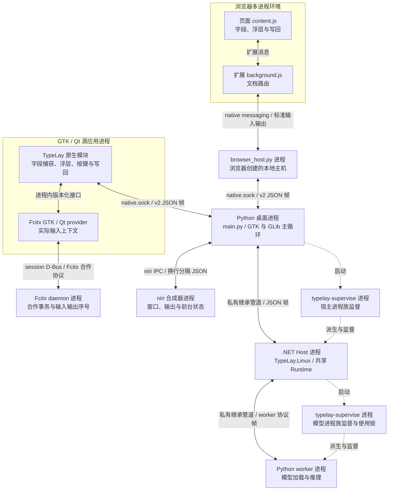
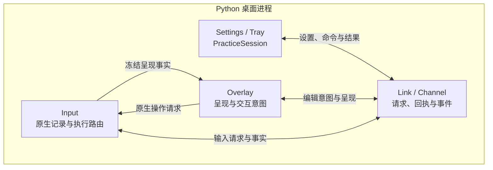
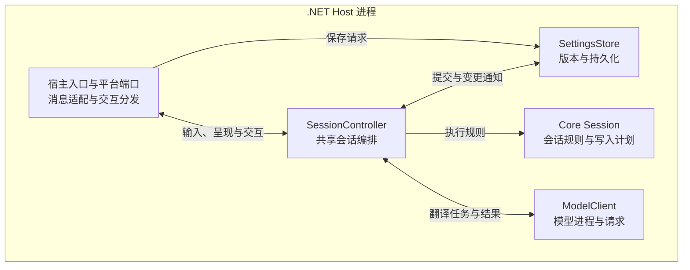
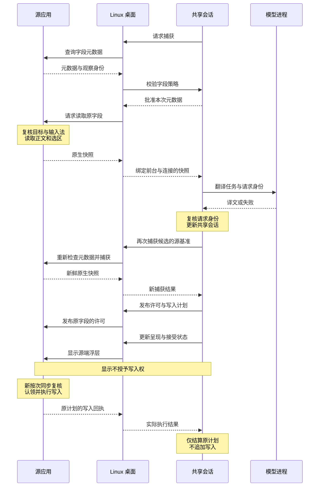
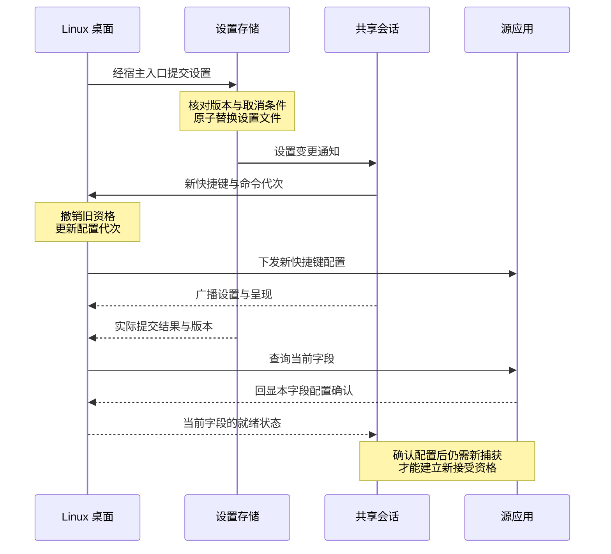

# Linux 系统架构

Linux 客户端由 Python 桌面进程、.NET 宿主和本地模型 worker 组成。源应用内的接入组件负责读取字段、显示浮层和执行写回。共享 Runtime 编排翻译会话，Linux 适配层提供字段、焦点、输入法和执行结果的证据。

本文描述进程部署、模块职责和运行时交互。共享领域规则见[共享架构](../../engineering/architecture.md)，安装与控件范围见[使用说明](README.md)，构建和验证入口见[开发指南](development.md)。

## 运行环境与宿主约束

当前目标是 CachyOS x86_64、niri 和 Wayland。桌面进程使用系统 GTK3、PyGObject 和 Ayatana AppIndicator；发行包自带 .NET 运行时。模型 worker 使用安装代内的私有 Python 与模型依赖。GTK/Qt 合作输入还需要匹配的 Fcitx 组件，固定来源由[合作构建输入](../../../eng/linux/cooperative/inputs.py)管理。

系统按 Wayland/niri 会话建立桌面实例。`Paths` 用 `WAYLAND_DISPLAY` 与 `NIRI_SOCKET` 生成会话目录身份，`desktop.lock` 串行化桌面与一次性宿主启动。niri 提供前台窗口观察，源应用提供实际字段身份。两者都有效时，Linux 才能把字段交给共享 Runtime。

Linux 浮层存在于源应用中。GTK/Qt 模块创建源窗口拥有的控件，浏览器脚本创建页面内元素。Python 桌面进程显示设置、托盘和指引，不创建覆盖所有应用的全局翻译窗口。当前实现仍依赖 niri，不能外推到任意 Wayland 合成器。

## 进程与通信

下图的框标明进程边界。GTK/Qt 框内的两个节点是同进程组件；浏览器框表示浏览器管理的多进程环境。实线表示通信，虚线表示创建和监督关系。

`native.sock`、桌面控制 socket 和继承管道使用长度前缀 JSON 帧。Python 的 [wire.py](../../../src/linux/desktop/wire.py)与 .NET 的 [DesktopLink](../../../src/linux/TypeLay.Linux/DesktopLink.cs)分别实现帧边界、请求标识、容量和断连处理。niri 使用自己的 IPC 协议；Fcitx 的事务观察通过 provider 与 daemon 之间的合作接口完成。

两类入口不经过普通字段捕获流程：

| 入口 | 路由与进程所有权 |
| --- | --- |
| 启动器命令 | `--settings`、`--wake`、`--direct` 等经会话内 `control.sock` 发给桌面进程。命令本身不授予字段能力。 |
| VS Code 手动翻译与本地试译 | VS Code 经 `typelay --editor-host` 提交显式快照，本地试译从桌面发起。桌面存在时，两者复用当前 worker。无桌面时，编辑器入口才可在 `desktop.lock` 下启动受监督的一次性宿主。锁被占用而转发失败时，请求失败，不另起模型所有者。 |

浏览器本地主机由浏览器启动，只转发消息，不启动桌面或模型。源端路由使用实际文档身份，页面不能自行选择可信 PID。VS Code 的手动替换由扩展确认文档版本后执行，具体边界见[手动命令](vscode.md)。

## 进程内组件与接口

[main.py](../../../src/linux/desktop/main.py)是 Python 装配入口，[Program.cs](../../../src/linux/TypeLay.Linux/Program.cs)是 .NET 装配入口。两个进程各有自己的串行上下文；共享 `SessionController` 只在 .NET 宿主内实例化。

以下两图分别展开进程内职责。Python 桌面进程通过 `Link` 与宿主通信，Input 与 Overlay 保持独立的记录所有权。

.NET 宿主中的入口与端口归为一组，包括 `Program`、`DesktopLink`、`DesktopInput` 和 `DesktopView`。共享会话通过这些端口使用 Linux 能力，并调用 Core、设置和模型组件。

### Input 持有原生交互记录

Python [Input](../../../src/linux/desktop/input.py)持有认证连接、字段观察、许可发布和回源记录。语言配置、编辑器交接和术语交接的原生记录也由 Input 管理。Input 结合 niri 前台状态与源端回执，向 .NET 发布 `state` 和 `notice`。

[Overlay](../../../src/linux/desktop/overlay.py)读取冻结的 `SourcePresentation`，并持有不透明的 `SourceConnection`。Overlay 通过 Input 的方法请求显示、回源或表单动作，不读取可变 peer 记录，也不修改原生操作字典。Input 每次仍以原连接和观察核验请求，冻结呈现不是输入授权。

[DesktopInput](../../../src/linux/TypeLay.Linux/DesktopInput.cs)把 Python 消息适配为共享输入端口。[DesktopView](../../../src/linux/TypeLay.Linux/DesktopView.cs)把共享呈现序列化，并将编辑和菜单意图交回 Runtime。具体操作的继续与退休条件属于共享会话操作，详见[会话运行时](../../engineering/session-runtime.md)。

### 主循环分别串行化平台与共享状态

Python 的 `Channel` 在 GLib 主循环处理 socket 与管道，异步任务沿同一桌面事件循环更新组件。niri IPC 在专用线程读取，再回到 GLib。`.NET EventLoop` 是共享会话的 `SynchronizationContext`；`DesktopLink` 在后台读写管道，把收到的消息交回 EventLoop 派发。

源应用仍是实际控件的执行者。GTK/Qt 在源 GUI 线程检查和操作控件，浏览器在文档事件线程操作 DOM 或编辑器事务。桌面进程与 .NET 宿主都不能越过源线程，直接修改控件状态。

## 捕获、预览与源端接受

普通自动会话先检查字段元数据，再读取正文。以下时序只保留四个进程角色。Linux 桌面包含 Input 与 Overlay；共享会话位于 .NET 宿主。传输适配器和浏览器本地主机的路由见进程图。

元数据请求为 `describe`，策略批准为 `allowField`，正文读取为 `capture`。新捕获沿用相同的批准步骤。Input 把原生结果适配为 `InputCapture`，将共享 `InputLease` 与 `AcceptancePermit` 发布到原字段。源端 `accepted(planId, receipt)` 由 Input 转为 `InputNotice.CompletedReceipt`，共享 `WriteSettlement` 据此结算。

Input 在捕获前后核对连接、前台、配置和字段连续性。源端在同次操作中核对控件、正文、选区、输入法及期限。任何必需事实未知时，对应读取或写入被拒绝。普通未合作 GTK 输入法保持 `Unknown`，只报告非正文元数据；空候选窗、Simple 输入法和模拟粘贴不能替代合作事务。

GTK/Qt provider 的 `inspect` 从实际输入上下文取得证明，`validate_local` 或 `validateLocal` 只能复核原证明。provider 还检查在途请求、输入输出序号和上下文寿命。接口定义见 [GTK 合作 ABI](../../../src/linux/native/fcitx5/typelay-fcitx-v1.h)与 [Qt 合作接口](../../../src/linux/native/fcitx5/typelay-fcitx-qt-v1.h)。控件准入和后台直接替换范围由 [Fcitx](fcitx.md)与 [Qt](qt.md)维护。

### 写入回执决定结算结果

普通接受在源线程同步执行。`DesktopInput.WriteAsync` 不会追加写入；已完成的源端回执经 `CompletedReceipt` 进入共享结算。一次性直接任务使用 `WriteDirectAsync`，始终绑定原字段和原计划，不转写后来聚焦的字段。

回执区分写入前拒绝、确认完成和结果未知。结果未知时，系统隔离原目标，不自动重试或回滚。Qt 设置选区可能触发应用回调；若操作在回调后失效，就不能假定应用尚未发生变化。

暂停、隐藏和关闭撤销未来资格，已派发的操作继续按原计划接收回执。`writeRetired` 仅表示执行者已确认：精确许可未被认领，且全部执行资格已经结束。到期、断连或撤权请求本身都不足以证明未写入。共享状态机见[会话运行时](../../engineering/session-runtime.md)，GTK/Qt 共用记录见 [write-settlement.h](../../../src/linux/native/common/write-settlement.h)。

点击译文后的编辑、第一次接受回源、重新捕获和第二次接受也遵循这条边界。共享呈现分别标识交互、显示序号、草稿和动作版本。源端必须确认 `presentationVersion=1`，显示续租不会延长写入许可。各项共享操作的详细合同由[会话运行时](../../engineering/session-runtime.md)维护。

## 设置提交与配置传播

设置窗口、托盘和源端菜单都把修改交给 .NET 的共享提交入口。Python 负责收集用户意图和显示结果，`SettingsStore` 负责版本检查及文件提交。以下时序表示普通设置已提交且值改变的分支。风格、术语和语言表单使用各自的专用入口。

图中的设置存储是 `SettingsStore`，共享会话是 `SessionController`，两者均在 .NET 进程内。`Changed` 触发共享重配，`shortcuts` 携带新 command generation，结果通过宿主返回 `SettingsCommitResult`。

`main.py` 把 `settings` 通知分发给 Input、Overlay、Settings 和 Tray。Input 先使旧配置关联的观察失效；原生组件收到 `configure-shortcuts` 后，也撤销旧许可。当前字段回显的键对、代次和 readiness 才能建立快捷键能力，另一字段或旧连接的确认无效。

文件已提交后，通知失败不能改称保存失败。Python 的 [settings_feedback.py](../../../src/linux/desktop/settings_feedback.py)保留共享结果。登录启动使用独立的 XDG autostart 文件，是设置文件之外的副作用。完整提交分类和风格、术语保存规则见[会话运行时](../../engineering/session-runtime.md)。

## 前台、坐标与暂停观察

[niri.py](../../../src/linux/desktop/niri.py)查询窗口、输出、工作区和 overview 状态。每轮观察在 IPC 请求前记录时间，再按 GLib 默认优先级交回主循环。接收和排队不会刷新观察年龄，过期前台观察不能继续授予能力。回源可请求 niri 聚焦原窗口，字段与输入法仍需源端重新核验。

GTK/Qt 使用父窗口内坐标，浏览器使用页面视口坐标。只有对应渲染器解释坐标，宿主不会把局部矩形换算成猜测的 Wayland 全局位置。锚点和布局约束见 [ADR-0004](adr/0004-native-anchors.md)。

暂停后，Runtime 清除正文会话、候选和草稿，并撤销后续许可。弱化入口使用 `PauseAnchor` 与 `ObservePauseAsync`，只请求 `describe` 元数据和暂停字段策略，不伪造空正文快照。已派发写入所需的结算事实继续保留，但不参与新的读取或授权。

练习进度由共享 `PracticeProgressCoordinator` 管理，输入权限由自有源会话持有。[PracticeSession](../../../src/linux/desktop/practice_session.py)协调 Linux 练习进程和绑定。组件就绪、模型就绪、练习进度和字段可写分别确认。

自有 GTK3 自动练习允许保留无正文的练习意图。恢复先撤销旧绑定并取得原连接确认，再进行新捕获和新代次绑定。原目标、连接、配置或输入法变化仍会结束练习。编辑回源还须核对本次 token 和精确编辑器；最终写回后先封闭写权限，再等待撤权确认。完成状态和偏好保存重试均不重新授予读写权。共享规则见[自动练习会话实现](../../../src/shared/TypeLay.Runtime/Sessions/SessionController.AutomaticPractice.cs)。

## 持久化与模型进程寿命

运行文件和用户数据分开存放。路径由 [Paths](../../../src/linux/desktop/paths.py)确定，安装代与 `current` 指针由 [LinuxModelInstallationStore](../../../src/linux/TypeLay.Linux/LinuxModelInstallationStore.cs)管理。

| 位置 | 内容与所有者 |
| --- | --- |
| 安装目录 | 桌面代码、.NET Host、原生模块和 worker 源码。安装器管理版本，普通运行不在这里写用户设置。 |
| `$XDG_CONFIG_HOME/typelay` | `settings.json` 由共享 `SettingsStore` 提交。未指定 XDG 时使用 `~/.config/typelay`。 |
| `$XDG_DATA_HOME/typelay` | 模型安装代位于 `components/`，还保存接入组件和受管会话数据。默认目录是 `~/.local/share/typelay`。 |
| `$XDG_CACHE_HOME/typelay` | 安装器管理下载和可验证续传缓存。默认目录是 `~/.cache/typelay`。 |
| `$XDG_RUNTIME_DIR/typelay/<会话身份>` | `control.sock`、`native.sock` 和 `desktop.lock` 属于当前桌面会话。 |
| 源应用、桌面与宿主内存 | 字段正文、候选、人工稿、观察和许可随会话管理，不作为设置持久化。 |

[setup.py](../../../src/linux/desktop/setup.py)准备候选安装代。[LinuxModelFactory](../../../src/linux/TypeLay.Linux/LinuxModelFactory.cs)创建实际 worker，宿主在同一安装锁内核对预期当前代。候选的包、方向和身份握手成功后，才切换 `current`。下载与候选准备期间原代继续服务；涉及原生模型切换时，旧进程族须先确认退出。通用加载与激活合同见[模型运行时](../../engineering/model-runtime.md)。

Linux 用 `components/install.lock` 保护安装事务，用每代 `use.lock` 保护运行文件。[typelay-supervise](../../../src/linux/native/supervise.c)在派生 worker 前取得共享使用锁，直到确认自有进程族退出才释放。删除先取得所有待删代的独占使用锁，再移除目录。

[LinuxChildProcess](../../../src/linux/TypeLay.Linux/LinuxChildProcess.cs)通过 pidfd 向原监督进程发送终止信号，并核对进程族退出证明。`Dispose` 或普通进程退出不构成这项证明。退出不明或锁异常时保留安装代，延后空间回收，不撤销已确认的模型切换。外部强杀监督进程后的脱离后代不在正常退出保证内。

## 故障与安全边界

| 观察到的故障 | 平台处理与保留事实 |
| --- | --- |
| niri 观察过期、字段身份变化或输入法未知 | 当前观察失去授权能力。已有译文不能据此获得新许可。 |
| socket、继承管道断开或消息容量超限 | 对应连接结束，待响应请求失败。旧连接身份不能转给新连接，未知写入继续按未知结果处理。 |
| 页面回调、控件回调使写入结果无法确认 | 返回 `OutcomeUnknown` 并隔离原目标，原计划不自动重试。 |
| 设置落盘后通知失败 | 返回已提交且通知失败的结果，界面保留实际保存事实。 |
| 候选模型验证失败或准备取消 | 候选不发布。原可用代和可验证下载进度按各自事务保留。 |
| worker 退出或安装代清理未获证明 | 保留进程所有权或安装代。后继加载与清理遵循共享模型寿命约束。 |

运行目录只允许同一用户访问。`peer_credentials` 用 `SO_PEERCRED` 核对连接 UID/PID，客户端还检查 socket 所有者和权限。浏览器身份进一步绑定当前安装、注册 origin、实际浏览器祖先与进程启动时间。这些检查不构成抵抗任意同用户代码篡改的沙箱。

Chrome/Chromium 顶层标准字段的默认接受要求 `SourceLocalAcceptanceVersion=1`。Firefox、富文本及身份能力不足的连接继续受实验写回边界约束，见[浏览器接入](browser.md)。模型只生成候选文字，不能授予字段读取或写入权限。

运行时通道不监听网络端口。模型准备由用户明确触发下载；worker 没有网络调用路径，也没有操作系统网络沙箱保证。日志不记录正文，系统崩溃转储和内存分页仍属于平台外部边界。

### 当前可用性与验收限制

浏览器短租约在到期与续期之间可能出现空窗。当前实现保留到期拒绝，不延长旧授权。源应用调度或输入法事务延迟也可能使 GTK/Qt 的命令与接受超期，具体时序限制见各接入页。

按需唤醒后的空捕获仍会结束会话和唤醒资格。稍后捕获到同一字段，不能证明中断期间焦点连续。恢复至少需要原字段与连接连续性、可排除离开再返回的焦点证据，以及同次命令和配置身份。当前端口不能统一提供这些事实，因此用户需要明确重试。GTK 首次命令的元数据批准只解决首次入口，不解决连续性缺口。

编译、协议回归和 Unknown 拒绝路径不证明成功捕获、编辑与接受。完整中文输入法、物理输入、多屏/DPI、真实撤销和视觉表现仍需目标桌面验收。当前提交与原始证据统一见[GitHub Issues](https://github.com/DingJWuyu/Typelay/issues)。

## 源码与维护导航

| 修改目标 | 生产入口 | 验证与操作文档 |
| --- | --- | --- |
| 桌面启动、进程和控制命令 | [main.py](../../../src/linux/desktop/main.py)、[paths.py](../../../src/linux/desktop/paths.py)、[Program.cs](../../../src/linux/TypeLay.Linux/Program.cs) | [构建与发行包回归](development.md) |
| 字段、焦点、原生记录与输入端口 | [input.py](../../../src/linux/desktop/input.py)、[niri.py](../../../src/linux/desktop/niri.py)、[DesktopInput.cs](../../../src/linux/TypeLay.Linux/DesktopInput.cs) | [隔离桌面检查](development.md#在隔离桌面检查输入与设置)、[原生回归判据](development.md#原生输入回归的判据) |
| 呈现、编辑与菜单 | [overlay.py](../../../src/linux/desktop/overlay.py)、[DesktopView.cs](../../../src/linux/TypeLay.Linux/DesktopView.cs)、[原生模块](../../../src/linux/native/) | [实际桌面验收](development.md#最后核对实际桌面)、[原型对照](../../design/prototype-parity.md) |
| 设置、托盘、应用接入与练习 | [ui.py](../../../src/linux/desktop/ui.py)、[tray.py](../../../src/linux/desktop/tray.py)、[application_support.py](../../../src/linux/desktop/application_support.py)、[practice_session.py](../../../src/linux/desktop/practice_session.py) | [使用说明](README.md)、[开发指南](development.md) |
| GTK/Qt provider 与源端执行 | [native](../../../src/linux/native/)、[合作补丁](../../../eng/linux/cooperative/patches/) | [Fcitx](fcitx.md)、[Qt](qt.md) |
| 浏览器与编辑器接入 | [共享浏览器代码](../../../src/shared/browser/)、[browser_host.py](../../../src/linux/desktop/browser_host.py)、[vscode](../../../src/linux/vscode/)、[EditorHost.cs](../../../src/linux/TypeLay.Linux/EditorHost.cs) | [浏览器](browser.md)、[VS Code](vscode.md) |
| 模型准备、激活与监督 | [setup.py](../../../src/linux/desktop/setup.py)、[LinuxModelInstallationStore.cs](../../../src/linux/TypeLay.Linux/LinuxModelInstallationStore.cs)、[LinuxChildProcess.cs](../../../src/linux/TypeLay.Linux/LinuxChildProcess.cs) | [模型包事务](development.md#模型包事务)、[模型运行时](../../engineering/model-runtime.md) |
| 构建、封装与安装 | [eng/linux](../../../eng/linux/)、[packaging/linux](../../../packaging/linux/) | [Linux 开发指南](development.md) |

`eng/linux/cooperative/`拥有生产组件的固定来源、补丁、构建与运行时探针。`tests/linux/`调用生产入口，持有 fixture、隔离桌面场景和发行包回归。生产构建不依赖测试 runner。文档随包封装的规则见[开发指南](development.md#文档与发行包)。
