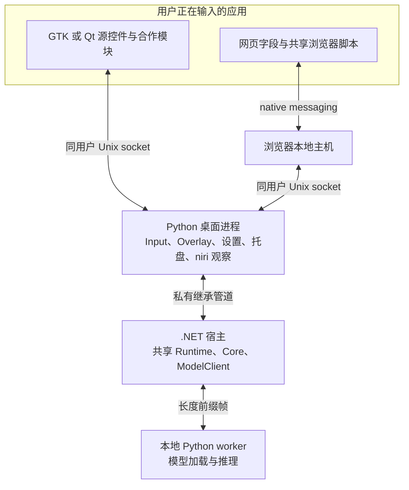

# Linux 如何连接输入框、浮层和本地模型

Linux 客户端把共享翻译会话接到 niri、GTK/Qt 和浏览器。共享 Runtime 决定何时翻译、保护人工稿和结算写入；Linux 负责证明当前字段身份、输入法状态和实际操作结果。模型只生成文字，不能授予输入权限。

本页解释这些责任如何配合。安装与能力范围见[使用说明](README.md)，构建和验证见[开发指南](development.md)。跨平台边界以[共享架构](../../engineering/architecture.md)和 [ADR-0003](../../adr/0003-cross-platform-runtime.md)为准。

## 输入、宿主与模型如何协作

用户在外部应用输入时，源应用内的接入组件先报告字段元数据。宿主检查字段策略后才读取正文与选区。共享会话将可用快照交给本地 worker，再把仍属于当前请求的结果交回源应用显示。

Linux 浮层在对应源应用中呈现。GTK/Qt 使用父窗口内的控件，浏览器使用页面内元素。Python 桌面进程负责路由和设置界面，并没有一个覆盖所有应用的全局浮层窗口。

[desktop/main.py](../../../src/linux/desktop/main.py)建立桌面会话并启动 .NET 宿主。[Program.cs](../../../src/linux/TypeLay.Linux/Program.cs)装配唯一的 `SessionController`、设置存储、模型客户端和平台端口。[EventLoop](../../../src/linux/TypeLay.Linux/EventLoop.cs)将异步结果交回串行上下文，避免两套会话所有者分别决定下一步。

## 输入模块持有原生证据，视图只表达交互

Python 的 [Input](../../../src/linux/desktop/input.py)拥有已认证连接、字段观察、回源、语言配置和术语交接记录。它核对同用户进程、连接寿命与目标身份，再通过 [DesktopInput](../../../src/linux/TypeLay.Linux/DesktopInput.cs)向 Runtime 提供输入端口。

[Overlay](../../../src/linux/desktop/overlay.py)消费冻结的 `SourcePresentation` 和不透明 `SourceConnection`，提交编辑、回源或菜单意图。它不读取 Input 的可变 peer 记录，也不修改原生操作字典。这样，显示刷新不会悄悄改变输入权限，迟到结果也仍能归还原连接。

共享呈现分别标识交互身份、显示序号、草稿版本和动作版本。显示序号用于丢弃旧画面；文字、颜色和菜单反馈不决定操作寿命。真实编辑即使改回原文，也要推进草稿版本。原生组件通过 `presentationVersion=1` 明确协商这份合同，缺失或未知版本不能降级猜测。

具体操作负责自己的继续与退休条件。普通回源、浏览器重译、自有源人工稿和术语表单不再由主捕获循环枚举阶段。Linux 的显示桥负责把意图交给这些共享操作，原生输入路径仍独立核验按次、焦点、输入法和期限。对应实现可从[共享会话目录](../../../src/shared/TypeLay.Runtime/Sessions/)及[呈现合同](../../../src/shared/TypeLay.Runtime/Presentation/SessionPresentation.cs)进入。

## 平台先证明能读，再证明能写

一次可接受的模型结果仍只是候选。接受需要当前字段的新鲜观察、匹配的源文本与配置，以及短期、可撤销、只能使用一次的许可。输入法状态、焦点身份或字段连续性未知时，平台会拒绝相应操作。

不同接入方式提供证据的方法不同：

| 接入方式 | 证据与执行位置 | 详细合同 |
| --- | --- | --- |
| GTK3/GTK4 | 合作模块在源控件线程读取和写入。Fcitx 提供真实 context、在途请求与输出序号，标准控件另行核验元数据和版本。 | [Fcitx 接入](fcitx.md)、[GTK3 源控件](../../../src/linux/native/gtk3/gtk-target.c)、[GTK4 源控件](../../../src/linux/native/gtk4/gtk-target.c) |
| Qt6 | 实际 QObject/provider 绑定字段、输入、选区和文档寿命，源 GUI 线程执行操作。 | [Qt 输入路径](qt.md)、[Qt module](../../../src/linux/native/qt6/qt-module.cpp) |
| 浏览器 | 文档事件线程持有目标、组合生命周期和最终写入许可。Tiptap 通过受限桥调用编辑器事务。 | [浏览器接入](browser.md)、[共享浏览器脚本](../../../src/shared/browser/) |
| VS Code | 用户主动提交文档快照，预览后按原文档版本与选区确认替换。 | [VS Code 手动命令](vscode.md)、[EditorHost](../../../src/linux/TypeLay.Linux/EditorHost.cs) |

普通 GTK API 无法证明异步输入法已经空闲。通用未合作路径因此保持 Unknown，只报告非正文元数据。没有候选窗、强制 Simple 输入法或模拟粘贴都不能代替事务证据。其它引擎、第三方 addon 和更广控件需要自己的可验证实现。

浏览器本地主机的进程身份来自宿主核对，页面不能自行声明可信 PID。Chrome/Chromium 顶层标准字段的默认接受还需要 `SourceLocalAcceptanceVersion=1`，绑定本用户注册、当前安装、浏览器祖先寿命和精确扩展 origin。Firefox、缺少可靠文档身份的连接和富文本继续使用实验写回边界，详情由[浏览器说明](browser.md)维护。

## 写入必须有唯一结算结果

Linux 普通接受在源控件线程同步完成，再把 `CompletedReceipt` 交给 Runtime 结算。[DesktopInput.WriteAsync](../../../src/linux/TypeLay.Linux/DesktopInput.cs)不会补做一次写入。一次性直接任务使用 `WriteDirectAsync`，始终带着原字段和原计划，不能转读或转写后来的焦点。

回执区分三个结果：写入前拒绝、确认完成、结果未知。未知结果会隔离原目标，不能解释为“没有写入”，也不能据此自动重试。Qt 把设置选区视为应用可观察的变化；选区回调之后才失效的操作可能已经产生影响，因此也必须返回未知结果。

视图退休、暂停和关闭只撤销后续资格，不能假定已派发操作被撤回。Runtime 保留原计划的接收者，直到实际执行结果结算。未用许可只能由实际执行者确认退休：`writeRetired` 必须证明精确许可从未被认领，并且已失去全部执行资格。过期、断连、撤权请求或没有回执本身都不够。

共享结算位于 [WriteSettlement](../../../src/shared/TypeLay.Runtime/Sessions/WriteSettlement.cs)，Linux 原生共同记录位于 [write-settlement.h](../../../src/linux/native/common/write-settlement.h)。这份记录只承担 GTK/Qt 实际共用的责任，不上提为跨平台输入实现。

## niri 提供前台观察，渲染器解释自己的坐标

[niri.py](../../../src/linux/desktop/niri.py)通过 niri IPC 获取前台状态。观察在后台读取，再按 GLib 默认优先级交回主循环。新鲜度从请求前计时，排队完成不刷新时间戳；超过原期限的观察不能继续授予能力。

GTK/Qt 使用父窗口内坐标，浏览器使用页面视口坐标。只有对应渲染器解释坐标，宿主不会把它们猜成全局屏幕位置。GTK 的锚点和布局约束见 [ADR-0004](adr/0004-native-anchors.md)。父窗口定位解决的是显示问题，不能补足输入法事务或焦点连续性。

当前会话身份和 socket 路由还依赖 `WAYLAND_DISPLAY` 与 `NIRI_SOCKET`。目录拆分没有消除这项跨语言约定，当前实现仍专属 niri，不能声称已经支持任意 Wayland 合成器。

## 暂停和练习保留不同的事实

暂停时，Runtime 清除正文会话、候选和草稿，并撤销可执行许可。弱化入口使用 `PauseAnchor` 与 `ObservePauseAsync`，只请求 `describe` 元数据，再检查暂停专用字段策略。平台不会用空正文伪造普通快照。已派发写入保留结算所需事实，不能用于暂停入口或新的授权。

教程进度由[PracticeProgressCoordinator](../../../src/shared/TypeLay.Runtime/Practice/PracticeProgressCoordinator.cs)记录，输入权限由自有源会话持有。组件已准备、模型已就绪、练习有进度和源字段可写是四件独立的事。只有确认本次目标的实际操作后，进度才推进。

自有 GTK3 自动练习在部分输入观察失效时，可以保留无正文的练习意图。恢复必须先撤销旧绑定，收到原连接确认，再完成新鲜捕获和新代次绑定。目标、连接、配置或输入法证据变化仍会结束练习；旧正文、候选、许可和异步结果不会恢复。编辑回源还须绑定本次返回 token、原字段和精确编辑器，普通返回成功布尔值不足以恢复授权。

最后一次确认写回会先封闭本次写权限，再等待最终绑定的撤权确认。完成状态和保存提示偏好的重试都不能恢复读写权。具体绑定逻辑见[自动练习会话](../../../src/shared/TypeLay.Runtime/Sessions/SessionController.AutomaticPractice.cs)和[Linux 练习会话](../../../src/linux/desktop/practice_session.py)。

## 设置和模型分别拥有提交点

设置界面、托盘和浮层操作都消费共享设置提交结果。保存完成后发生通知失败，不能改称“没有保存”。平台启动项仍是独立外部副作用，不能与设置文件冒充原子事务。Linux 的[设置反馈](../../../src/linux/desktop/settings_feedback.py)保留共享消息，文案刷新和源窗口退休不会抹去已确认的提交事实。

模型准备由 [setup.py](../../../src/linux/desktop/setup.py)下载、校验并构建候选安装代。激活由 [LinuxModelInstallationStore](../../../src/linux/TypeLay.Linux/LinuxModelInstallationStore.cs)和 [LinuxModelFactory](../../../src/linux/TypeLay.Linux/LinuxModelFactory.cs)完成：同一安装锁内核对预期当前代，唯一候选 worker 的实际包、方向和身份握手成功后，才切换 `current`。准备期间原代继续服务，失败或取消不能发布候选。

模型使用寿命由 [typelay-supervise](../../../src/linux/native/supervise.c)保护。监督进程在派生 worker 前取得精确安装代的共享使用锁，直到确认自有进程族退出才释放。移除先取得所有待删代的独占锁，再删除目录；未知退出或锁异常只延后空间回收，不撤销已确认的切换结果。外部强杀监督进程后的脱离后代不在正常退出保证内。

本地试译和外部编辑器的显式快照优先复用桌面 serving worker，绑定文档、版本、UTF-16 选区、设置与模型代次。没有桌面时才在 `desktop.lock` 下运行受监督的一次性宿主。桌面锁已被占用而转发失败时，不能另起第二个模型所有者。安装与回归方法见[模型包事务](development.md#模型包事务)。

## 构建代码与验证代码各有所有者

[eng/linux/build.py](../../../eng/linux/build.py)装配运行时发行包。[eng/linux/cooperative](../../../eng/linux/cooperative/)拥有固定合作组件来源、补丁、生产构建和 Qt 运行时探针；[packaging/linux](../../../packaging/linux/)拥有安装与逐应用启动器。生产构建不导入测试 runner。

[tests/linux](../../../tests/linux/)负责 fixture、隔离桌面场景和实际发行包回归。测试调用生产构建入口，Qt 可选打包还检查同一构建的真实异步输入证据。构建成功只证明产物可生成，当前执行范围以[开发状态](../../engineering/development-state.md)为准。

## 当前仍有两类可用性限制

浏览器短租约在到期与续期之间仍可能出现空窗。当前实现保留到期拒绝，不能通过延长授权或放宽断言掩盖问题。

按需唤醒后，同一控制器代次的空捕获仍会结束会话和唤醒资格。稍后再次捕获到相同字段，不能证明缺失期间始终属于原焦点家族。恢复这一资格至少需要原字段与连接连续性、可排除离开再返回的焦点证据，以及同次命令和配置身份。当前端口尚不能统一提供这些保证，因此继续拒绝，用户需明确重试。GTK 首次命令的元数据授权解决首次入口建立，不解决这段连续性缺口。
