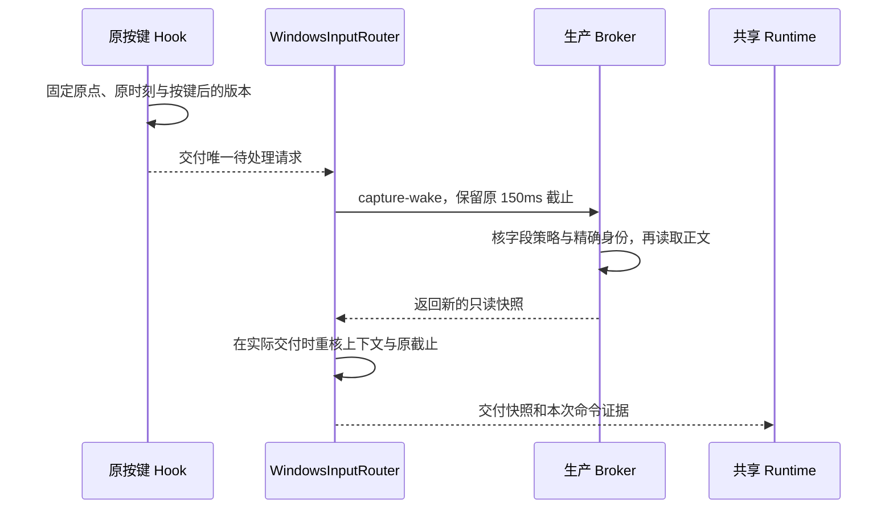

# Windows 宿主与输入边界

Windows 宿主把外部输入框、系统按键和 WPF 浮层接入共享翻译会话。平台层负责证明目标身份与实际执行结果；共享 Runtime 决定会话、候选和写入结算。译文可见、候选可用与允许写入是三个不同状态。

本页解释当前源码。推荐下载包的行为与验证范围见[Windows 使用说明](README.md#当前可验证候选)。本轮 Windows App 已构建，受影响的 WPF 交互与原生关闭流程仍未实测，具体状态见[当前开发状态](../../engineering/development-state.md)。共享概念以[术语表](../../../GLOSSARY.md)和[工程架构](../../engineering/architecture.md)为准。

## 生产模块与平台内共享

| 模块 | 当前职责 |
| --- | --- |
| [WindowsRuntime](../../../src/windows/TypeLay.App/Windows/WindowsRuntime.cs) | 组装共享控制器、系统输入、浏览器输入和 WPF 视图，提供 Windows 副作用。 |
| [WindowsInputRouter](../../../src/windows/TypeLay.App/Windows/WindowsInputRouter.cs) | 在原生输入与浏览器输入之间路由观察和命令，并保留连接及输入版本。 |
| [WindowsInputService](../../../src/windows/TypeLay.App/Windows/WindowsInputService.cs) | 将输入操作转换为 Broker 请求，处理原生目标、焦点恢复与请求期限。 |
| [TypeLay.Broker](../../../src/windows/TypeLay.Broker/Program.cs) | 在单一 MTA 线程持有 UI Automation（UIA）对象，通过标准输入输出提供生产协议。 |
| [TypeLay.NativeInput](../../../src/windows/TypeLay.NativeInput/transaction.c) | 在合格的 x64 系统 Edit 线程中读取或执行受限事务。 |
| [Windows.Contracts](../../../src/windows/TypeLay.Windows.Contracts/BrokerMessages.cs) | 保存 Windows DTO、协议版本和不透明目标的编码合同。它引用 Core，但不是跨平台输入协议。 |
| [WindowsSessionView](../../../src/windows/TypeLay.App/UI/WindowsSessionView.cs) | 将共享呈现交给 WPF 或浏览器视图。显示刷新不重新决定交互寿命，视图不直接写源字段。 |
| [TypeLay.Practice](../../../src/windows/TypeLay.Practice/Program.cs) | 提供独立自有 stock Edit 与练习说明。翻译与授权仍由正式 App/Broker 处理。 |
| [TypeLay.Launcher](../../../src/windows/TypeLay.Launcher/launcher.c) | 调用发行目录的启动脚本，不下载 SDK 或编译源码。 |

设置保存由共享 [SettingsStore](../../../src/shared/TypeLay.Runtime/Settings/SettingsCommit.cs)返回提交结果。WPF、托盘和浏览器消费者保留“已保存但通知失败”等事实，不能因原窗口退休或普通成功标志而丢弃警告。平台只实现注册表启动项等副作用。

模型安装仍由 Windows 的 `ModelInstaller`、`ModelInstallationStore` 与 `AppPaths` 承担。Windows wheel 选择、Job Object 和数据目录规则不冒充共享安装器。

## 输入后端的安全准入

每条输入路径独立证明能力。普通 UIA 能读到文字，不代表可编辑；直接替换能力也不授予自动接受权限。

| 路径 | 能提供的能力与限制 |
| --- | --- |
| 普通 UIA | 按字段策略读取。IME 状态未知时只提供只读预览；缺失接口不能补成 Clear。 |
| 原生系统 Edit | 严格核对 x64、类名、线程、寿命、字段资格与输入上下文。普通捕获可补充源线程只读观察；读取本身不授写权。 |
| 有序源接受 | 当前正式 factory 与 Broker/Main 固定选择此路线。逐次捕获证明只允许提出计划，源端安装和实际按键仍须独立通过检查。 |
| 浏览器合作输入 | 对明确接入的顶层 HTTP(S) 原生 input/textarea，使用精确文档与 DOM 字段合同。失败不回退 UIA 写入。 |
| 自有自动练习 | 仅对本次受管 stock Edit 授权，自有消息泵参与原键消费与事务裁决。 |

当前 [Broker v5](../../../src/windows/TypeLay.Windows.Contracts/BrokerMessages.cs)可在 ordinary capture 中返回 `SourceAcceptanceEligibility`。该证明绑定版本、完整目标、观察时间、输入版本和焦点版本。App 只在响应有效、焦点为 Source、快照新鲜且配置仍当前时，报告 `SourceLocalAcceptanceVersion=1`。缺失或错误证明保留版本 0，并关闭该快照的写能力；旧实验开关不能替代证明。

这一能力版本不表示源计划已安装或接受已就绪。源端仍须完成安装确认、Prepared/Arm、输入来源、原 100ms 许可、IME、焦点、正文、选区与尾键检查。Direct、Wake 和自有练习不借 ordinary capture 的证明。正式入口不通过 CLI、环境或 `--automation-test` 切回旧 sent 路线。

旧 sent、非有序 retrieved-MSG 和严格拒绝构造只服务现役隔离回归。旧包的普通能力版本 0，以及旧路线的局部通过，均不能替当前有序实现背书。构造、现有证据和正向验收入口见[开发文档](development.md#真实-runtime-的受控组装)。

### 有序源接受怎样保留原按次

[SourceInputWitness](../../../src/windows/TypeLay.App/Windows/SourceInputWitness.cs)复用现有低级键盘线程。每个源寿命只有一个有界 FIFO，记录按键和身份元数据，不保存正文。源 GUI 是唯一消费者，App 的原键盘线程是唯一写入者。

初始化按顺序完成三个动作：App 发布休眠映射，源端确认本次 Prepared owner，原键盘线程再发布初始时间下界与 recording-active，并尝试 Arm。休眠时不记录或消费队首；首次激活之后，即使 Arm 失败也保留历史，不能清队列或重设下界。

源端在实际 `PM_REMOVE` 的同一个 MSG 上检查来源和 FIFO 队首。匹配包括目标寿命、序号、主键、scan、方向、重复与时间。缺失、乱序、复用、溢出、旧键、同 tick 或不可比较时间均拒绝。队列不能按键值搜索，也不能借新 grant 丢弃旧记录。

认领成功后，native 立即把原 MSG 改成 `WM_NULL`，再进入正文事务。认领与置空之间没有可重入调用。低级 Hook 不负责此路线的吞键、激活或正文写入。认领前失败完整旁路；认领后拒绝或结果未知都不能恢复、重放原键。

无修饰主键为 Tab 或 F1-F24。F10 另接受符合原 context 条件的系统键消息，不开放 Alt。Ctrl+功能键先通过显式 `ObserveControlPrefix` 记录原 Ctrl；Ctrl 正常派发并撤旧许可。后继功能键必须绑定该前缀、Ctrl 后完整新捕获与新计划，Ctrl 自身不被吞。前缀不能跨配置、其它输入、字段或 IME 变化恢复。人工草稿沿原稿基线保留，不因此获得写许可。

同按次的 repeat/up 独立验证来源与身份。首写期限到期不消除尚欠的尾键责任，配置变化也不能把旧尾键交给新键。源应用内继续按原按次收束；用户主动切到另一应用后，后续键交给新应用，旧按次不恢复消费资格。此范围来自[已接受的产品边界](../../product/README.md#接受后主动切换应用时的-tab)。

## 输入来源资格

产品允许物理键盘及 UIAccess 辅助输入触发接受。源端只在本次实际 MSG 上取得成功的 `GetCurrentInputMessageSource` 结果，并确认 `IMDT_KEYBOARD / IMO_HARDWARE`，才获得来源类别资格。[微软定义](https://learn.microsoft.com/windows/win32/api/winuser/ne-winuser-input_message_origin_id)中的 `IMO_HARDWARE` 包含 UIAccess 注入，不能解释成纯物理来源。

普通注入、System、Unavailable、未知枚举或查询失败都不授资格。低级 Hook 的 injected 标记与 MSG 的 origin 含义不同，不能以全局 `allowInjectedInput` 放行。来源结果只属于当前回调，不能缓存后追认另一条消息。

有序见证采用正常 Windows 消息时序的有限假设。消息时间是拒绝依据，不是不可伪造的事件 ID；同 tick 可能拒绝一次合法按键。实现不承诺抵御获准工具刻意填写未来时间、任意外部 Hook 篡改历史或所有同用户恶意进程。可观察的旧键与未知来源仍须拒绝，不能靠等待、重发或续期隐藏代价。

## 首次按需唤醒的只读捕获

首次 Wake 可能先于普通观察租约到达。已装配 Router 的 Hook 可在原按键回调中固定原生原点和版本，再请求一次新的只读捕获。裸 Hook、Direct 及已有但过期的租约不借这条路径。

Hook 只用非阻塞 Win32 元数据取得 root、精确字段 HWND、PID/TID、进程开始时间，并持有原进程查询句柄。它不调用 UIA、IPC、正文读取或移焦。回调结束前固定输入、源输入、内容、前台、窗口版本，以及配置与命令序号。

[Router Wake](../../../src/windows/TypeLay.App/Windows/WindowsInputRouter.Wake.cs)使用发请求时的当前排除列表。Broker 在正文前检查 FieldPolicy，并在读取前后核原 PID、寿命、TID、root、焦点、精确字段与截止。虚拟 UIA 子元素不能借同一 root 获得字段身份。返回值不含接受或直接写入能力。

原 150ms 约束命令准入和实际交付。等待串行槽或发送前失效时，客户端拒发且不停止别的调用；已经发出的只读帧沿原 1500ms wire 保护排空。迟到结果仍拒绝，不能延长原命令或借旧普通 capture 的正文。拒绝、替换、取消和结束均释放原进程句柄。

## 浏览器合作输入

[BrowserInput](../../../src/windows/TypeLay.App/Windows/BrowserInput.cs)通过同一个 SessionController 工作。[BrowserHost](../../../src/windows/TypeLay.BrowserHost/Program.cs)由 Chrome 启动，只连接已经运行的同用户、同会话、同发行目录 App。双方核实际管道进程与精确扩展 origin；PID 和 `--parent-window=0` 均不能证明网页字段身份。

字段授权绑定同一连接、文档端口、目标、元数据、IME 和内容版本。页面在原 trusted keydown 同步冻结正文、选区和时刻，宿主与 Runtime 分别核原 150ms 边界。直接替换可在用户离开后完成，但始终只写原 DOM 与原范围，不抢焦点或提交表单。自动接受由页面同步裁决，实际回执只结算原计划，不再发第二次写入。

浏览器与 native 热键只能有一个命令消费者。进入页面前，两个全局热键均须注销且旧按键组已释放；退出时，须收到精确退休回执，或等待所有已发归属租约到期并确认整组释放，再恢复 native 热键。800ms 归属租约与 200ms 准备预算不延长字段读取权限。

元数据续证与正文捕获分开。Poll 最多预取一个下一描述，批准仍在前一回执终态后串行提交；35ms 最小轮次间隔保持。描述本身会产生短期 authority，预取不更新 Ready 或旧期限。每轮正文只领取一次原描述，迟到结果不能追认旧键。

连接收帧与 UI 处理通过有界 FIFO 分开，RPC 结果仍等待之前的事件处理。关闭或溢出停止新授权。已经收到的精确终态继续结算；送写后断连、超时或回执不完整则按未知结果隔离原目标，不重试。[既有软件链检查](https://github.com/DingJWuyu/Typelay/actions/runs/39232325140)覆盖了标准字段自动接受、前台与后台原框 F10，以及主动移除后的零写，不能替代当前源码、物理 IME 或异常断连的全部验收。

### Chrome 接入管理

[BrowserConnection](../../../src/windows/TypeLay.App/Windows/BrowserConnection.cs)读取发行根的 `browser/chromium/connection.json`。固定身份优先，ID 和可选商店链接必须一致；当前源码配置为空。此时 [BrowserExtensionInstallation](../../../src/windows/TypeLay.App/Windows/BrowserExtensionInstallation.cs)只读标准 Chrome 的 Default 与 Profile 安装记录，寻找本包绝对目录唯一对应的 ID。单文件上限为 16 MiB，损坏或多身份时不注册，不修改浏览器配置。

安装记录只证明浏览器分配过身份，不证明实时权限或连接。应用支持页分别显示注册、已认证 peer 和当前批准字段能力；模型未就绪或暂停不阻止连接管理。

维护命令串行调用同目录 Host，输出和等待有界。超时先终止并确认自有子进程退出；退出未知时锁住后续变更。操作结束后重新查询真实注册。关闭设置只停止呈现，迟到结果不重新打开窗口。

注册只写当前用户 HKCU 和 `%LOCALAPPDATA%\TypeLay\browser\org.typelay.browser.json`。Host 核两个注册视图、系统级同名项及安装路径，冲突时拒绝。高级维护命令仍为 `status`、`register --extension-id <ID>` 和 `unregister --extension-id <ID>`，界面移除始终带确认的精确 ID。

移除先封 origin 的新准入、退休页面消费者并关闭原 peer，再删除精确匹配注册。已执行回执继续结算；失败在本次 App 中保持封锁。只有用户重新确认并完成注册对账才恢复。残留系统注册在 App 重启后可能重新连接，不另设持久拒绝标记。

## 身份、时序与进程

[WindowsTarget](../../../src/windows/TypeLay.Windows.Contracts/WindowsTarget.cs)包含 PID、进程开始时间、root/字段 HWND、provider、元素令牌与寿命。普通 stock Edit 使用 `GA_ROOT`，不把 child 当新根，也不以 `GA_ROOTOWNER` 合并 owned dialog。App 的 HWND 分类只供观察筛选，不能替代 Broker/native 的 cookie、线程、IME 和最终执行检查。

普通显式回源可在原 800ms 请求仍有效时，短暂容忍前台采样为 0。期间不采正文，也不授予 Source、IME 或写许可。明确外窗事件、输入或配置变化永久取消本次返回；成功 ACK 只确认身份与焦点，仍须完整 fresh capture 和 Core 原稿基线确认。

App、Hook 和 Broker 共用 [WindowsInterruptClock](../../../src/windows/shared/WindowsInterruptClock.cs)，以 `QueryInterruptTimePrecise` 的毫秒值计算跨进程观察与授权期限。该时钟包括睡眠时间，最低平台为 Windows 10 / Server 2016。私有 GUI 事务另有 `GetTickCount64` 的 500ms 派发预算；前台写入还须满足原授权期限，两个时间域不相减，也不互相续期。

进程族由精确 Job Object 和原进程句柄管理。模型退出须同时取得根进程退出和 Job active=0，才能释放使用锁或删除相关安装代。管道 token 不承诺隔离所有同用户恶意进程。

### 已派发写入怎样收尾

共享 [WriteSettlement](../../../src/shared/TypeLay.Runtime/Sessions/WriteSettlement.cs)持有原计划的唯一终态。窗口、视图或会话退休不等于写入撤回，源端同步接受只交回执，不触发补写。

未使用许可只有在执行者证明从未认领且已失去执行资格后才能退休。过期、断连、撤权请求和没有回执均不足以证明未执行。终态释放正文；未知结果保留原目标隔离。正常关闭沿 [ShutdownAsync](../../../src/shared/TypeLay.Runtime/Sessions/SessionController.WriteSettlement.cs)停止新授权，继续接收已派发结果，再释放输入接收者。当前 Windows 对这一收尾路径仍需真实桌面验证。

## 分发契约

发行根包含 `TypeLay.exe`、`app/`、`worker/`、`browser/chromium/`、`bootstrap/`、字体和第三方声明。`AppPaths.Home` 指向整个根目录；App、Broker、Practice 与 BrowserHost 共用 `app/`。开机启动也指向根 `TypeLay.exe`。生产清单由[打包脚本](../../../eng/windows/dev.ps1)明确复制。

当前 pack/run 默认包含 Index ABI1/b11913 CPU 载荷。传入 `-HyRuntime` 才附带独立 Hy ABI5/b11717 载荷。模型权重经用户确认后另行安装；运行库存在不等于模型已就绪。

组件准备使用独立安装代。请求方向自检和真实候选握手成功后，才发布活动指针并接管同一连接。失败保留可用旧安装，但不能恢复已失效连接的健康状态。启动只尝试指针指定的活动代和明确上一代；没有指针时兼容旧固定目录，不扫描猜版本。

Argos 的可选 `archivePin` 固定 SHA-256、下载大小和解包大小。重复键、坏 pin 或错放字段会拒绝；新下载和缓存都校验。pin 是项目审核的归档身份，不是上游签名，也不追认旧安装。Windows 保留独立保守磁盘准入：有 pin 的每包至少 3 GiB，且不少于归档加两份解包量；无 pin 为 5 GiB，运行时与旧库存复制另计。

schema1/2 的旧方向集合和 schema3 包库存继续按实际记录处理。修复、选择和补方向各自保留用户意图；坏库存不能猜方向。代使用锁阻止删除仍被使用的模型，清理失败保留副本并报告空间未回收。

## 暂停时的最小观测

`observe-pause` 只返回 `PauseAnchor`。它不构造 `InputSnapshot`，不读取值、正文、选区、光标或组合正文，也不调用原生 Edit 正文采集。元数据须确认真实前台字段、寿命、可编辑性、可见边界及非敏感、非排除状态。

暂停视图清除文字和撤销状态，只显示恢复按钮。点击携带显示代次；共享控制器重新读取专用元数据，确认目标、版本与时效后才保存 `Enabled=true`。失败或旧观察不能恢复入口，其它偏好保持。

## B-01：非原子写回与按键所有权

B-01 仍阻塞通用安全写回发布。UIA 读取、比较与 `SetValue` 不是原子事务，写后核验不能恢复并发覆盖的新文字。低级 Hook 先吞键再异步写入，也可能留下“键已消费但写入被拒”的结果。

另一个具体反例已被观察到：源端 Claim 后已写入，但低级回调超时，原 Tab 在回调返回前到达源队列。[LowLevelKeyboardProc 合同](https://learn.microsoft.com/windows/win32/winmsg/lowlevelkeyboardproc)允许这种超时放行。写入成功或回调耗时检查不能证明原键已消费；该反例否定旧“写后靠 LL 返回值吞首键”的路线。

当前有序源路线改在实际 MSG 上认领并置空，再执行事务。它仍须证明完整 callback 寿命、尾键责任、来源、IME 和最终正文条件。写完、外层检索返回或 Unhook 返回都不等于可退休的 Quiet；未知 owner 继续保留资源，直至精确退休或原进程退出。

关闭 B-01 需要同一真实输入事件的消费裁决、与源文本变化协调的写入机制，以及物理和实际输入法证据。增加重读、缩短期限、盲目补发 Tab 或局部自有练习通过都不足以关闭它。当前诊断继续标记 `productionReadiness=false`，正向剩余条件见[开发文档](development.md#正向接受的剩余条件)。

## 系统 Edit 前台事务

原生 Transaction v2 使用独立导出、消息与字段寿命属性，Broker 只接纳同版 DLL。前台 op5 在源 GUI 线程核焦点、root、完整原文、当前选区、控件资格、cookie 和明确 IME Clear。设置替换范围后，再核安全条件与原授权期限。

当前选区与替换 Scope 分开传递，因此回源后的折叠光标可以不同于原替换范围。选中的原生请求失败不回退 UIA；后台 F10 op2 保留自己的原目标合同。派发后无法确认的结果仍按未知处理，不自动重试。

## 自有练习与首 Tab 接受

自动练习的授权绑定本次受管 stock Edit。`capture-owned` 固定 PID/开始时间、root/字段、线程、cookie、run 和 native FocusRevision。每轮从精确 HWND 重取 UIA 元数据与 runtime ID，保留 FieldPolicy 与排除检查。源焦点变化单调推进版本，返回相同 HWND 不恢复旧授权。

自有低级 Hook 只发布 FIFO 见证，原消息仍到 GUI 队列。GUI 在 `IsDialogMessage` 前匹配真实 MSG 和一次许可。native 无副作用前置通过后才标记 accepted，再调用 SETSEL；GUI 只消费 accepted 的原键。失败前旁路，受理后拒绝或未知不补发。

源 Esc 使用独立无写权退出租约。进入编辑先退休源授权并取得精确 ACK，再核本次视图、点击和焦点家族。编辑期间没有源写许可；任何家族外窗口事件会取消旧意图，最终又回原窗不能追认。

键或鼠标回源都先封旧通道并取得 ACK，再以新焦点、完整捕获和 Core 原稿确认建立新许可。第一次回源不写入。编辑器 Esc 复用回源，在确认原源后、发布新许可前结束会话。500ms 编辑交接与原按次不因重试或刷新续期。

完成页先等待实际完成与退休确认，再保存教程偏好。保存失败只重试保存。控制 stdio 有界且不载正文；每 run 的见证、plan/result 映射独立拥有，关闭、重启和配置变化先阻止新授权，再等待源端退休。自动 owned 标记保留到寿命结束，撤销计划不会重新开放旧通用写入口。

[既有自有练习软件链](https://github.com/DingJWuyu/Typelay/actions/runs/39046030080)覆盖默认键、Ctrl+功能键、编辑回源、人工稿接受及完成保存。真实 SETSEL 栈内退休另有[单一反例回归](testing.md#系统-edit-前台事务回归)。这些证据不替代物理输入、实际 IME、其它重入情形或当前重构后的 GUI 验收。

## 通用 UIA 后端缺口

Unknown IME 的字段只能预览，不能进入人工编辑或接受；读到的文字可能包含未提交组合。富文本缺 ValuePattern 时不能降级整框 SetValue，自绘控件缺可编辑接口时仍缺后端。即使范围外文字相同，整框 SetValue 仍须验证受控组件状态、撤销栈与事件语义。

当前没有生产 TSF 后端。候选必须分别证明精确字段和寿命、完整正文与 UTF-16 选区、真实组合态、连续变化及写资格。相同 view HWND 或 COM 身份不证明正文来源完整。既有 top context 曾返回空正文，与原生非空 Edit 不符，全文写入实验因此停止；保留的只读入口见[TSF 正文来源约束](development.md#tsf-正文来源约束)。不能换 context、伪造组合态或修改输入法来补成通过。

## 修改底层接口时的依据

修改组合态读取时，以 [TextEditPattern](https://learn.microsoft.com/windows/win32/api/uiautomationclient/nn-uiautomationclient-iuiautomationtexteditpattern)和 [GetActiveComposition](https://learn.microsoft.com/windows/win32/api/uiautomationclient/nf-uiautomationclient-iuiautomationtexteditpattern-getactivecomposition)核接口合同。接口不可用保留 Unknown；跨线程 [IMM 上下文](https://learn.microsoft.com/windows/win32/intl/developing-ime-aware-multiple-thread-applications)取不到不能推为 Clear。

修改写入或退休时，以 [SetValue](https://learn.microsoft.com/dotnet/api/system.windows.automation.valuepattern.setvalue)、[GetMsgProc](https://learn.microsoft.com/windows/win32/winmsg/getmsgproc)和 [UnhookWindowsHookEx](https://learn.microsoft.com/windows/win32/api/winuser/nf-winuser-unhookwindowshookex)区分字段操作、消息消费与回调寿命。TSF 的[编辑上下文](https://learn.microsoft.com/windows/win32/tsf/edit-contexts)只提供候选机制依据，不证明当前跨进程 UIA 已有编辑锁。
